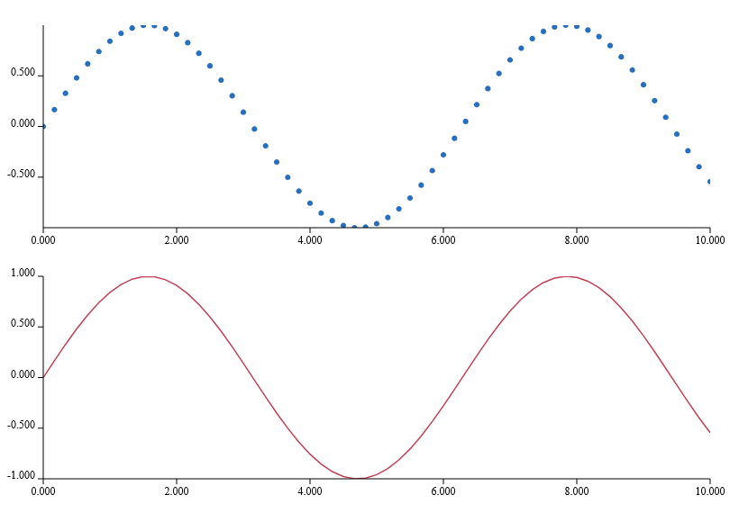

# Ranvier.D5

Functional-first visualization foundations for native F# applications. Compose immutable data, scales, geometry and scenes; let Ranvier signals update retained SVG through View and native WebCore. No JavaScript, HTML or CSS files are required.

## Packages

- **Ranvier.D5**: data summaries, bins, keyed joins, numeric/categorical/UTC scales, axes, affine transforms, paths, lines/areas/arcs/symbols, pie/stack/tree/treemap (`Squarify`, `Strip`, `Hilbert`, `Moore`, `evolveLocalMoves`) and hexagonal `GosperMap` layouts, `PowerDiagram` / `VoronoiTreemap` / `Cvt2D` / `Voronoi3D` / `Cvt3D`, 2D & 3D space-filling curves (`Morton2D`/`3D`, `Hilbert2D`/`3D`, `Moore2D`), static packed `RTree2D`/`RTree3D`, `Bvh3D`, `Spatial`/`Spatial3D` k-d trees, combinatorial `Seriation` (`RCM`, `SpectralFiedler`, `OptimalLeafOrder`, `Bicluster`), `Dbscan2D`/`3D`, `UpSet` & `EulerVenn` set algebra, reactive values, animation, zoom and brush — see [spatial and organisation engines](docs/spatial-and-organisation-layouts.md) and [primary-source research](docs/spatial-and-organisation-research.md).
- **Ranvier.D5.View**: keyed SVG scene components and native mark events.
- **Ranvier.D5.Charts**: typed pure chart recipes (`Chart.upset`, `Chart.euler`, seriated `Chart.adjacencyMatrix`, Cartesian, hierarchy, flow, network, density and distribution charts) and composition.
- **Ranvier.D5.Geo**: [geographic geometry, projections, map charts, `SphericalFibonacci` equal-area lattice binning and `SphericalVoronoi` CVT](docs/geographic-kernels.md).
- **Ranvier.D5.Graph**: [2D compound diagram, port, routing, bundling, hyperbolic constellation, community and manifold engines](docs/graph-layouts.md) (Sugiyama/ELK-class layered, orthogonal & $45^\circ$ `OctilinearRouter` metro routing, IPSep-CoLa, fCoSE, PivotMDS, SGD Stress, Modularity ForceAtlas2/LinLog, 2D hyperbolic `PoincareDisk` & Möbius focus, multi-scale `ConstellationLayout`, `Pava` / `IsotonicLayers` unrolling & `LabelCull`, `Leiden` communities, `HierarchicalBundle` / `DividedForceBundle` / `MingleBundle` / `KdeBundle2D`, `CircularLayout` / `ArcLayout` / `HivePlot` / `BioFabric`, `PrismOverlap` / `GMap` / `BubbleSets`, `BallTree` / `NnDescent`, and `Umap2D` / `Tsne2D` / `Isomap2D` / `Sammon2D`) — see [graph layout research](docs/graph-layout-research.md) and [spatial & organisation layouts](docs/spatial-and-organisation-layouts.md).
- **Ranvier.D5.Graph3D**: [3D Euclidean, spherical $\mathbb{S}^2$, and hyperbolic $\mathbb{H}^3$ layout & manifold engines](docs/graph-layouts.md) including Tamara Munzner's H3, CAIDA Walrus, conformal 2D-to-3D `PoincareBallLift` morphing, Octree Barnes-Hut Force3D, 3D SGD Stress, `SphericalStress3D` & `SphericalFibonacci3D`, Cone/Balloon trees, 3D stratified layers, `Treemap3D` / `StepTree` / `CodeCity`, `Pack3D` & `VoronoiTreemap3D`, `HierarchicalBundle3D` & volumetric `KdeBundle3D`, `Umap3D` / `Tsne3D` / `Isomap3D` / `Sammon3D`, and SVG projection.
- **Ranvier.D5.Wgpu**: WebGPU 3D and multi-dimensional visualization scales (`Scale3D`), 3-wall projections and framing (`Axis3D`), perceptual colormaps (`ColorRamp`) and WGSL uniform-LUT shader (`ColorShader`), structured/curvilinear/Delaunay surfaces (`SurfaceGrid`, `Surface3D`, `SurfaceBatch`), instanced glyphs/bars/lines/SDF scatter discs (`Glyph3D`, `Bar3D`, `Line3D`, `Scatter3D`), volumetric marching-cubes isosurfaces and orthogonal slices (`VolumeGrid`, `IsoSurface3D`), camera controls and GPU picking probes (`PlotCamera3D`, `Probe3D`), and Ranvier reactive GPU sinks (`Reactive3D`) over `Ranvier.Wgpu`.
- **Fable.Ranvier.D5.Wgpu**: Browser/Fable source-compatible package of `Ranvier.D5.Wgpu` targeting `Fable.Ranvier.Wgpu` (WebGPU with WebGL2 fallback) for Fickl compilation to JavaScript.
- **Ranvier.D5.Wgpu.Sdl**: Native SDL3 + WebGPU interactive 3D plot host view (`PlotView3D`, `PlotPass3D`, `PlotViewConfig3D`) binding `WgpuSdlSurface` with a pointer-transparent `Renderer.passive` SVG axis overlay, container orbit/pan/zoom/keyboard controls, GPU picking hover spikes, and dirty-only frame scheduling.
- All 9 packages (`Ranvier.D5*`, `Fable.Ranvier.D5.Wgpu`, and `Ranvier.D5.Wgpu.Sdl`) have a **.Traced** variant (`-p:RanvierTrace=true`). Use one variant throughout the dependency graph.

Target: .NET 10. Version: **0.4.0**. This is a pre-1.0 release: APIs may still change between 0.x versions. [Contracts and limits](docs/contracts.md) describe the algorithms and integration responsibilities.

## A reactive scene

```fsharp
open Ranvier
open Ranvier.D5
open Ranvier.D5.View

// Inside the host's Ranvier graph/owner:
let values = Api.createSignal [10.; 30.; 20.]
let scene =
    Reactive.derive (fun () -> values.Value) (fun data ->
        let x = Scale.linear (0., 2.) (20., 280.)
        let y = Scale.linear (0., 40.) (180., 20.)
        let points =
            data |> List.mapi (fun i v ->
                Some(Point.create (Scale.map x (float i)) (Scale.map y v)))
        let line =
            Shape.line Curve.Linear points
            |> Mark.path "series"
            |> Mark.withFill Paint.none
            |> Mark.withStroke (Paint.rgb 45 120 210) 2.
        Scene.create 300. 200. "Measurements" [line])

// Mount Renderer.passive with (fun () -> scene.Value) through View.
// Writing values.Value updates the retained series mark.
```

Use `Renderer.create (fun key eventName event -> ...)` for mark events. Use `Ranvier.Anime.Ease.named "inOutCubic"` with `Transition.start` or `Reactive.animate`; the latter consumes your clock signal and creates no timer. `Paint.ofCss` accepts existing typed Ranvier.Css values.

The [native gallery](examples/Ranvier.D5.Gallery) includes the full mount, graph and window lifetime:

```sh
dotnet run --project examples/Ranvier.D5.Gallery -c Release
dotnet run --project examples/Ranvier.D5.Gallery -c Release -- --capture gallery.bmp
```

It renders a signal-driven line, donut, treemap and bars using the same scene primitives.



The [live dashboards app](examples/Ranvier.D5.Dashboards/README.md) is a native gallery of ten animated, input-reactive dashboards: operations, trading, a flight-tracking globe, revenue, a power grid, security operations, climate, product analytics, a bar-chart race and an emergency-department simulation. It uses only Ranvier libraries; run it with `dotnet run --project examples/Ranvier.D5.Dashboards -c Release`.

See the [native example gallery](examples/Ranvier.D5.Gallery/README.md) for rendered snapshots and reproduction commands, including [hierarchy layouts](docs/hierarchy.md), [tiling and packing](docs/tiling.md), and the [reactive hierarchy explorer](docs/hierarchy-charts.md).

## Expansion packages and examples

`Ranvier.D5.Charts` adds typed, pure chart recipes. See [alpha.3 hierarchy scope and validation](docs/release-alpha.3.md), [alpha.2 foundations](docs/release-alpha.2.md), [owned interaction](docs/interaction.md), [keyed transitions](docs/transitions.md), [background layouts](docs/background-layout.md), and [palettes](docs/chromatic.md).

Run `dotnet run --project examples/Ranvier.D5.Gallery -c Release -- --linked` for signal-linked scatter/brush/line views. Use `--chart` for the reactive Cartesian recipe demo.

Run `dotnet run --project examples/Ranvier.D5.Wgpu.WaveDemo -c Release` (or `-- --capture wgpu-wave.bmp` for a hidden-window frame capture) to explore the live WebGPU `(96 × 96)` wave plane colored by instantaneous phase velocity (`4`th dimension `ColorRamp.turbo`), `Axis3D` bounded frame, `Editable<PlotCamera3D>`, interactive `Editable<SectionPlane>`, and `KeyedCollection` extrema markers.

Run `dotnet run --project examples/Ranvier.D5.Wgpu.LayoutsDemo -c Release` (or `-- --capture-all artifacts` for hidden-window captures of all four scenes) to explore the interactive `0.3.0` 3D layout showcase driven by `KeyedCollection`, `Projection`, and `Reactive3D` GPU sinks: `H3` Poincaré hyperbolic Lorentz focus, `CodeCity` ↔ exploded `CubeHilbert` `Treemap3D` morphing, `SphericalStress3D` + `HierarchicalBundle3D`/`KdeBundle3D` 3D streamtube bundling with animated packet discs, and `Umap3D` + reactive `Dbscan3D` density clustering with `Hilbert3D` tour and `Bvh3D` raycasting.

## Build and verify

```sh
dotnet run --project tests/Ranvier.D5.Tests -c Release
dotnet run --project tests/Ranvier.D5.Wgpu.Tests -c Release
dotnet run --project tests/Ranvier.D5.Native.Tests -c Release
dotnet run --project tests/Ranvier.D5.Wgpu.Native.Tests -c Release
dotnet run --project benchmarks/Ranvier.D5.Benchmarks -c Release
dotnet run --project benchmarks/Ranvier.D5.Graph.Benchmarks -c Release
dotnet run --project benchmarks/Ranvier.D5.Wgpu.Benchmarks -c Release
dotnet pack src/Ranvier.D5 -c Release -o artifacts/packages
dotnet pack src/Ranvier.D5.View -c Release -o artifacts/packages
dotnet pack src/Ranvier.D5.Charts -c Release -o artifacts/packages
dotnet pack src/Ranvier.D5.Geo -c Release -o artifacts/packages
dotnet pack src/Ranvier.D5.Graph -c Release -o artifacts/packages
dotnet pack src/Ranvier.D5.Graph3D -c Release -o artifacts/packages
dotnet pack src/Ranvier.D5.Wgpu -c Release -o artifacts/packages
dotnet pack src/Fable.Ranvier.D5.Wgpu -c Release -o artifacts/packages
dotnet pack src/Ranvier.D5.Wgpu.Sdl -c Release -o artifacts/packages
dotnet fickl src/Fable.Ranvier.D5.Wgpu -o artifacts/fable/d5-wgpu
```

See [performance gates and evidence](docs/performance-gates.md) for the paired comparison method and rendering phase diagnostics.

Append `-p:RanvierTrace=true` for Traced. Native acceptance requires WebCore and Vulkan platform libraries; [CI](.github/workflows/ci.yml) lists Ubuntu dependencies (including `mesa-vulkan-drivers` and `libvulkan1` for headless Vulkan/Lavapipe WebGPU tests). Windows, Linux and macOS run normal and Traced tests, native rendering, performance gates, gallery/wave captures and packing.

## Kit snapshot and compatibility

[kit.lock.json](kit.lock.json) records eight committed source revisions: Ranvier, Anime, CSS, View, WebCore, Persistence, Examples and Docs. Existing local edits were excluded and preserved. Recreate detached source checkouts in a new directory:

```sh
python tools/snapshot-kit.py ../snapshots
```

Snapshots are reference material; builds use the published cohort set as minimum versions in [Directory.Build.props](Directory.Build.props): Ranvier 0.2.0, Anime 0.1.0, CSS 0.1.1, View 0.2.0 (its `Ranvier.View.Dsl` surface), View.WebCore 0.2.0, View.WebCore.Sdl 0.2.1, Wgpu 0.3.1, Wgpu.Sdl 0.2.3, and Fable.Ranvier.Wgpu 0.2.1. See [design](docs/design.md).

D5 provides reusable foundations, not every D3 algorithm. Spatial indexing, triangulation and force/network layouts are available; see [network examples and measured limits](docs/network.md). [Chord layouts and ribbons](docs/chord.md) provide matrix relationship geometry. [DAG Sankey layouts](docs/sankey.md) support explicit flow imbalance. [Interactive flow recipes](docs/flow-charts.md) include staged alluvial and constrained node dragging. [Density grids, Gaussian blur and 1D KDE](docs/density.md) provide bounded aggregation and an owned-worker native example. [Contour topology](docs/contours.md) provides closed shells and holes with bilinear saddle decisions. [Hexbin and source-preserving line reduction](docs/reduction.md) bound visible data. [Heatmap, hexbin, contour and isoband recipes](docs/density-charts.md) add explicit aggregate membership and region-aware picking, with working native snapshots. [Violin and reduced-series compositions](docs/distribution-series.md) preserve original statistics while bounding visible geometry. Geographic clipping/projections remain planned. Large scenes need aggregation/windowing; SVG does not promise million-mark frame rates.

MIT licensed.
