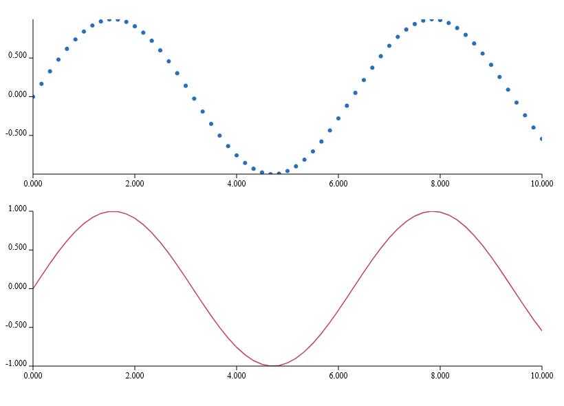

# Ranvier.D5

Functional-first visualization foundations for native F# applications. Compose immutable data, scales, geometry and scenes; let Ranvier signals update retained SVG through View and native WebCore. No JavaScript, HTML or CSS files are required.

## Packages

- **Ranvier.D5**: data summaries, bins, keyed joins, numeric/categorical/UTC scales, axes, affine transforms, paths, lines/areas/arcs/symbols, pie/stack/tree/treemap layouts, spatial queries, reactive values, animation, zoom and brush.
- **Ranvier.D5.View**: keyed SVG scene components and native mark events.
- **Ranvier.D5.Charts**: typed pure chart recipes and composition.
- **Ranvier.D5.Geo**: optional [geographic geometry, interchange and spherical kernels](docs/geographic-kernels.md); full projection and map-chart pipelines are still in development.
- All packages have a **.Traced** variant. Use one variant throughout the dependency graph.

Target: .NET 10. Version: **0.1.0-alpha.7**. APIs may change during alpha. [Contracts and limits](docs/contracts.md) describe the algorithms and integration responsibilities.

## A reactive scene

```fsharp
open Ranvier
open Ranvier.D5
open Ranvier.D5.View

// Inside the host's Ranvier graph/owner:
let values = Api.createSignal [10.; 30.; 20.]
let scene =
    Reactive.derive (fun () -> values.Value) (fun data ->
        let x = Scale.linear (0., 2.) (20., 280.)
        let y = Scale.linear (0., 40.) (180., 20.)
        let points =
            data |> List.mapi (fun i v ->
                Some(Point.create (Scale.map x (float i)) (Scale.map y v)))
        let line =
            Shape.line Curve.Linear points
            |> Mark.path "series"
            |> Mark.withFill Paint.none
            |> Mark.withStroke (Paint.rgb 45 120 210) 2.
        Scene.create 300. 200. "Measurements" [line])

// Mount Renderer.passive with (fun () -> scene.Value) through View.
// Writing values.Value updates the retained series mark.
```

Use `Renderer.create (fun key eventName event -> ...)` for mark events. Use `Ranvier.Anime.Ease.named "inOutCubic"` with `Transition.start` or `Reactive.animate`; the latter consumes your clock signal and creates no timer. `Paint.ofCss` accepts existing typed Ranvier.Css values.

The [native gallery](examples/Ranvier.D5.Gallery) includes the full mount, graph and window lifetime:

```sh
dotnet run --project examples/Ranvier.D5.Gallery -c Release
dotnet run --project examples/Ranvier.D5.Gallery -c Release -- --capture gallery.bmp
```

It renders a signal-driven line, donut, treemap and bars using the same scene primitives.



See the [native example gallery](examples/Ranvier.D5.Gallery/README.md) for rendered snapshots and reproduction commands, including [hierarchy layouts](docs/hierarchy.md), [tiling and packing](docs/tiling.md), and the [reactive hierarchy explorer](docs/hierarchy-charts.md).

## Expansion packages and examples

`Ranvier.D5.Charts` adds typed, pure chart recipes. See [alpha.3 hierarchy scope and validation](docs/release-alpha.3.md), [alpha.2 foundations](docs/release-alpha.2.md), [owned interaction](docs/interaction.md), [keyed transitions](docs/transitions.md), [background layouts](docs/background-layout.md), and [palettes](docs/chromatic.md).

Run `dotnet run --project examples/Ranvier.D5.Gallery -c Release -- --linked` for signal-linked scatter/brush/line views. Use `--chart` for the reactive Cartesian recipe demo.

## Build and verify

```sh
dotnet run --project tests/Ranvier.D5.Tests -c Release
dotnet run --project tests/Ranvier.D5.Native.Tests -c Release
dotnet run --project benchmarks/Ranvier.D5.Benchmarks -c Release
dotnet pack src/Ranvier.D5 -c Release -o artifacts/packages
dotnet pack src/Ranvier.D5.View -c Release -o artifacts/packages
```

See [performance gates and evidence](docs/performance-gates.md) for the paired comparison method and rendering phase diagnostics.

Append `-p:RanvierTrace=true` for Traced. Native acceptance requires WebCore's platform libraries; [CI](.github/workflows/ci.yml) lists Ubuntu dependencies. Windows, Linux and macOS run normal and Traced tests, native rendering, performance gates, gallery capture and packing.

## Kit snapshot and compatibility

[kit.lock.json](kit.lock.json) records eight committed source revisions: Ranvier, Anime, CSS, View, WebCore, Persistence, Examples and Docs. Existing local edits were excluded and preserved. Recreate detached source checkouts in a new directory:

```sh
python tools/snapshot-kit.py ../snapshots
```

Snapshots are reference material; builds use a compatible published cohort: Ranvier preview.2, Anime rc.2, CSS alpha.2, View 0.1.49-rc.3, WebCore backend rc.8 / native rc.8, and SDL rc.12. Newer independent core/CSS packages are deliberately not substituted because Anime pins this cohort. See [design](docs/design.md).

D5 provides reusable foundations, not every D3 algorithm. Spatial indexing, triangulation and force/network layouts are available; see [network examples and measured limits](docs/network.md). [Chord layouts and ribbons](docs/chord.md) provide matrix relationship geometry. [DAG Sankey layouts](docs/sankey.md) support explicit flow imbalance. [Interactive flow recipes](docs/flow-charts.md) include staged alluvial and constrained node dragging. [Density grids, Gaussian blur and 1D KDE](docs/density.md) provide bounded aggregation and an owned-worker native example. [Contour topology](docs/contours.md) provides closed shells and holes with bilinear saddle decisions. [Hexbin and source-preserving line reduction](docs/reduction.md) bound visible data. [Heatmap, hexbin, contour and isoband recipes](docs/density-charts.md) add explicit aggregate membership and region-aware picking, with working native snapshots. [Violin and reduced-series compositions](docs/distribution-series.md) preserve original statistics while bounding visible geometry. Geographic clipping/projections remain planned. Large scenes need aggregation/windowing; SVG does not promise million-mark frame rates.

MIT licensed.
