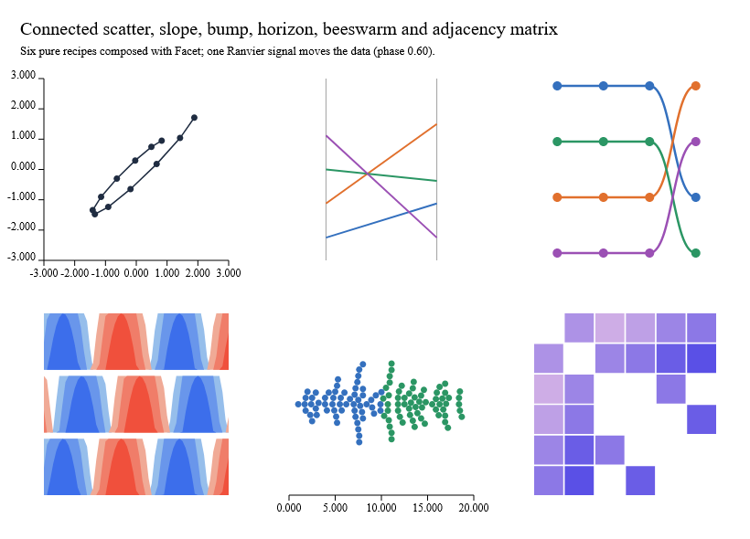

# Advanced chart recipes

Six pure recipes compose existing scales, curves and picking into charts that
D3 users usually build by hand. Each returns a `ChartOutput` with semantic IDs,
hit targets and accessible labels, and none creates signals.



```sh
dotnet run --project examples/Ranvier.D5.Gallery -c Release -- --advanced
dotnet run --project examples/Ranvier.D5.Gallery -c Release -- --capture-advanced artifacts/advanced.bmp
```

The gallery composes all six with `Facet` and moves their data through one
signal. The capture fails unless every cleanly pickable dot and matrix cell
paints in native pixels at both phases.

| Recipe | Contract | Limits |
|---|---|---|
| `Chart.connectedScatter` | Points joined in `Order` (ties by key); missing coordinates break the trail | O(n log n) |
| `Chart.slope` | One line per complete item between two shared axes; picking uses a band along each line | O(n) |
| `Chart.bump` | Ranks within each period, ties broken by ordinal series ID; one value per series and period; ranks inset so no dot is clipped | O(n log n) |
| `Chart.horizon` | One row per series folded into 1–8 bands of equal height; negatives mirror in their own colours; rows pick with all their IDs | O(n × bands) |
| `Chart.beeswarm` | Equal circles in x order, each dodged to the smallest offset that clears neighbours within one diameter; positions keep exact x | At most 20,000 marks |
| `Chart.adjacencyMatrix` | Cells per link (mirrored when undirected), ordered by input, label or degree; unknown endpoints, duplicate IDs and negative weights are typed errors | O(nodes + links) |

## Linked small multiples

`Facet.build` already scopes each cell's marks, definitions and semantic paths.
Data IDs are left unchanged, so one `Selection` set reaches the same entity in
every cell; brushing one facet highlights the others. A test checks a shared
selection across two connected-scatter cells.

## Extending with your own layout

A layout written outside D5 needs only public APIs: compute positions, build
marks with `Mark`, `Shape` and `Path`, compose a `Scene`, and return a
`ChartOutput` with `SemanticMark` and `HitTarget` values. `HitTest`, `Facet`,
`ChartInteraction` and the renderer then treat it like any built-in recipe.
`tests/Ranvier.D5.Tests/AdvancedChartTests.fs` contains a golden-angle
"sunflower" layout written this way, checked for picking and composed inside a
facet grid.

A gate bounds a 2,000-mark beeswarm at 150 ms and 24 MB; the local median was
16.6 ms, mostly spent building circle symbols as in any scatter.
