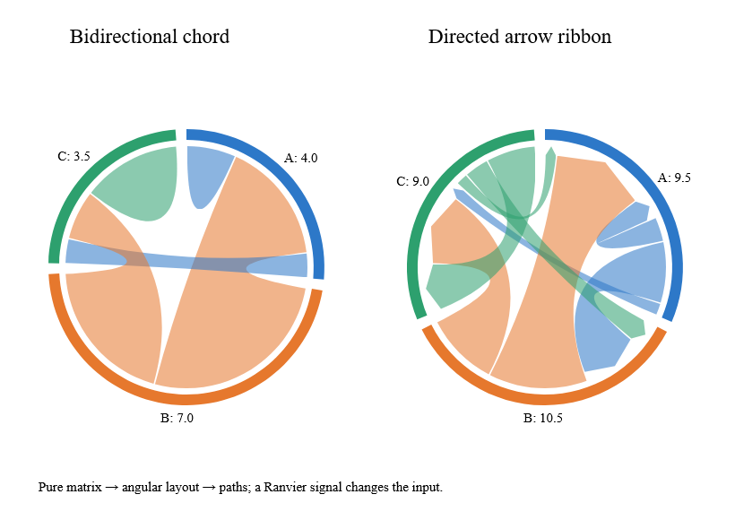

# Chord layouts and ribbons

`Chord.layout config matrix` returns immutable group arcs and flows from a square,
finite, nonnegative matrix. Angles are radians, clockwise from twelve o'clock.
Group output stays in matrix-index order even when angular placement is sorted.

- `Undirected` pairs the two directions of each relationship. Group values are
  row totals; the larger endpoint becomes the ribbon source. A diagonal entry
  consumes its group arc once.
- `Directed` retains each ordered pair separately. Groups count both incoming
  and outgoing values, so a diagonal entry consumes two arcs.
- `Transposed` applies the undirected layout to the transposed matrix.

`GroupOrder`, `SubgroupOrder`, and `FlowOrder` accept input, ascending, or descending
ordering, with stable input-order ties. Directed subgroup ordering uses negative
incoming and positive outgoing weights, matching the pinned D3 reference.
Flow IDs are matrix-index pairs: canonical unordered pairs for undirected modes,
ordered pairs for directed mode. Sorting does not change IDs. Reordering the input
matrix does change identities; callers should retain their domain-to-index mapping.

Padding must fit within one circle. Empty matrices produce empty output. All-zero
matrices retain evenly spaced zero-width group slots but no flows. Padding that
consumes the full circle leaves zero-width arcs. Angles are normalized before
summing to support subnormal inputs and overflowing global totals. Unrepresentable
individual group values return an error. `MaxCells` defaults to 1,000,000 and bounds
the quadratic matrix storage; exceeding it returns `BudgetExceeded`.
`layoutWithCancellation` checks cancellation during validation, layout and sorting.

`Ribbon.path (RibbonSpec.create radius flow)` produces a closed core `Path`.
Source and target radii can differ. `PadAngle` trims each endpoint arc, collapsing
oversized padding to the midpoint. `ArrowHead=Some length` adds a target arrow;
its radial length must fit the target radius. Radii and padding must be finite and
nonnegative, and arcs must ascend by at most one turn. Invalid ribbon geometry
throws `ArgumentException`, consistent with the other path constructors. Two zero
radii produce an empty path; a full circle uses two SVG arc commands.

The [native example](../examples/Ranvier.D5.Gallery/ChordGallery.fs) derives its scene
from a Ranvier signal. Run `dotnet run --project examples/Ranvier.D5.Gallery -c Release
-- --chord`, or capture with `--capture-chord artifacts/chord.bmp`. The checked-in
image above is converted directly from that WebCore capture. CI repeats the native
capture on Windows, Linux and macOS in normal and Traced builds.

Reference fixtures pin `d3-chord` 3.0.1 (ISC; included in the core package), covering
18 matrix/mode/ordering combinations. D3 is a development reference only, not a
runtime dependency. Geometry uses Ranvier's existing path primitives.

Local Windows Release measurements before cross-platform qualification: a dense
256-by-256 directed layout took 24.1 ms median and 33.7 MB; generating and serializing
10,000 ribbons took 5.9 ms and 15.5 MB. CI gates p95 at 200 ms/96 MB and 100 ms/48 MB
respectively. Large matrix layouts belong in the existing owned worker adapter;
these measurements are not a promise of frame-budget execution.
