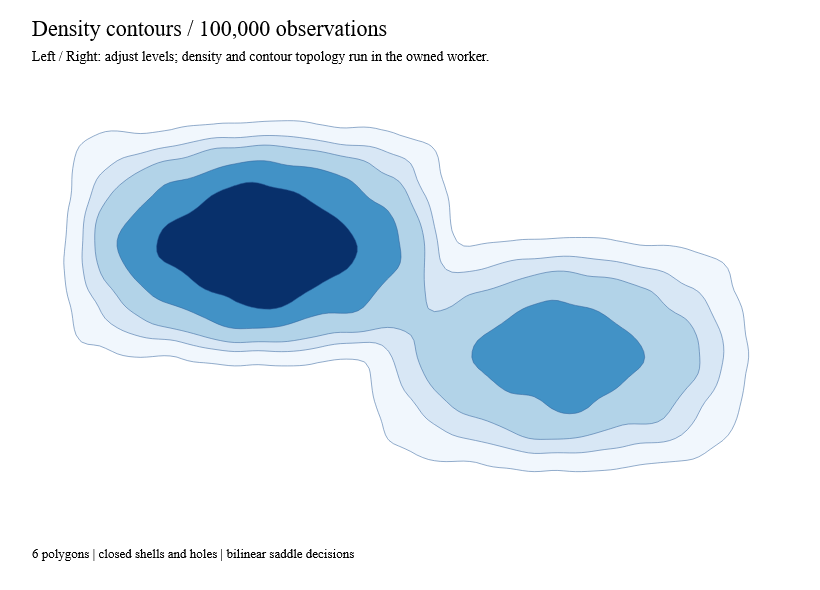

# Contour topology



`Contour.compute` converts a `DensityGrid` into immutable superlevel polygons.
Each `ContourPolygon` has a threshold, an explicitly closed clockwise outer ring,
and explicitly closed counterclockwise holes in SVG's x-right/y-down coordinates.
The result contains geometry, not SVG commands, and creates no signals or threads.

```fsharp
let contours =
    DensityGrid.create (Bounds.create 0. 0. 3. 3.) 3 3
        [Some 2.; Some 2.; Some 2.
         Some 2.; None;    Some 2.
         Some 2.; Some 2.; Some 2.]
    |> Result.bind (Contour.compute (ContourConfig.create [1.]))
```

The center is an explicit missing-data hole. Measured zero remains a finite sample;
map external NaNs to `None` when constructing a grid. Thresholds must be finite and
unique; output is ordered by ascending threshold. A level with no area contributes
no polygons. An empty threshold list returns an empty result.

## Sampling and topology

Samples are located at cell centers. Values **greater than or equal to** the
threshold are inside. Missing samples and a single exterior ghost layer are
outside. Linear interpolation locates finite sample crossings; `Interpolate=false`
uses midpoints instead. Crossings to missing or exterior samples always use the
midpoint. Exterior coordinates are bounded to the grid extent. A constant high
field therefore has beveled corners, rather than raster-cell-union geometry.

Ambiguous diagonal cells use the bilinear asymptotic decider. For clockwise
corners a, b, c, d and level t, the sign of
`(a-t)*(c-t) - (b-t)*(d-t)` determines the connected diagonal. An exact tie keeps
the high components separate. A floating-point filter handles ordinary cases;
uncertain or overflowed products use D5's existing exact dyadic arithmetic.
This is not D3's fixed diagonal pairing policy, so saddle fixtures deliberately
test the stated bilinear convention rather than claiming identical D3 polygons.

Segments join by integer grid-edge identity, never by rounded world coordinates.
Repeated-coordinate walks are split into simple cycles, exact collinear vertices
are removed without changing geometry, and zero-area cycles are discarded, and winding identifies shells and holes. A hole belongs to the smallest
shell containing all its vertices. Existing robust polygon containment is reused
with one retained array per shell. Boundary contacts at points are possible at
critical/equal levels; self-crossing rings and open paths are not emitted.

Final coordinates use the input extent. If distinct local vertices collapse to
one world coordinate at that extent's floating-point precision, the operation
returns an explicit numeric error instead of silently changing topology.
The output is piecewise linear; no spline smoothing is applied across boundaries.

## Reactive native example

[ContourGallery.fs](../examples/Ranvier.D5.Gallery/ContourGallery.fs) combines
100,000 Anime-seeded observations, density aggregation and contour topology in
`ReactiveLayout.create`. A Ranvier signal controls the levels; `Reactive.derive`
builds the scene from the latest immutable result. Arrow keys adjust levels.
Native capture changes that signal and checks that the worker publishes the
requested level multiplier and closed polygons before painting the view above.

```text
dotnet run --project examples/Ranvier.D5.Gallery -c Release -- --contour
dotnet run --project examples/Ranvier.D5.Gallery -c Release -- --capture-contour artifacts/contour.bmp
```

## Budgets and verification

For C cells and L levels, scanning costs O(C*L). For E crossed edges, deterministic
edge sorting costs O(E log E); stitching is linear. Hole assignment uses shell
bounds and robust containment; worst-case containment work is quadratic in ring
vertices and is budgeted explicitly. Storage is O(C+E+output), not one SVG mark
per input observation.

Defaults allow 1,048,576 cells, 2,000,000 closed output vertices, 250,000 polygons
and 100,000,000 work units. Work accounts for scanned cells, stitching and
containment edge tests. Exceeding a budget returns `BudgetExceeded`; output is
never silently truncated. Cancellation is checked during grid strips, stitching,
hole assignment and containment loops. Cancellation throws
`OperationCanceledException`; there is no hard real-time guarantee.

Tests cover all sixteen local cases, both saddle orientations and exact ties,
extreme finite measurements, masks, nested holes/islands, equality plateaus,
noncrossing edges, closed oriented rings, threshold area monotonicity, output
precision, budgets and cancellation. These are analytical and generated invariant
fixtures, with no copied upstream implementation. Benchmarks exercise 256² and
1024² scalar grids at three levels, checking each result's shell/hole topology.
Chart recipes, contour/isoband selection, hexbin and sampling remain task I3.

Local Windows normal Release measurements (60 measured iterations after warm-up):

| Workload | Median / p95 | Managed allocation | p95 / allocation gates |
|---|---:|---:|---:|
| 256², three levels | 7.15 / 16.58 ms | 13.54 MB | 75 ms / 24 MB |
| 1024², three levels | 36.60 / 48.67 ms | 67.99 MB | 250 ms / 100 MB |
| 2,048 disconnected polygons | 15.12 / 27.98 ms | 28.41 MB | 100 ms / 32 MB |

The first 1024² implementation allocated 564.61 MB and took 471.77 ms median.
Retaining shell arrays, removing exact straight-line vertices, and copying scalar
samples without temporary option lists reduced both costs. Area orientation uses
the existing exact polygon routine, including a certified exact half-grid fast
path. Timings measure worker computation, not a promise of host-frame latency.
