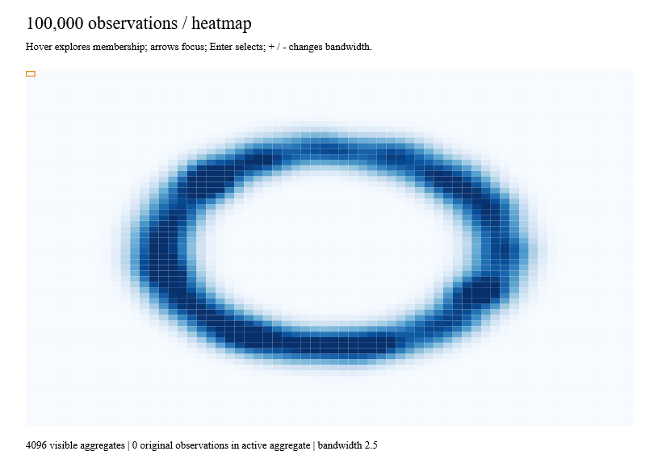
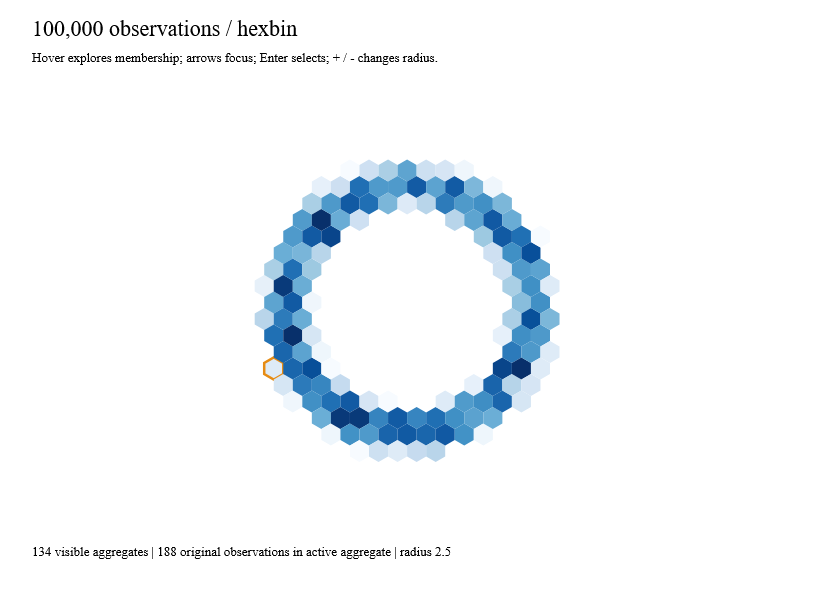
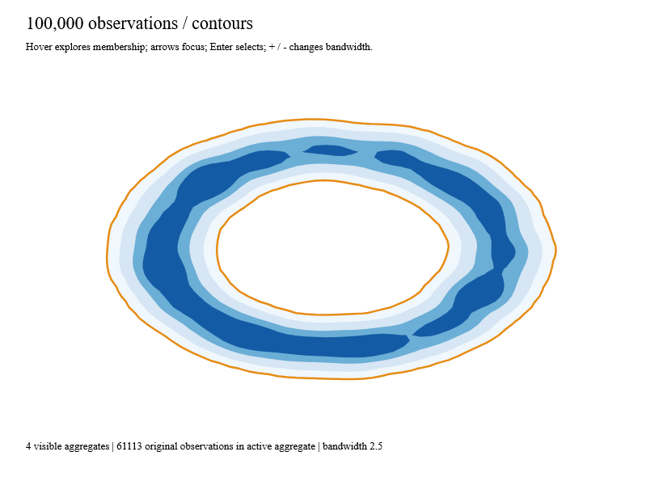
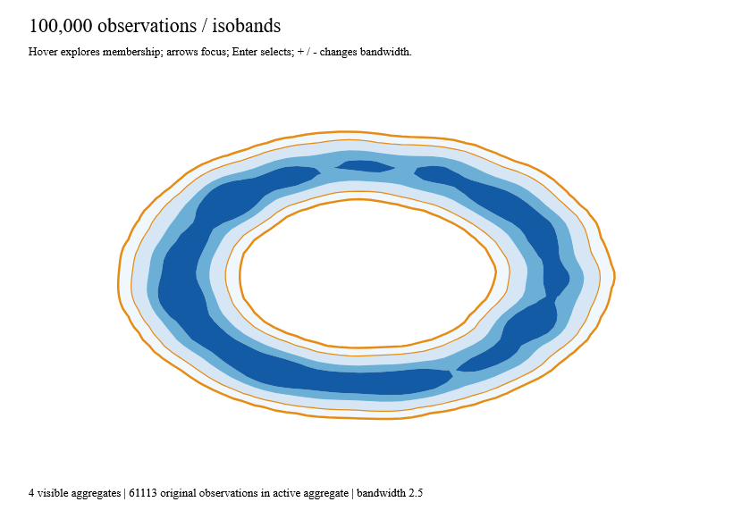

# Density chart compositions

`DensityChart.heatmap`, `DensityChart.hexbin`, `ContourChart.contours` and
`ContourChart.isobands` compose the existing density, hexbin and contour kernels.
They return `Result<AggregateChartOutput, LayoutError list>`. The output contains
an ordinary `ChartOutput` plus a map from selectable aggregate IDs to original
observation IDs. Each has a `WithCancellation` variant for an owned worker.

```fsharp
let frame = ChartFrame.create 800. 570. "Density bands"
let spec = DensityChartSpec.create frame (fun value -> colorScale value)
let config = { DensityConfig.create (Bounds.create 0. 0. 100. 100.) 64 64 with Bandwidth=2. }
let compute token points =
    Density.gridWithCancellation token config points
    |> Result.bind (ContourChart.isobandsWithCancellation token spec (ContourConfig.create [5.;25.;75.;125.]))
```

Run this function through `ReactiveLayout.create`; publish `LastGood` through
Ranvier signals and use `ChartInteraction.attach` for hover, brush and keyboard
selection. The [native example](../examples/Ranvier.D5.Gallery/DensityRecipesGallery.fs)
does this with 100,000 Anime-seeded observations. Selection changes only the
presentation; they do not restart aggregation. Disposing the root owns the worker,
listeners and mounted scene. No chart kernel creates threads or signals.

## Identity and membership

- Heatmaps select grid cells, including observed zero. Missing cells have no mark.
  IDs include source extent, dimensions and cell coordinates. Resizing the view
  preserves identity; changing the source lattice invalidates old selections.
- Hexagons use origin, radius and axial coordinates as identity. Membership is
  canonical by original ID. The viewport preserves hexagon aspect ratio and clips
  to the plot. Changing radius creates different aggregates.
- Contours group all components at one threshold into one semantic mark. Component
  indices are not stable identities. Isobands use the lower and upper thresholds;
  the final band extends to positive infinity. Threshold input order is canonical.
- Density membership records the original containing-cell observations, **not all
  contributors to Gaussian smoothing**. Contour membership classifies those cells
  by their scalar value. Interpolated regions can be visible without any original
  members. The aggregate itself remains selectable and accessible.
- All styles use a caller-supplied `float -> Paint`. Signed direct grids are valid;
  aggregation still rejects negative weights. The example uses Anime Lab colors.

## Painting and picking

Contours are filled superlevel regions. Isobands are the lower superlevel minus
the next higher superlevel, using reversed upper rings in the same nonzero-winding
path. `HitRegion` uses the identical included-minus-excluded polygon contract,
including holes and disconnected islands. Picking tests the projected coordinates
actually painted; floating-point projection can move an exact edge slightly from
its mathematical source-space position. No arbitrary hit epsilon is added.

Polygon outer boundaries are included and hole boundaries excluded. An excluded
upper region belongs to the upper band. Region bounding boxes reject impossible
hits before robust polygon tests; they are not substitutes for polygon geometry.
Facets translate polygons, holes, exclusions, clips and brush anchors together.

A deterministic scanline finds an interior brush anchor, including bands whose
threshold interval contains no sampled grid center. Rectangle/lasso selection uses
this anchor, just as point charts use their point centers. It does not mean “any
intersection with the brush.” Identical superlevels produce no lower-band mark.
An unrepresentable interior or collapsed projected geometry returns a typed error.

`MaxMarks` bounds visible output. Contour cell, polygon and vertex limits come from
`ContourConfig`; its `MaxWork` separately bounds kernel work and composition work
(sorting, anchor search and membership traversal). Cancellation is checked during
composition and before returning an output. Dense scenes still need bounded grid
resolution: constructing 4,096 marks is not a per-pointer-event operation.

Local Windows Release measurements (60 samples, including allocations):

| Operation | Median | p95 | Allocated |
|---|---:|---:|---:|
| 4,096-cell heatmap composition | 15.43 ms | 33.04 ms | 17.99 MB |
| 100,000-point hexbin aggregation + composition | 77.71 ms | 104.69 ms | 54.00 MB |
| 100 pointer queries over the hexbin chart | 13.10 ms | 16.98 ms | 19.76 KB |
| 256² grid, three isobands | 9.29 ms | 14.12 ms | 15.28 MB |
| 1024² grid, three isobands | 60.40 ms | 81.42 ms | 74.72 MB |

These measure pure composition and picking, not frame-rate promises. CI gates both
normal and Traced variants on Windows, Linux and macOS. Region picking initially
allocated 91.92 MB per 100 queries; early bounds rejection and avoiding per-target
closures reduced it to 19.76 KB. Avoiding scalar option allocation for cells with
no source members reduced the 1024² band case from 150.22 MB to 74.72 MB.

## Working native views

These images are captured from WebCore, not mockups. Captures verify the latest
worker result, keyboard selection and membership conservation. Contour captures
also deliver native pointer events into a hole and a filled region, and verify
brush selection. The orange outlines show selection/focus.

```sh
dotnet run --project examples/Ranvier.D5.Gallery -c Release -- --density-recipe isobands
dotnet run --project examples/Ranvier.D5.Gallery -c Release -- --capture-density-recipe isobands artifacts/isobands.bmp
```

Replace `isobands` with `heatmap`, `hexbin` or `contours`. Hover explores aggregate
membership; arrows and Enter select; `+`/`-` changes bandwidth or hexagon radius.









The remaining task-9 compositions are violin and reduced time-series recipes.
The existing KDE and min/max/LTTB kernels are available, but these chart recipes
are not claimed complete here.
