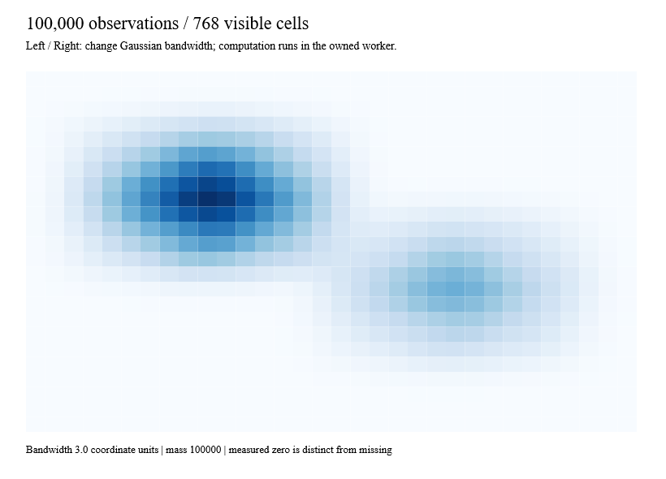

# Density foundations



`Density.grid` aggregates immutable, keyed weighted points into a fixed-resolution
grid. `Density.blur` smooths an existing grid, including one with missing cells.
`Density.kde1d` evaluates a normalized Gaussian probability density for violin or
density-curve construction. These are pure functions; signals and workers belong
to the caller. Errors are `Result<_, LayoutError list>`, and cancellation overloads
throw `OperationCanceledException`.

```fsharp
let config =
    { DensityConfig.create (Bounds.create 0. 0. 100. 100.) 32 24 with
        Bandwidth = 3.
        Boundary = DensityBoundary.Renormalize }
let points =
    [{ WeightedPoint.Id = "observation-1"
       Position = Point.create 25. 40.
       Weight = 2. }]
let result = Density.grid config points
```

Grid bounds and dimensions must be positive. Point IDs must be unique and
nonempty; weights must be finite and nonnegative. Points outside the bounds are
rejected rather than silently discarded. The final upper boundary belongs to the
last cell. Original IDs remain available through `DensityGrid.members`; they
describe the **original containing cell**, not every contributor after smoothing.
Private arrays never escape; accessors return scalars or immutable lists.

`DensityGrid.create` accepts row-major `float option list`: `None` is missing,
`Some 0.` is a measured zero. Nonfinite measurements are rejected; map an external
NaN mask to `None` explicitly. Direct grids may contain negative scalar values.
An empty point list produces an observed grid of zeroes, not a missing grid.

Bandwidth is in input coordinate units, not pixels or cell counts. Zero disables
smoothing. Positive bandwidth uses a sampled Gaussian truncated at three standard
deviations, with horizontal and then vertical passes. `Renormalize` distributes
each source's mass across valid destinations per pass, conserving the total within
floating-point tolerance. `Drop` uses the full kernel denominator and permits
boundary/mask mass loss. Missing destinations stay missing, but the kernel can
reach observed cells beyond a gap. Source normalization preserves mass; it does
not promise a constant field near boundaries. Axis order matters for irregular masks.

`Mass` returns weighted mass per cell. `Density` divides by cell coordinate area;
it does not divide by total weight. Unrepresentable cell areas, accumulated weights
or output densities return explicit errors. KDE is different: it uses the
untruncated analytic Gaussian and normalizes by total sample weight. Empty or
all-zero weights yield zeroes. Its bandwidth must be strictly positive. Log-space
accumulation preserves representable densities even when intermediate probability
weights or Gaussian tails would underflow.

This is a directly evaluated sampled Gaussian, **not exact parity with D3's
approximate box-blur implementation**. Tests use the Gaussian formula, analytical
KDE values/integrals, mass conservation, masks, symmetry and extreme numeric inputs;
no upstream implementation was copied.

## Reactive native example

[DensityGallery.fs](../examples/Ranvier.D5.Gallery/DensityGallery.fs) uses Anime's
seeded generator, a Ranvier bandwidth signal, `ReactiveLayout.create`, and
`Reactive.derive` to publish the latest immutable grid through the existing host
dispatcher. Arrow keys adjust bandwidth. The worker supports cancellation and
owner disposal; the renderer sees at most 768 heat cells. Capture mode changes
the signal and verifies the latest grid's dimensions and conserved mass before
painting the actual native view above.

```text
dotnet run --project examples/Ranvier.D5.Gallery -c Release -- --density
dotnet run --project examples/Ranvier.D5.Gallery -c Release -- --capture-density artifacts/density.bmp
```

## Cost and limits

For N points, C cells and radii rx/ry, aggregation takes O(N+C), blur takes
O(C*(rx+ry+1)), and storage is O(N+C+rx+ry), including original memberships.
KDE is O(samples*queries), with linear sample/output storage. Do expensive work
through the owned worker; the kernels do not create threads or signals themselves.

Default limits are 1,000,000 points, 1,048,576 cells and radius 256. Callers can
lower these budgets. Blur also rejects a conservative estimate above 256 million
tap operations or 1,048,576 weights in either kernel before allocating kernels.
KDE limits each list to one million entries and the product to 100 million.
Cancellation checks run during aggregation, kernel construction, grid passes and
KDE's inner evaluation loop; no hard real-time latency guarantee is made.

Benchmarks cover 100,000 points at both 256×256 and 1024×1024, bandwidth two cells,
and 1,000 KDE samples at 512 positions. Both variants and all three platforms retain
performance gates. Contours, hexbin, reduction and full density chart recipes are
the next task-9 batches; this example composes the existing scene primitives.

Local Windows Release measurements (60 measured iterations after warm-up):

| Workload | Normal median / p95 | Traced median / p95 | Managed allocation | p95 gate |
|---|---:|---:|---:|---:|
| 100k points, 256² grid | 16.49 / 30.14 ms | 15.21 / 26.96 ms | 15.07 MB | 125 ms |
| 100k points, 1024² grid | 31.63 / 49.89 ms | 29.86 / 42.17 ms | 55.35 MB | 250 ms |
| KDE, 1k samples × 512 queries | 4.68 / 15.47 ms | 3.26 / 11.03 ms | 0.105 MB | 30 ms |

These are worker computation timings, not host-frame guarantees. CI uses the same
gates with allocation limits of 24 MB, 80 MB and 1 MB respectively.
