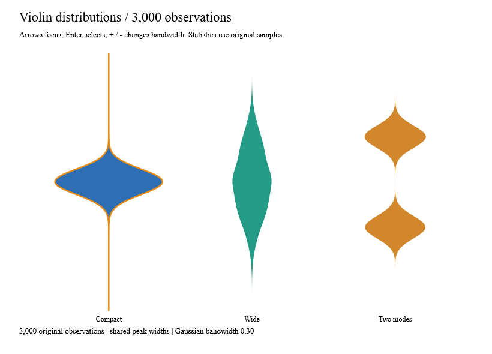
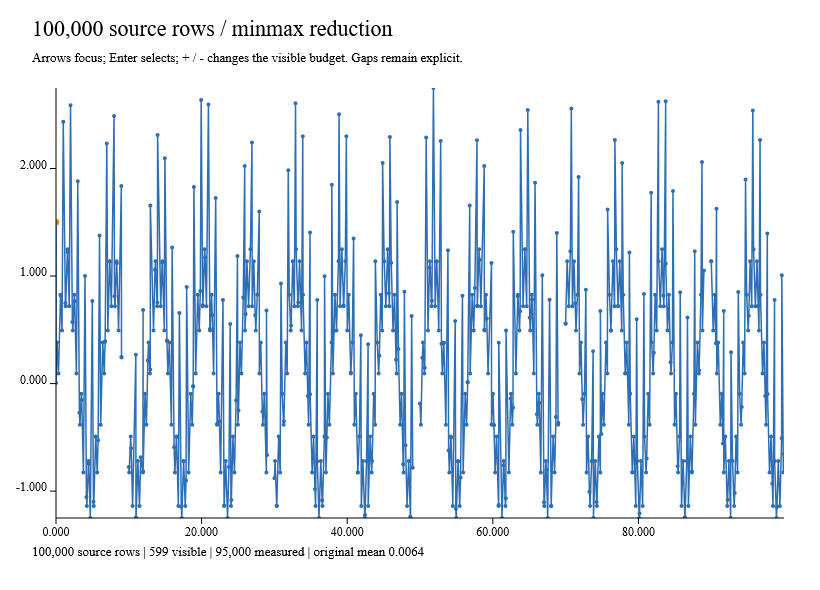
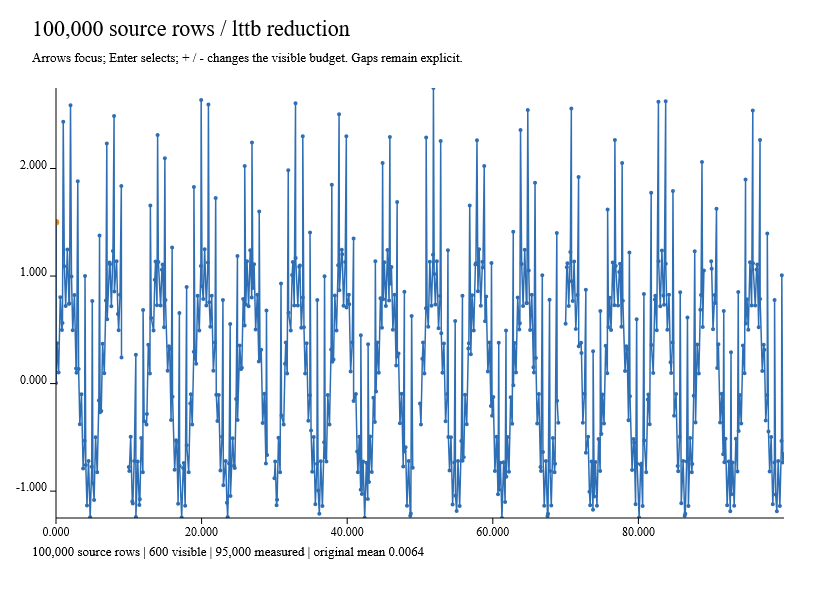

# Violin and reduced-series recipes

These pure compositions reuse `Density.kde1d`, `Sampling`, `Data`, scales, paths,
paint and the shared chart interaction layer. Their cancellable variants fit the
existing `ReactiveLayout` adapter; neither introduces a scheduler or reactive engine.

## Violin distributions

```fsharp
let frame = ChartFrame.create 800. 570. "Distributions"
let spec = { ViolinSpec.create frame (-4.,4.) 0.3 with Width=SharedPeak }
let groups =
    [{ Id="A"
       Observations=[{Id="a";Value=Some -1.};{Id="b";Value=Some 1.}] }]
let result = ViolinChart.build spec groups
```

The domain, Gaussian bandwidth and query resolution are explicit. `EachGroup`
gives every visible group the same maximum width. `SharedPeak` compares the
normalized KDE peaks across groups in the chosen domain. KDE probability is
normalized independently per group; duplicating a group's sample count does not
make it wider. Gaussian tails are untruncated, while the chosen domain truncates
the displayed curve. No smoothing beyond linear connections between KDE queries
is invented. Selected outlines can expose the very thin tails.

`ViolinOutput.Aggregate` contains a normal chart and original-ID membership.
Selection identifies a stable group aggregate; `Summaries` is keyed by original
group ID and contains count, minimum, maximum, mean and median from the original
nonmissing values. None of those statistics is calculated from the sampled KDE.
Missing observations retain their identity in the input but do not count as
measurements. Empty groups retain their category slot and an empty summary, with
no fabricated distribution mark. Groups outside the display domain can have no
representable density at its query points and therefore no visible mark.

Group IDs must be unique and nonblank; observation IDs must be globally unique
and nonblank. Repeated numeric values are valid. Nonfinite observations, invalid
domains/bandwidths and unrepresentable query or projected resolution return errors.
`MaxGroups`, `MaxSamples`, `MaxVertices` and `MaxWork` bound input, requested
geometry, and KDE/summary work. The resolution is 2–4096. Cancellation is checked
during validation, KDE and composition, and before returning the output.

```fsharp
let worker =
    ReactiveLayout.create dispatcher
        (fun () -> bandwidth.Value)
        (fun token value ->
            ViolinChart.buildWithCancellation token {spec with Bandwidth=value} groups)
```

The [native example](../examples/Ranvier.D5.Gallery/DistributionRecipesGallery.fs)
uses Anime's seeded randomness, Ranvier signals and owned workers. Selection
updates retained presentation without recomputing KDE. The snapshot verifies
3,000 measured observations, native hover and keyboard selection.



## Large time series

```fsharp
let spec =
    { ReducedSeriesSpec.create frame 600 with Reduction=SeriesReduction.Lttb }
let result = ReducedSeriesChart.build spec observations
```

`MinMax` is the default and preserves each interior bucket's extrema. `Lttb` is
an explicit visual reduction choice, not a statistical sample. Both reuse the
[sampling contracts](reduction.md): nondecreasing finite X, distinct original IDs,
finite or missing Y, endpoints, gap preservation and explicit errors when the
budget cannot preserve the mandatory run boundaries.

`ReducedSeriesOutput.Source` retains the complete immutable input list. `Visible`
contains original records selected by the reducer, including gap markers.
`Summary` uses all original nonmissing Y values, including observations outside a
fixed viewport. Automatic domains also use original data; reducing away a spike
does not erase it from the axis range or summary. Missing-row X positions remain
part of the source time extent. Fixed domains use the shared clipping contract.

Only visible measured points create point marks and hit targets. Their semantic
IDs are the original observation IDs. Missing records break the line and never
become measurement targets. The visible budget counts gap markers too; it does
not include the constant-size axes or the line mark. `Sampling.MaxInput` bounds
source validation and summary work. Median calculation sorts the original
measured values, so this is background work for large inputs, not a pointer handler.

The native examples start with 100,000 rows, including five missing intervals.
Captures assert 95,000 original measurements, a budget of 600 visible records,
all five gaps, the latest worker result, native hover and keyboard selection.
Both images report the same original mean despite different visible subsets.

Local Windows Release measurements over 60 samples:

| Composition | Median | p95 | Allocated |
|---|---:|---:|---:|
| Violin: 10 groups, 10,000 observations | 10.02 ms | 17.79 ms | 5.81 MB |
| Min/max: 100,000 rows to 1,000 visible | 25.24 ms | 35.10 ms | 29.98 MB |
| LTTB: 100,000 rows to 1,000 visible | 34.50 ms | 44.17 ms | 39.49 MB |

Both normal and Traced variants are gated in CI. Reusing original summary bounds
and the ordered X endpoints avoids rebuilding full domain lists; LTTB composition
allocation fell from 54.73 MB to 39.49 MB. Statistics still cover the entire source.
These timings include pure layout and scene construction, not native painting.





## Run and capture

```sh
dotnet run --project examples/Ranvier.D5.Gallery -c Release -- --distribution violin
dotnet run --project examples/Ranvier.D5.Gallery -c Release -- --capture-distribution violin artifacts/violin.bmp
```

Use `violin`, `minmax` or `lttb`. Arrows focus, Enter selects, and `+` / `-`
changes bandwidth or visible budget through the owned worker. The images above
are snapshots of these working native views, not generated mockups.
