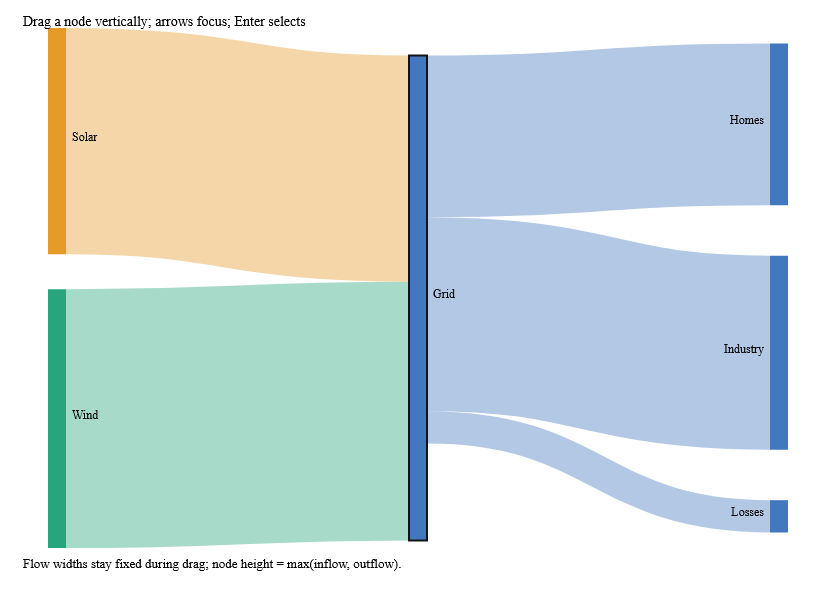
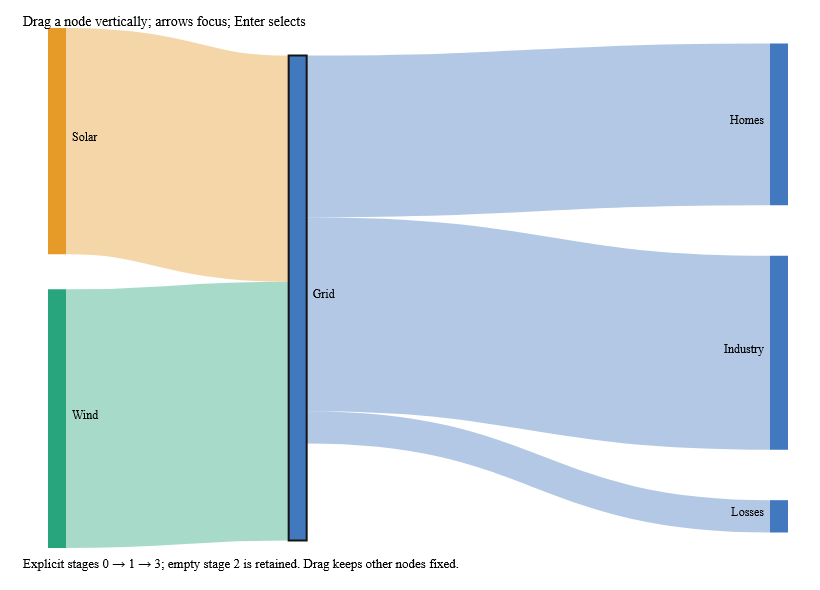
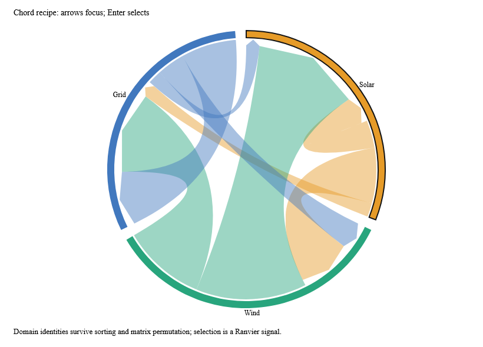

# Interactive flow chart recipes

`FlowChart.sankey spec layout` composes an immutable `SankeyLayout` into a
`ChartOutput`. It draws one cubic path per link with the layout's width, and one
rectangle and hit target per node. Parallel edges keep separate keys; node and link
key spaces are distinct. Labels and colors come from callbacks, while `Selected`
adds an outline. Coordinates are retained from the layout and clipped to the chart's
plot bounds. Use `ChartLayout.plot spec.Frame` when creating the layout configuration.

`FlowChart.alluvial spec config stages graph` lays out and renders explicit stages.
`stages` is a complete `Map<string,int>` from node ID to nonnegative stage number.
Every link must advance to a later stage. Missing/extra IDs, backward links and
stage indices outside `MaxNodes` return errors. Empty stages are retained, as the
0 → 1 → 3 example shows. A repeated category in different stages needs separate node
IDs; the label callback can display the same category name. Flow imbalance remains
explicit rather than being silently redistributed.

For interaction, keep the result of `Sankey.layoutStaged` in a Ranvier signal and
render it with `FlowChart.sankey`. `FlowChart.alluvial` is the pure one-call
convenience when retaining intermediate layout state is unnecessary.

`FlowChart.chord spec ids matrix` maps matrix indices to explicit domain IDs. Group
keys and flow keys use those IDs, so reordering the matrix and its matching ID list
preserves scene identity. Undirected pairs use canonical ordinal domain order;
directed pairs preserve direction. Groups expose sector hit targets. Numeric
layout controls live in `ChordSpec.Layout`; the recipe sizes its radius to the plot
and rejects frames too small for group bands. See [chord contracts](chord.md).

## Owned drag and selection

`FlowInteraction.attach element readChart readConfig readLayout publish report`
reuses the existing owned chart/input adapter. All callbacks run on the owner
thread. `publish` writes the next immutable layout into the caller's Ranvier signal;
`report` receives typed layout errors. Read `Selection` and derive the recipe's
`Selected` set to display pointer/keyboard selection.

Dragging calls `Sankey.moveNode config id top layout`. It clamps vertical movement
between the node's existing neighbors and viewport edges, preserving requested
padding and column order. It does not reorder nodes, move neighbors, rerun relaxation,
or change link widths. Only the dragged node's incident attachment coordinates are
updated. A fully occupied column can therefore leave a node with no room to move.
Keep the configuration consistent with the layout when calling this operation.

Native acceptance tests exercise down/move/final-up, pointer capture, cancellation,
focus loss, keyboard selection, exiting targets and disposal. `ChartInteraction`
owns coordinate conversion and event lifetime; this module adds no global listener
or second reactive engine. Heavy initial layouts can use `ReactiveLayout`, then
publish immutable results into the same signal used by the drag adapter.

## Working examples and performance

Run `dotnet run --project examples/Ranvier.D5.Gallery -c Release -- --flow-sankey`,
`--flow-alluvial`, or `--flow-chord`. Their corresponding `--capture-flow-*` modes
verify keyboard selection; Sankey/alluvial captures also verify native pointer
movement before saving. The images above come directly from these WebCore views.

CI measures pure movement, recipe construction, and native update plus paint for
201 positive-valued nodes and 400 independently keyed links. The benchmark toggles
a source node by one pixel and asserts that it actually moves, updating all 400
incident paths. Gates are 2 ms/256 KB for movement, 10 ms/8 MB for recipe construction,
and 100 ms/32 MB for native update and paint. These bounds detect regressions; they
are not a guarantee of 60 fps on dense SVG scenes.

Local Windows Traced Release measurements were 0.024 ms/55 KB for movement,
0.565 ms/1.70 MB for recipe construction, and 18.57 ms median (28.32 ms p95)/5.77 MB
for native update and paint. The pure operation fits comfortably within a frame;
the complete dense native repaint still exceeds the 16.7 ms frame target.
The normal build measured 0.017 ms for movement, 0.393 ms for recipe construction,
and 16.66 ms median (22.56 ms p95)/3.32 MB for native update and paint.

The initial implementation failed the macOS native repaint gate. The renderer now
applies mark opacity to its single visible path/text element instead of creating a
wrapper opacity group. For fill-only or stroke-only marks it applies alpha directly
to that paint; marks with both paints retain combined element opacity. Native tests
exercise style changes between these modes and compare pixels against the previous
filled-and-stroked compositing behavior. The updated local normal repaint measured
9.88 ms median and 14.81 ms p95; cross-platform CI retains the same 100 ms gate.
