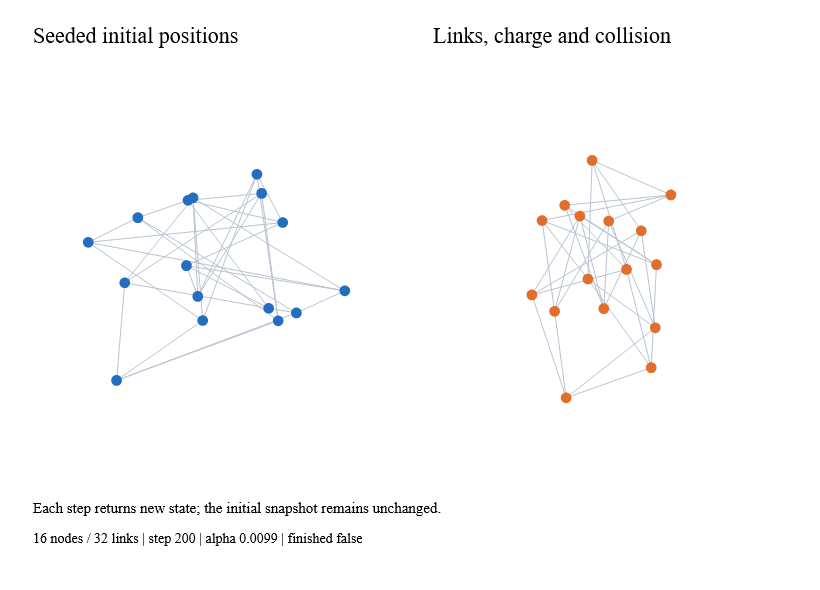

# Deterministic force state



`GraphData.create nodes links` validates IDs, endpoints, finite positive masses,
nonnegative radii and link parameters. Nodes and links are captured in ordinal
ID order. Parallel links have distinct IDs; self-links remain in the graph but
exert no spring force. Missing endpoints and invalid observations return typed
layout errors.

`Force.initialize config seed graph` creates private state. Explicit positions
are honored; pins override positions. Missing positions use Ranvier.Anime's
seeded generator with an explicit seed and stable per-ID hash. Changing input
order does not change initialization. No global random state is consumed.

`Force.step count state` advances unit-time ticks and returns new state, leaving
previous snapshots intact. Each tick cools alpha, adds center/axis/radial/link
velocity contributions, adds optional many-body and collision forces, applies
velocity decay, and advances positions. Center
force moves the collective mean toward the configured center. Link corrections
are divided inversely by endpoint mass. Pins restore their fixed position and
zero velocity after forces. Coincident radial/link directions use deterministic
seeded perturbations. Disabled forces do no arithmetic.

This is an explicit fixed-step solver, not a variable-frame-time integrator or
a guarantee of a unique optimum. Anime is reused for seeded utilities and later
presentation animation, not for physics equations. Large strengths or extreme
active-force coordinates can overflow; stepping throws instead of publishing
nonfinite state. Callers retain the unchanged input state on failure.

`snapshot` returns immutable node records, alpha and iteration. `Converged`
means alpha cooled below its threshold (or topology is empty); `Finished` also
includes the iteration budget. `reheat` raises alpha and starts a fresh budget.
`pin id position` pins or unpins an ID and reheats. `updateGraph` replaces the
topology, retains surviving positions/velocities, deterministically initializes
new IDs and removes exited IDs. Pins in the replacement graph are authoritative;
initial-position fields do not teleport surviving nodes.

`stepWithCancellation token count state` checks cancellation before stepping,
before every tick, every 64 nodes/edges/pairs, and each visited spatial cell.
Quadtree construction also checks cancellation during input capture and partitioning. Cancellation discards private work
without modifying input. Cancellation latency is cooperative, not real-time.
Same seed/config/input reproduces results; cross-platform bitwise transcendental
math identity is not promised.

```fsharp
let graph = GraphData.create [GraphNode.create "a"; GraphNode.create "b"]
                            [GraphLink.create "ab" "a" "b"]
let run = graph |> Result.bind (Force.initialize (ForceConfig.create(Point.create 0. 0.)) (Seed.create 42u))
let snapshot = run |> Result.map (Force.step 100 >> Force.snapshot)
```

The native example publishes successive immutable states through a Ranvier
signal, rendering initial and current positions side by side:

```sh
dotnet run --project examples/Ranvier.D5.Gallery -c Release -- --force
dotnet run --project examples/Ranvier.D5.Gallery -c Release -- --capture-force artifacts/force.bmp
python tools/document-snapshots.py
```

The local 1,000-node/2,000-edge benchmark takes about 0.42 ms for ten steps,
allocating 1.46 MB. Its p95 time/allocation gates are 8 ms / 3 MB across normal
and Traced CI. This baseline case excludes rendering and collision/many-body
kernels; it is not a complete interactive-frame claim.

## Spatial forces

Set `ManyBody=Some(ManyBodyConfig.create -20.)` for repulsion; positive strength
attracts. Source mass weights acceleration. `Theta=0.` uses exact pairwise
evaluation; positive theta enables Barnes–Hut aggregate traversal. The default
is 0.8. A fixed 400-site distribution at theta 0.5 is tested against exact
forces with a relative RMS velocity error below 3%; this is a fixture bound,
not a universal error guarantee. Approximation need not conserve exact momentum.

`MinDistance` softens the force near zero; coincident pairs use deterministic
seeded directions. `MaxDistance` is an inclusive cutoff. Cells crossing the
cutoff are descended instead of incorrectly including distant sources.
Strength and theta must be finite, theta nonnegative, and minimum distance
positive. Maximum distance may be positive infinity.

Set `Collision=Some(CollisionConfig.create 0.7)` for soft circle separation.
Each iteration builds an index of predicted positions, then accumulates overlap
corrections using node radii and inverse-mass shares. A pinned node gives the
free node the full correction. Strength lies in [0,1]; iterations must be
positive. Collision does not scale with alpha, but final velocity decay still
applies. Crowded configurations may retain overlap: this is an iterative force,
not a hard packing constraint. Both kernels are disabled by default.

On this machine the combined 1,000-node/2,000-edge step takes 4.46 ms median,
11.95 ms p95 and 1.69 MB allocation. The gate is 25 ms p95 / 8 MB. At 400 nodes,
exact evaluation takes 1.47 ms versus 0.93 ms for theta 0.5, at the cost of
51.6 KB versus 339.6 KB allocation. Quadtree traversal has quadratic worst cases
for coincident or highly clustered points; exact evaluation is always quadratic.
These are solver measurements, excluding host rendering and publication.

The native snapshot above includes link, charge and collision forces. Task 7 G3
still owns bounded worker publication, interactive dragging and network recipes.
