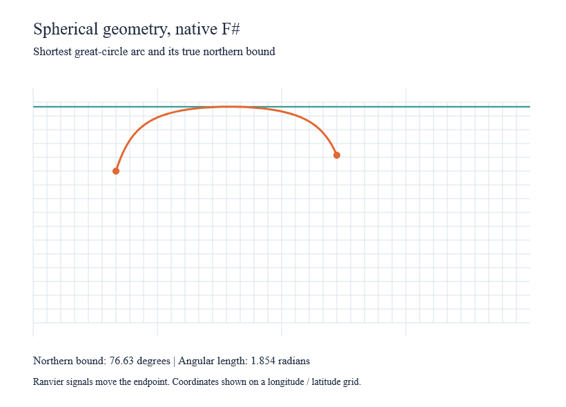

# Geographic foundations

`Ranvier.D5.Geo` is an optional package, with a matching `.Traced` variant. It
depends on Charts; core, Charts and View do not depend on Geo. These are pure
spherical kernels and bounded interchange adapters. Complete projection,
clipping, resampling and map-chart pipelines remain work in progress.



This is a capture of the working native gallery after a Ranvier signal moves
the endpoint. The orange path samples a shortest great-circle arc; the teal
line is its analytical latitude maximum. The example places coordinates on a
longitude/latitude grid. It is not a general map projection or clipping API.

```sh
dotnet run --project examples/Ranvier.D5.Gallery -c Release -- --geographic-kernels
dotnet run --project examples/Ranvier.D5.Gallery -c Release -- --capture-geographic-kernels artifacts/geographic-kernels.bmp
```

## Values and measurements

`GeoPosition.create longitude latitude` validates finite degrees and latitude
in [-90,90]. Longitude normalization is explicit: `GeoPosition.normalize`
returns [-180,180). Screen-space `Point` is a different type.

`GeoGeometry` represents points, lines, polygons, their multi variants,
collections and a sphere. Inputs and outputs are immutable. `GeoStream.fold`
and `foldDocument` share a bounded traversal with the measurement kernels;
their cancellation variants observe cancellation during traversal. Events are
struct values. Rings emit no duplicate closing vertex, but that input vertex
still counts toward the point budget.

| Operation | Contract |
|---|---|
| `Geodesic.distance` | Shortest angular distance in radians, including antipodal endpoints |
| `Geodesic.interpolate t a b` | Shortest spherical route, t in [0,1]; ambiguous antipodal interiors return an error |
| `GeoRotation.create/apply/inverse` | Explicit degree angles and reversible spherical rotation |
| `Graticule.create` | Bounded meridians, parallels and closed outline |
| `GeoMeasure.length` | Angular boundary length; polygon closure and holes count |
| `GeoMeasure.area` | Steradians, with winding selecting region or complement |
| `GeoMeasure.centroid` | Polygon vector weighting, then line weighting, then points; ambiguous direction is `None` |
| `GeoMeasure.bounds` | Arc latitude extrema, pole interiors and smallest circular longitude interval; empty is `None` |

Bounds use degrees. `West > East` means the interval crosses the dateline;
[-180,180] means all longitudes. Poles on a boundary do not automatically make
the longitude range global; an isolated pole has no preferred longitude and
uses the global range. Coincident geometry is valid. Antipodal edges in area,
centroid and bounds require an explicit intermediate point.

Spherical polygons use clockwise exteriors for small regions, the opposite
of RFC GeoJSON. Reversing a ring selects the spherical complement; rings are
not silently reduced to the smaller region. Collections sum areas and lengths;
they do not calculate a geometric union. A polygon is interpreted as supplied
oriented rings, not repaired or checked for self-intersections.

```fsharp
open Ranvier
open Ranvier.D5
open Ranvier.D5.Geo

let require = function Ok value -> value | Error errors -> failwithf "%A" errors
let position lon lat = GeoPosition.create lon lat |> require

// Run inside the application's existing Ranvier graph and owner.
let endpoint = Api.createSignal (position 40. 35.)
let arcBounds =
    Reactive.derive (fun () -> endpoint.Value) (fun destination ->
        GeoMeasure.bounds GeoStreamConfig.defaultValue
            (GeoGeometry.LineString [position -120. 30.; destination]))
```

Use the existing owned `ReactiveLayout` worker for large inputs. Publish on
the host thread and retain the last valid result. The kernels create no graph,
timer, worker or hidden mutable simulation state.

## Interchange and limits

`GeoJson.parse/serialize` use System.Text.Json and detached immutable
`GeoValue` trees. Numeric properties and IDs retain their JSON number lexemes,
including numbers outside float range. Coordinates require representable
finite numbers and exactly two dimensions. String and numeric IDs stay distinct;
generic interchange preserves duplicate feature IDs for later join validation.
Absent members and explicit null values remain distinct where the data model
supports them. Features require geometry and properties, either nullable.

The adapter reverses RFC rings at its boundary. RFC coordinate-linear edges
become shortest great-circle arcs in the spherical model, so this is an explicit
semantic conversion. `Sphere` is an internal extension and cannot be serialized
as RFC GeoJSON. See [RFC 7946](https://www.rfc-editor.org/rfc/rfc7946).

Feature and collection foreign members survive round trips. Geometry foreign
members, including a geometry's bbox, are validated where applicable but are
not retained by the geometry DU. Bounding-box metadata must be four finite
numbers with ordered latitudes in [-90,90]; wrapped longitudes are accepted.
Metadata is not used as a trusted culling bound, nor checked for geometric
enclosure. Compute spherical bounds from the converted geometry instead.

Default JSON limits are 32 MB UTF-8, depth 64, one million positions, 100,000
features and ten million work units. Parsing the bounded JSON DOM itself cannot
be interrupted mid-call; conversion and output traversal check cancellation.
Malformed structures, duplicate object members, reserved-field collisions,
unsupported dimensions, invalid rings and exceeded budgets return typed errors.

Stream defaults are one million positions, depth 64 and ten million work units.
Bounds use O(n) range storage and O(n log n) merging; traversal and merging each
receive the configured work limit. Merging checks cancellation on every step.
Other measurements keep constant-size accumulators beyond the input geometry
and traversal state. Folder callbacks may occur before a later validation error;
use pure folds rather than callbacks with irreversible effects.

## Evidence and deliberate reference differences

Fixtures pin d3-geo 3.1.1; independent high-precision and analytic cases cover
tiny distances, near-antipodes, poles, winding, holes and full arc angles.
Three upstream behaviors are deliberately not copied: polygon length includes
the closing edge; a small north-cap bound excludes the south pole; centroid
weights preserve arc angles larger than 90 degrees. Raw upstream fixtures are
retained alongside independent expectations.

Normal and Traced benchmark executables measure 60 iterations after three
warmups. CI gates stream/length/bounds at 100,000 points, area/centroid at 10,000
octants, default graticules and 10,000-point JSON round trips. The initial Windows
100,000-point bounds comparison reduced allocation from 188 MB to 7.4 MB by
removing boxed tuple comparisons; the 10,000-point regression test enforces a
1 MB allocation ceiling. Timing measurements and platform evidence are build
artifacts, not universal responsiveness guarantees.

```sh
dotnet run --project benchmarks/Ranvier.D5.Geo.Benchmarks -c Release
dotnet run --project benchmarks/Ranvier.D5.Geo.Benchmarks -c Release -p:RanvierTrace=true
```
