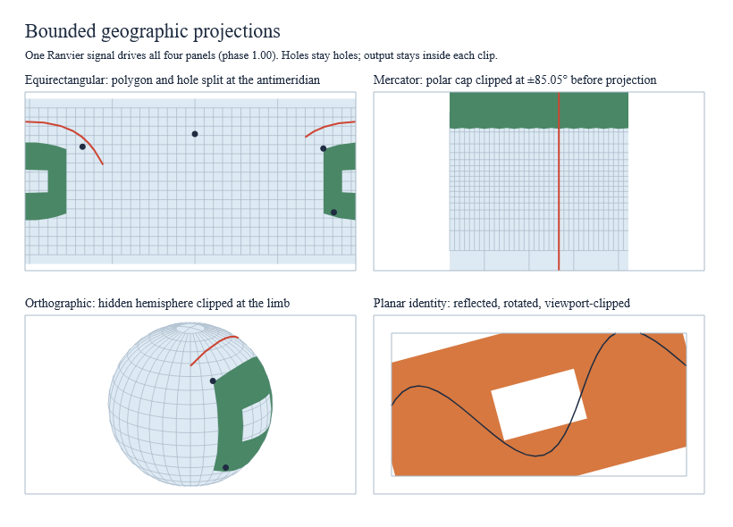

# Geographic projections and paths

`Ranvier.D5.Geo` turns validated spherical or planar geometry into ordinary
toolkit `Path` values through a bounded stream pipeline. Core, Charts and View
do not depend on Geo.



This is a capture of the working native gallery after a Ranvier signal moves
every panel to phase 1. Before the capture is written, the gallery paints both
phases and samples native pixels: polygon interiors must show the land fill,
holes must show the ocean or page beneath, and the polar cap must stop at the
Mercator band. Any mismatch fails the capture.

```sh
dotnet run --project examples/Ranvier.D5.Gallery -c Release -- --projections
dotnet run --project examples/Ranvier.D5.Gallery -c Release -- --capture-projections artifacts/projections.bmp
```

| Panel | What it shows |
|---|---|
| Equirectangular | A seam-crossing polygon and its hole split into separate filled pieces; a great-circle route crosses the antimeridian |
| Mercator | A polar cap clipped to the finite latitude band before projection; a pole-to-pole meridian stops at the band |
| Orthographic | The same polygon clipped at the limb as the globe rotates; hidden geometry never paints |
| Planar identity | A reflected, rotated polygon with a hole intersected with a viewport smaller than the polygon |

## Pipeline

`GeoPath.project options projection geometry` runs rotation, spherical
preclipping, adaptive projected resampling, optional rectangular clipping and
path assembly. Errors are typed and the result is published only when the
whole geometry succeeds; a partial path is never returned.

| Stage | Contract |
|---|---|
| Rotation | `ProjectionConfig.Rotation` uses the D3 longitude, latitude, roll convention |
| Preclip | Equirectangular and Mercator cut at the antimeridian; orthographic cuts at the visible hemisphere; Mercator then clips to latitudes ±atan(sinh π), about ±85.051129° |
| Resampling | Great-circle edges subdivide until the projected midpoint and quarter samples lie within `Precision` screen units, at most `MaxSubdivisionDepth` levels; an unmet bound is a `BudgetExceeded` error |
| Polygons | Fragments rejoin around the projection boundary with holes, complements and independent multipolygon members preserved |
| Viewport | `ClipExtent` intersects lines and polygons with a rectangle; concave polygons can yield several disconnected components |
| Points | Point symbols are bounded circles of `PointRadius`; zero omits them |
| Sphere | Emits the equirectangular rectangle, orthographic disk or canonical Mercator square, intersected with `ClipExtent` |

Rings follow the D3 convention: small exterior rings are clockwise and holes
have opposite winding; reversing a ring selects its spherical complement.
Antipodal edges are ambiguous and require an explicit waypoint.

Mercator explicit viewports intersect the finite canonical world; they do not
extend its vertical coverage. This deliberately differs from D3's explicit
viewport behavior. `Projection.project` remains a mathematical point mapping
away from the exact poles, while streamed point centers outside the band are
omitted.

## Planar identity

`IdentityProjection` maps already planar `Point` coordinates with positive
scale, optional reflection, a counterclockwise angle in degrees and a
translation, matching D3 geoIdentity. `PlanarPath.project` uses the same
viewport clipping and circle rendering as geographic paths, but edges stay
straight and there is no spherical rotation, seam splitting or planar Sphere.
Polygon rings are simple and explicitly closed: the first is the exterior and
later rings are enclosed holes with opposite winding. Reflection can reverse
every ring; clipping normalizes the exterior winding first so enclosed holes
remain holes.

## Budgets and cancellation

`GeoPathOptions` separates input limits (`InputLimits`), output endpoints
(`MaxOutputPoints`), intermediate clipping buffers (`MaxBufferedPoints`), work
units (`MaxWork`) and subdivision depth. `projectWithCancellation` checks the
token during traversal, splitting, clipping, resampling, rejoining and copying.
Published paths own their coordinates.

## Evidence

Pinned d3-geo 3.1.1 fixtures cover 158 geographic polygon streams, twelve
clipped geographic line streams, twelve identity point mappings and forty
clipped identity polygons. Independent tests cover winding, holes, complements,
precision, budgets, cancellation and degenerate input. One D3 discrepancy is
retained as evidence rather than copied: a reflected clipped exterior and its
hole can share winding in D3 and fill the hole.

Normal and Traced geographic benchmarks gate ordinary, seam-heavy, polar,
clipped and 100,000-vertex workloads; see [performance gates](performance-gates.md).
Resampling halves each great-circle arc by rotating its parent frame instead
of re-solving the arc from rounded degrees; in a same-machine alternating
comparison the 10,000-vertex Mercator polar workload measured 50 to 34 ms
median. Timings are local evidence, not cross-platform guarantees.

Not yet provided: conic, azimuthal, gnomonic, stereographic and transverse
Mercator projections, composites, fit-to-bounds and map chart recipes.
