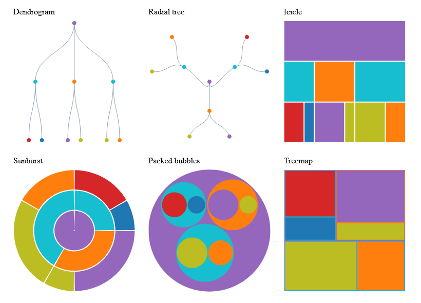
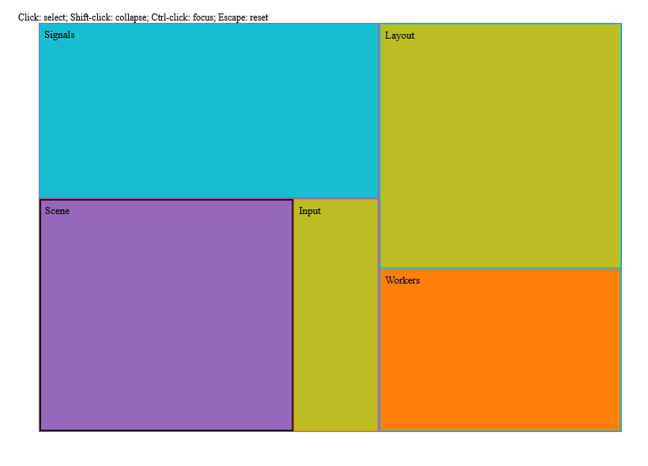

# Hierarchy charts and native interaction



The [native gallery](../examples/Ranvier.D5.Gallery/HierarchyChartsGallery.fs)
composes dendrogram, radial tree, icicle, sunburst, packed bubbles and treemap
recipes. All six return a scene, semantic domain IDs and clipped hit targets.

```fsharp
let spec = HierarchySpec.create (ChartFrame.create 800. 570. "My hierarchy")
let chart = HierarchyChart.sunburst spec hierarchy
let collapsed = HierarchyChart.treemap { spec with Collapsed = set ["branch"] } hierarchy
let focused = HierarchyChart.treemap { spec with Focus = Some "branch" } hierarchy
```

Labels are separate from domain identity. Repeated display labels are fine;
domain IDs must remain unique. A collapsed branch keeps its aggregate weight and
domain key. Focus chooses a subtree; a missing focus ID returns a typed error.
Selection is explicit in `Selected` and is not discarded when a selected node
is temporarily hidden by collapse or focus. The caller can prune IDs when the
underlying data changes. Selection adds an outline to visible nodes.

## Reactive native explorer



The [explorer source](../examples/Ranvier.D5.Gallery/HierarchyExplorer.fs) uses a
Ranvier signal for selection, collapse and focus, the owned ReactiveLayout worker
for coalescing/cancellation, and KeyedTransition for identity-preserving motion.
Worker cancellation is checked before and after the pure layout; a running kernel
finishes before the next pending request starts. Publication is on the host thread
and stale results cannot replace the latest request. The screenshot is captured
after a worker-driven collapse update and native click selection checks.

Click to toggle selection, Shift-click to collapse/expand, Ctrl-click to focus,
and Escape to reset. Selected IDs survive collapse/expand. Transition groups keep
domain keys, with private layers inside them; input dispatch resolves the domain
group rather than the layer key. The explorer disposes its listeners, worker,
reactive computations and native mount with its owner.

```sh
dotnet run --project examples/Ranvier.D5.Gallery -c Release -- --hierarchy-charts
dotnet run --project examples/Ranvier.D5.Gallery -c Release -- --hierarchy-explorer
dotnet run --project examples/Ranvier.D5.Gallery -c Release -- --capture-hierarchy-charts artifacts/hierarchy-charts.bmp
dotnet run --project examples/Ranvier.D5.Gallery -c Release -- --capture-hierarchy-explorer artifacts/hierarchy-explorer.bmp
python tools/document-snapshots.py
```

These PNGs are lossless conversions of native WebCore captures. CI repeats the
captures and the explorer's worker/click checks on Windows, Linux and macOS, both
normal and Traced. The 10,000-node treemap recipe measured 33.96 ms median and
40.94 MB allocated locally after removing unnecessary tree copies and repeated
palette conversion. Large chart construction belongs on the worker, not in an
input handler. Time and allocation are gated in CI.
