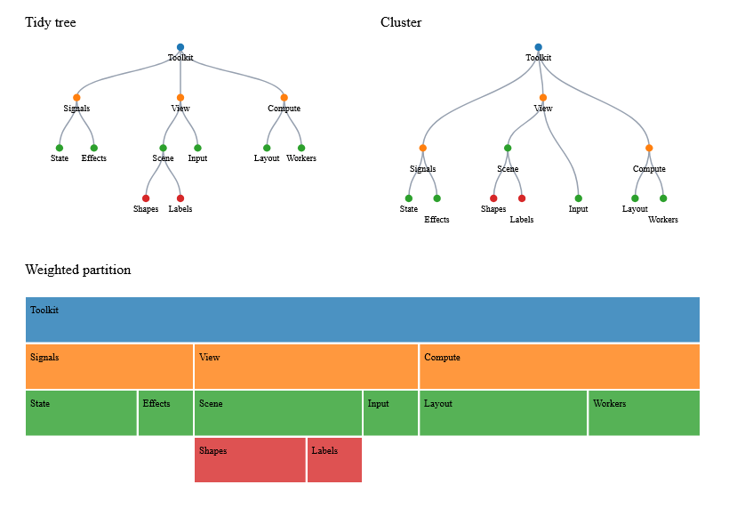

# Hierarchy construction and layouts



This image is a capture of the running native WebCore view, not a mockup.
Source: [HierarchyGallery.fs](../examples/Ranvier.D5.Gallery/HierarchyGallery.fs).

```fsharp
let root =
    Hierarchy.stratify fst snd
        ["root", None; "first", Some "root"; "second", Some "root"]
let positions =
    root |> Result.bind (Tree.layout (TreeConfig.create (Bounds.create 0. 0. 800. 600.)))
```

Parent tables preserve sibling input order. IDs must be unique and nonempty;
missing parents, cycles and multiple roots return typed errors. Hierarchy.forest
adds a caller-named virtual root, checked for collisions. stratify gives leaves
unit weight and branches zero own weight; stratifyWeighted accepts explicit
nonnegative own weights. Construction and traversal use bounded private buffers,
not recursion through the user's tree.

Tree.layout implements iterative Buchheim tidy placement, with the d3-hierarchy
3.1.2 license and coordinate fixtures checked in. Cluster.layout aligns leaves
and places parents at child means. TreeConfig accepts a strictly positive finite
separation function and output bounds. Partition.layout uses depth bands and
weighted spans; own branch weight reserves blank space, zero-total siblings share
equally, and padding clamps a small cell to zero size instead of negative size.
Legacy Hierarchy.tree/treemap remain compatible.

Tests include a 50,000-node chain and a 10,000-child tree. The 10,000-node benchmark
measured 0.86 ms construction and 7.29 ms tidy layout on the development machine.
CI enforces absolute and matched baseline regression gates; these timings are
observations, not promises for every machine.

Reproduce the native image:

```sh
dotnet run --project examples/Ranvier.D5.Gallery -c Release -- --hierarchy
dotnet run --project examples/Ranvier.D5.Gallery -c Release -- --capture-hierarchy artifacts/hierarchy.bmp
python tools/document-snapshots.py
```

PNG conversion requires Pillow and only changes image encoding. CI retains raw
native BMP captures for Windows, Linux and macOS, normal and Traced.
