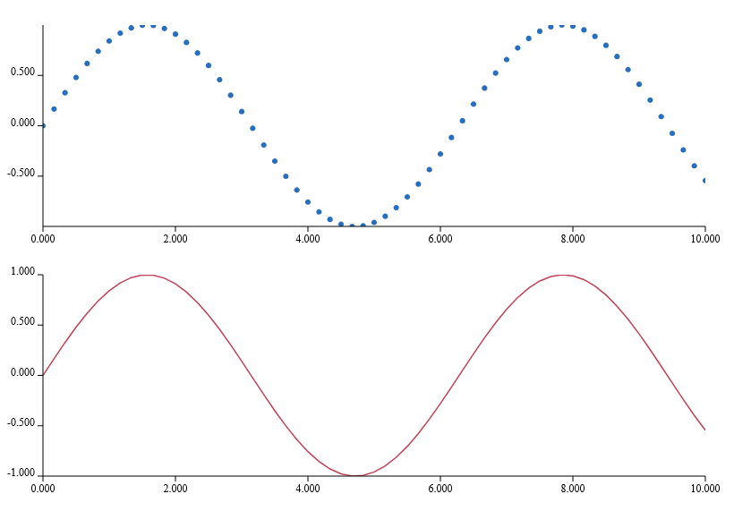

# Ranvier.D5

Functional-first visualization foundations for native and browser F# applications. Compose immutable data, scales, geometry, and scenes; let Ranvier signals update retained SVG through `Ranvier.View` and native `Ranvier.WebCore`, or drive GPU-instanced 3D plots over `Ranvier.Wgpu`.



## Ecosystem packages

- **`Ranvier.D5`**: Data summaries, bins, keyed joins, numeric/categorical/UTC scales, axes, affine transforms, paths, lines/areas/arcs/symbols, pie/stack/tree/treemap layouts, spatial queries, reactive values, animation, zoom, and brush.
- **`Ranvier.D5.View`**: Keyed SVG scene components (`Renderer.create`, `Renderer.passive`), [owned chart interaction](interaction.md), [keyed transitions](transitions.md), and [cancellable background layouts](background-layout.md).
- **`Ranvier.D5.Charts`**: Typed pure chart recipes and composition across [distributions and reduced series](distribution-series.md), [heatmaps, hexbins, contours, and isobands](density-charts.md), [hierarchies](hierarchy-charts.md), [Sankey, alluvial, and chord flows](flow-charts.md), [networks and bubble clusters](network.md), and [advanced multi-series charts](advanced-charts.md).
- **`Ranvier.D5.Geo`**: Validated [spherical geometry, GeoJSON/TopoJSON interchange, and measurement kernels](geographic-kernels.md), [azimuthal/conic/cylindrical projections and adaptive clipping](geographic-projections.md), and [choropleth and proportional-symbol map charts](map-charts.md).
- **`Ranvier.D5.Graph`**: [2D compound diagram, port, obstacle-avoiding orthogonal routing, and association-machine layout engines](graph-layouts.md) (Sugiyama/ELK layered, IPSep-CoLa constrained stress, fCoSE, PivotMDS, SGD Stress, Modularity ForceAtlas2/LinLog, radial mindmaps, and skyline packing).
- **`Ranvier.D5.Graph3D`**: [3D Euclidean and hyperbolic layout engines](graph-layouts.md) including Tamara Munzner's H3, CAIDA Walrus, Octree Barnes-Hut Force3D, 3D SGD Stress, Cone/Balloon trees, 3D stratified layers, and SVG projection.
- **`Ranvier.D5.Wgpu`**: WebGPU 3D and multi-dimensional visualization scales (`Scale3D`), 3-wall projections and framing (`Axis3D`), perceptual colormaps (`ColorRamp`) and WGSL/GLSL LUT shaders (`ColorShader`), structured/curvilinear/Delaunay surfaces (`SurfaceGrid`, `Surface3D`, `SurfaceBatch`), instanced glyphs/bars/lines/SDF scatter discs (`Glyph3D`, `Bar3D`, `Line3D`, `Scatter3D`), volumetric marching-cubes isosurfaces (`VolumeGrid`, `IsoSurface3D`), camera controls and GPU picking probes (`PlotCamera3D`, `Probe3D`), and Ranvier reactive GPU sinks (`Reactive3D`) over `Ranvier.Wgpu`.
- **`Fable.Ranvier.D5.Wgpu`**: Browser/Fable source-compatible package of `Ranvier.D5.Wgpu` targeting `Fable.Ranvier.Wgpu` (WebGPU with WebGL2 fallback) for Fickl compilation to JavaScript.
- **`Ranvier.D5.Wgpu.Sdl`**: Native SDL3 + WebGPU interactive 3D plot host view (`PlotView3D`, `PlotPass3D`, `PlotViewConfig3D`) binding `WgpuSdlSurface` with a pointer-transparent `Renderer.passive` SVG axis overlay, orbit/pan/zoom/keyboard controls, GPU picking hover spikes, and dirty-only frame scheduling.

Every package has a matching **`.Traced`** variant (`-p:RanvierTrace=true`). Use a single variant consistently across the dependency graph. See [architecture and design](design.md) and [foundation contracts](contracts.md) for numeric invariants, coordinate conventions, and integration boundaries.

## Reactive SVG scene quick start

```fsharp
open Ranvier
open Ranvier.D5
open Ranvier.D5.View

// Inside the host's Ranvier graph/owner:
let values = Api.createSignal [ 10.; 30.; 20. ]

let scene =
    Reactive.derive (fun () -> values.Value) (fun data ->
        let x = Scale.linear (0., 2.) (20., 280.)
        let y = Scale.linear (0., 40.) (180., 20.)
        let points =
            data
            |> List.mapi (fun i v ->
                Some(Point.create (Scale.map x (float i)) (Scale.map y v)))
        let line =
            Shape.line Curve.Linear points
            |> Mark.path "series"
            |> Mark.withFill Paint.none
            |> Mark.withStroke (Paint.rgb 45 120 210) 2.
        Scene.create 300. 200. "Measurements" [ line ])

// Mount Renderer.passive with (fun () -> scene.Value) through Ranvier.View.
// Writing values.Value updates the retained series mark in place.
```

Use `Renderer.create (fun key eventName event -> ...)` when handling mark events, `Ranvier.Anime.Ease.named "inOutCubic"` with `Transition.start` or `Reactive.animate` for clock-driven transitions without ambient timers, and `Paint.ofCss` to reuse typed `Ranvier.Css` values.

## Guide map

- **Overview & Design**: [Foundation architecture](design.md) · [Foundation contracts](contracts.md)
- **Scales, Color & Data**: [Palette policy](chromatic.md) · [Delimiter-separated values](dsv.md) · [Explicit-state randomness](random.md) · [Hexbin and line reduction](reduction.md)
- **Charts & Series**: [Violin and reduced-series compositions](distribution-series.md) · [Density grids and KDE](density.md) · [Heatmap, hexbin, contour, and isoband charts](density-charts.md) · [Contour topology](contours.md) · [Advanced chart recipes](advanced-charts.md)
- **Hierarchies & Flows**: [Hierarchy layouts](hierarchy.md) · [Hierarchy charts and explorer](hierarchy-charts.md) · [DAG Sankey layouts](sankey.md) · [Chord layouts and ribbons](chord.md) · [Interactive flow charts](flow-charts.md)
- **Networks & Graph Layouts**: [Force simulation](force.md) · [Networks and bubble clusters](network.md) · [Robust planar geometry](planar.md) · [Compound 2D & 3D graph layouts](graph-layouts.md) · [Owned background layouts](background-layout.md)
- **Spatial & Geography**: [Immutable quadtree](quadtree.md) · [Delaunay, Voronoi, and picking](spatial.md) · [Treemaps and circle packing](tiling.md) · [Geographic kernels](geographic-kernels.md) · [Geographic projections and paths](geographic-projections.md) · [Map charts](map-charts.md)
- **Interaction**: [Owned chart interaction](interaction.md) · [Keyed transitions](transitions.md)

## Running the native galleries

Explore the runnable examples directly from the [Ranvier.D5 repository](../examples/Ranvier.D5.Gallery):

```sh
dotnet run --project examples/Ranvier.D5.Gallery -c Release
dotnet run --project examples/Ranvier.D5.Gallery -c Release -- --linked
dotnet run --project examples/Ranvier.D5.Dashboards -c Release
dotnet run --project examples/Ranvier.D5.Wgpu.WaveDemo -c Release
```
