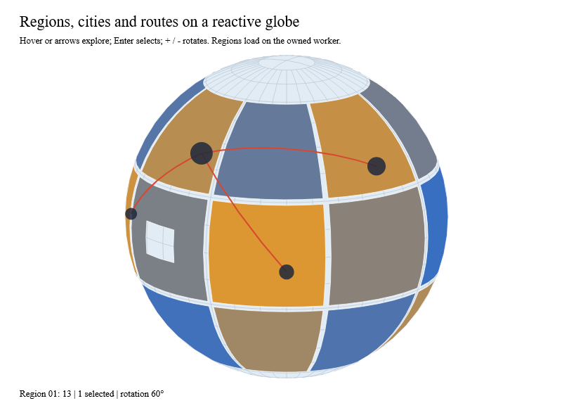

# Map charts

`MapChart` recipes live in the optional `Ranvier.D5.Geo` package and return
ordinary `ChartOutput` values: a keyed scene, semantic marks and hit targets.
Charts and View stay free of geographic dependencies; View's existing
`ChartInteraction` drives hover, brush, lasso and keyboard selection unchanged.



```sh
dotnet run --project examples/Ranvier.D5.Gallery -c Release -- --map
dotnet run --project examples/Ranvier.D5.Gallery -c Release -- --capture-map artifacts/map.bmp
```

The gallery loads synthetic regions from GeoJSON on the owned background worker
(`ReactiveLayout`) and composes regions, routes and cities over an orthographic
globe whose rotation is a Ranvier signal. The capture fails unless native pixels
show each sizeable region's joined fill, the lake hole stays open, a native
pointer move hovers the region beneath it, the keyboard selects, and a rotation
update re-renders with fills re-verified.

## Recipes

| Recipe | Contract |
|---|---|
| `MapChart.choropleth` | Joins data to `MapFeature.Id`; unmatched data keys, duplicate data keys and duplicate feature IDs are typed errors. Features without a value use `Missing` and say "no data". |
| `MapChart.bubbles` | Circle area is proportional to `Size`; the largest datum has `MaxRadius`. Hidden positions (behind a globe, outside a cap or band) are omitted. Largest circles are drawn first so small ones stay pickable. |
| `MapChart.routes` | Shortest great-circle routes, split at seams and clipped like any line; picking uses a band around each projected segment, never a chord across the map. |
| `MapChart.overlay` | Stacks outputs drawn in one frame under unique layer scopes; later layers paint and pick above earlier ones. |
| `MapFeature.ofDocument` | Requires a stable non-empty ID and a geometry for each GeoJSON feature; numeric IDs keep their JSON lexeme. |

`MapFrame` carries the chart frame, a `MapProjection` (one projection or a
composite such as Albers USA), path options and non-interactive background
layers (`Sphere`, `Lines`, `Fill`). The plot bounds always clip the map.

Region picking uses the projected polygons: holes stay unpickable and every
member of a multipolygon picks its feature. Each region's anchor (used by brush
and lasso selection) is the midpoint of the widest inside span across several
scanlines, so concave slivers at a limb or seam anchor inside their fill.
Semantic IDs are the feature IDs, so reordering data never changes identity.

Recipes are pure and create no signals. Signal-driven projection and selection
belong to the caller, as in the gallery: derive the projection from a rotation
signal and pass `Selection.Selected` back as `Selected`.

## Limits and evidence

Each feature projects through the bounded `GeoPath` pipeline with the frame's
budgets, so cost is linear in input vertices plus clipped output. Gates: 1,000
choropleth regions (150 ms p95, 32 MB) and 1,000 bubbles (40 ms, 7 MB); local
normal p95 measured 35.3 and 5.2 ms. Tests cover joins, typed errors, hole-aware
picking, composite insets, hidden features and bubbles, seam-crossing routes,
overlay ordering, concave anchors and GeoJSON feature conversion.

TopoJSON decoding remains a separate optional adapter and is not included.
