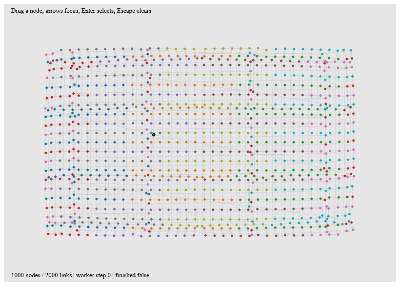
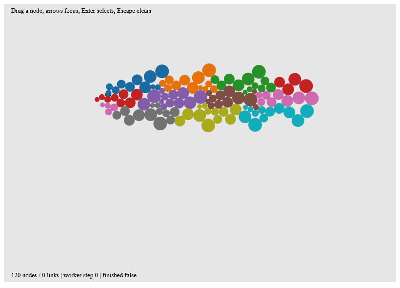

# Networks and bubble clusters



`NetworkChart.network spec graph snapshot` builds a pure chart value from a
validated graph and immutable force snapshot. `NetworkChart.bubbles spec snapshot`
uses the same node geometry without links. Positions are SVG plot coordinates;
the recipe does not silently rescale a layout during a drag. Radii represent
actual circle radii, not areas. Both recipes clip to the frame's plot bounds.

Node and link keys have separate namespaces; parallel links keep their IDs.
For dense views, set `AggregateLinks=true` to draw all edges in one shared path.
This mode retains individual node identities and hit targets, but replaces
individual link semantics with one aggregate endpoint description. The native
1,000-node example uses this mode; the default preserves separate link marks.
Node hit targets carry semantic IDs and circle geometry. Stale snapshots with
different node IDs are rejected instead of dropping edges. Missing or invalid
node observations return layout errors. Self-links are retained as zero-length
paths; this recipe does not yet route parallel edges into separate curves.

## Owned simulation

Create `ReactiveForce.create dispatcher chunk initialState` inside a Ranvier
owner. Its read-only `Snapshot` is a Ranvier signal-backed value. The controller
uses the existing `ReactiveLayout` adapter: one running worker, one latest
pending request, cancellation and generation checks, and publication on host
frames. Workers receive immutable force state and never read signals.

Chunks stop after the configured step count or elapsed time budget; the default
is eight steps or six milliseconds. A single step may exceed the time budget,
so this is cooperative scheduling rather than a real-time deadline. Finished
layouts schedule no further chunks. Alpha cooling and iteration budgets stop
the solver; cooling does not prove a unique optimum or overlap-free packing.

Dispatch `ForceMessage.Pin`, `Unpin`, `Reheat` or `ReplaceGraph` on the owner
thread. Successful messages immediately update the visible state and supersede
old worker results. Topology changes retain surviving positions and remove
exits. Failures preserve the last good snapshot. Disposing the owner cancels
work and prevents late publication; messages after disposal are rejected.

## Native input and examples

`NetworkInteraction.attach svg readChart force` reuses D5's owned chart gestures
and pointer capture. Dragging pins a node and reheats; release applies the last
movement before unpinning. Cancel, focus loss, node exit and disposal release
the drag. Keyboard arrows move semantic focus, Enter/Space selects and Escape
clears selection. Consumers can render the returned selection state.

The examples connect force snapshots through `Reactive.derive` to chart
construction and retained native SVG. Physics uses fixed steps; presentation
animation can use Anime through D5's existing keyed transitions.

```sh
dotnet run --project examples/Ranvier.D5.Gallery -c Release -- --network
dotnet run --project examples/Ranvier.D5.Gallery -c Release -- --bubbles
dotnet run --project examples/Ranvier.D5.Gallery -c Release -- --capture-network artifacts/network.bmp
dotnet run --project examples/Ranvier.D5.Gallery -c Release -- --capture-bubbles artifacts/bubbles.bmp
```



The network example has 1,000 nodes and 2,000 links; the bubble example has 120
variable-radius nodes using center/axis attraction and collision. The benchmark
suite measures chart construction and native update-plus-paint separately from
force stepping. With individual edge marks, the local update-plus-paint median
was 58.85 ms (18.66 MB allocated). Explicit aggregation reduced it to 28.61 ms
(11.94 MB), with a 34.38 ms p95. Chart construction alone took 5.19 ms. These
measurements still exceed a 16.7 ms frame budget: dense SVG updates remain the
main bottleneck, even though simulation no longer blocks the host. Shared CI
gates are regression guards, not a 60 FPS guarantee.
