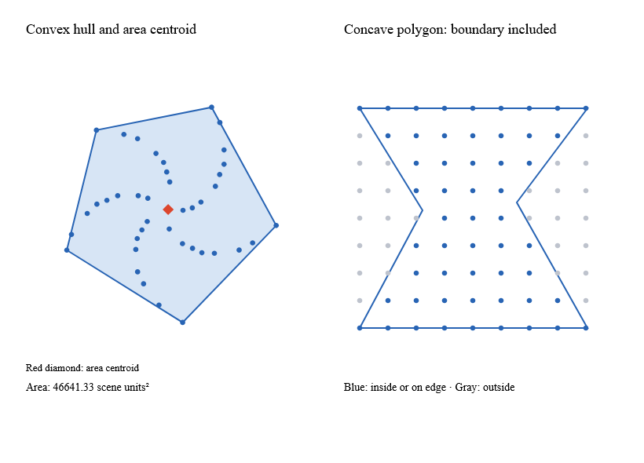

# Robust planar geometry



This is a capture from the [native planar example](../examples/Ranvier.D5.Gallery/PlanarGallery.fs).

`Predicates.orient2d a b c` returns -1, 0 or 1, with Cartesian counterclockwise
positive. `Predicates.incircle a b c d` is positive inside the circle through a
counterclockwise triangle, negative outside, and zero on the circle. Reversing
the triangle reverses the sign. In SVG's downward-Y coordinates, the same numeric
counterclockwise sign appears clockwise on screen.

The floating filters are adapted from pinned robust-predicates 3.0.2 (Unlicense).
Uncertain signs and extreme exponents use exact BigInteger arithmetic on the
input doubles' dyadic values. There is no epsilon-based topology decision and no
shared scratch buffer. The fallback supports subnormal coordinates and finite
values whose differences or products overflow ordinary floating arithmetic.
The fast zero-product case is only accepted in a range where multiplication
cannot underflow. Nonfinite coordinates throw ArgumentException.

Polygon functions use immutable point lists:

- `Polygon.area` returns signed area, Cartesian counterclockwise positive. An
  unrepresentable area throws ArgumentException; a subnormal area may round to zero.
- `Polygon.centroid` returns None for zero signed area, otherwise the area centroid.
  Exact intermediate moments preserve tiny and huge finite coordinate cases.
- `Polygon.contains` uses nonzero winding and includes the boundary. Empty rings
  contain nothing. Repeating the first point to close a ring is optional.
- `Polygon.hull` returns a counterclockwise hull starting at the lexicographic
  minimum. Duplicate points are removed; a collinear set returns its endpoints.

These APIs do not validate polygon simplicity or model hole collections. Winding
and signed moments still have their algebraic meanings for self-intersections.
Use separate rings and explicit fill rules when building compound paths.

Reference tests use robust-predicates and d3-polygon with explicit sign conversion;
extreme IEEE cases are checked independently because upstream expansion arithmetic
does not cover every exponent range. Local 100,000 ordinary orientations measured
0.54 ms with no per-call allocation; 10,000 exact tiny-coordinate orientations
measured 2.92 ms / 8.16 MB, and the 10,000-point grid hull measured 16.23 ms / 15.55 MB.
Time and allocation are gated separately for ordinary and fallback workloads.

```sh
dotnet run --project examples/Ranvier.D5.Gallery -c Release -- --planar
dotnet run --project examples/Ranvier.D5.Gallery -c Release -- --capture-planar artifacts/planar.bmp
python tools/document-snapshots.py
```
