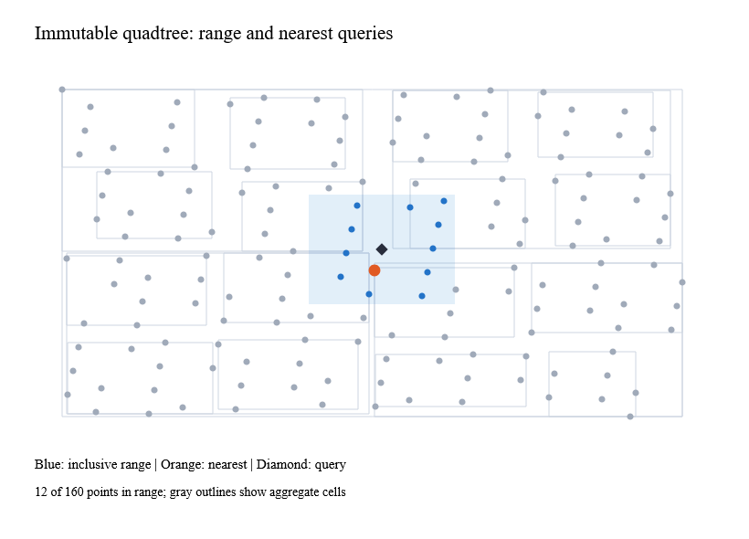

# Immutable quadtree



`Quadtree.build position mass items` captures coordinates and nonnegative masses
once. It retains original values and input indices in immutable leaf buckets;
callers should use immutable values too. Construction uses private mutable
buffers. Queries do not change the tree and can run concurrently.

`within` accepts inclusive `QuadExtent` endpoint bounds and returns values in
input order. `nearest` uses an inclusive radius, accepts positive infinity, and
breaks exact distance ties by input order. Nearly equal, overflowing or
underflowing distances use exact dyadic comparisons. Invalid bounds, negative
or nonfinite masses and an overflowing total mass are rejected.

`visit` receives immutable cell summaries: extent, count, total mass, weighted
center, depth and leaf items. Return false to prune descendants. Zero-mass cells
use the extent midpoint. Mass and centers use floating arithmetic; they are
aggregates, not exact-moment guarantees. Endpoint bounds support finite extremes
whose width would overflow a normal rectangle. Consumers must avoid subtracting
those endpoints without checking the result.

The bulk builder determines finite bounds from all captured points, so no
unbounded doubling/expansion loop is needed. Cells split at representable
midpoints; coincident points stay together. Eight-item leaves, a 64-level cap,
and a representability check bound subdivision. Skewed distributions can leave
larger buckets; queries have linear worst-case cost. Construction is O(n * d),
with d at most 64. Range results cost O(k log k) to restore input order. The
existing k-d index is unchanged.

Local normal measurements for 100,000 grid points: construction 32.7 ms / 37.8 MB;
1,000 nearest queries 1.30 ms / 1.24 MB. Separate time and allocation gates run
on all six platform/build combinations. These are workload measurements, not
guarantees for adversarial distributions.

The native example reuses a captured tree while a Ranvier signal moves the query:

```sh
dotnet run --project examples/Ranvier.D5.Gallery -c Release -- --quadtree
dotnet run --project examples/Ranvier.D5.Gallery -c Release -- --capture-quadtree artifacts/quadtree.bmp
python tools/document-snapshots.py
```
