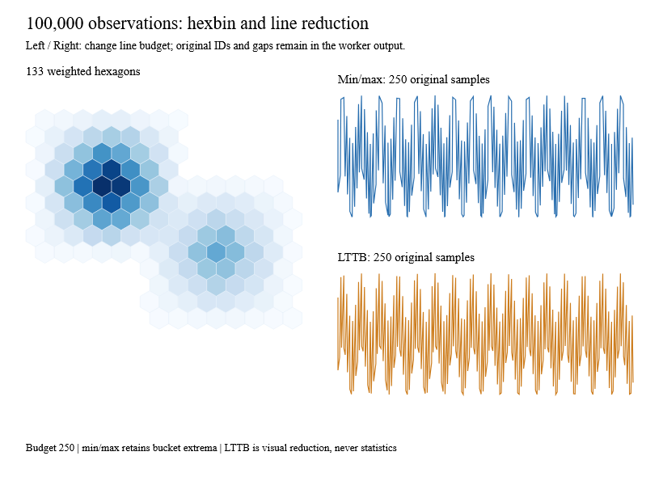

# Hexbin and line reduction



`Hexbin.aggregate` groups keyed weighted points into pointy-top regular hexagons.
`Sampling.minMax` and `Sampling.lttb` reduce ordered series while retaining original
records and IDs. All are pure functions returning typed errors; their cancellation
overloads accept the existing worker's token. Hexbin and LTTB are ecosystem
extensions, not claims of D3 core-module parity.

```fsharp
let bins =
    Hexbin.aggregate
        (HexbinConfig.create (Bounds.create 0. 0. 100. 100.) 5.)
        [{ WeightedPoint.Id = "source-1"
           Position = Point.create 25. 40.
           Weight = 2. }]

let samples =
    [for i in 0..999 ->
        { SeriesSample.Id = string i
          X = float i
          Y = if i = 500 then None else Some(sin(float i / 20.)) }]
let visible = Sampling.minMax (SamplingConfig.create 100) samples
let visualAlternative = Sampling.lttb (SamplingConfig.create 100) samples
// Statistics continue to use the original observations.
let mean = samples |> List.choose (fun sample -> sample.Y) |> Data.mean
```

## Hexagonal aggregation

Radius is the circumradius in input coordinate units. The lattice origin is the
top-left of the configured bounds. Axial keys `(q,r)` place centers at
`origin + radius * (sqrt(3)*(q+r/2), 1.5*r)`. Cube rounding selects the cell:
nearest-even rounding is followed by correction of the largest coordinate error,
with deterministic q/r/third-coordinate tie order. Hexagons can extend beyond the
input bounds; clip the rendered view when needed. `Hexbin.path` returns six
vertices and a closed path with the same circumradius.

IDs must be unique and nonempty, positions must lie inside the inclusive bounds,
and weights must be finite and nonnegative. Zero-weight observations still retain
membership. Members are sorted by ordinal ID before summing weights, so both
membership and floating-point sums are deterministic under input permutation.
Bins are returned in axial-key order. `HexBin.Members` exposes the original IDs;
no observation is invented to represent an aggregate.

Defaults cap input at one million points and output at one million bins. Lattice
coordinates beyond 2^50, unrepresentable centers/corners, collapsed corners and
weight overflow return explicit errors. Radius and bounds must be positive.
Empty input returns no bins. Private mutable buckets never escape.

For N observations and B bins, expected grouping is O(N), canonical ordering costs
O(B log B + sum(k log k)) for bin populations k, and storage is O(N+B).

## Sampling contracts

`SeriesSample` contains an ID, finite X and optional finite Y. `None` denotes a
gap. Input X must be nondecreasing; equal X is allowed and original order is
preserved. IDs must be unique and nonempty. The default input cap is one million.
Neither sampler sorts the series or interpolates replacement observations.

`TargetCount` is a global visible-output cap, including gaps. Each contiguous
observed run retains its endpoints. When reduction is needed, consecutive missing
samples become one marker retaining the first missing sample's ID. Remaining
budget is distributed proportionally across run capacities, with deterministic
largest-remainder allocation. A budget too small for mandatory boundaries returns
`BudgetExceeded`. If no reduction is needed, the original sequence is returned.

Min/max partitions each run's interior into index buckets, retains both extrema
per bucket, and emits them in source order. Equal values choose the earliest
index. A long run requires at least four slots to promise endpoints plus both
interior extrema. Flat buckets and odd budgets can yield fewer samples than the
requested cap. Buckets are uniform in **source index**, not elapsed time.

LTTB uses index buckets, the prior selected point and the next bucket's average
to choose the largest triangle. It reuses `Data.mean`; uncertain, overflowed or
underflowed triangle calculations use the shared exact dyadic arithmetic. Exact
ties choose the earliest candidate. A two-slot run keeps only its endpoints.
LTTB is an optional visual reduction: it does not promise extrema preservation and
must never replace the original observations for statistics.

Both algorithms take O(N) for ordinary single-run input and O(N) temporary storage.
Multiple runs add O(R log R) budget-allocation ordering for R runs. Extreme numeric
area comparisons incur additional BigInteger work. Cancellation checks occur in
validation, grouping and reduction loops; these are cooperative, not real-time
deadlines. Kernel calls create no threads or signals.

## Native example and evidence

[ReductionGallery.fs](../examples/Ranvier.D5.Gallery/ReductionGallery.fs) uses a
Ranvier signal for the visible budget and the existing owned worker for both
100,000-point operations. Anime supplies seeded observations. The scene contains
bounded hexagons and two reduced paths, with original membership/IDs retained in
the worker result. Arrow keys change the line budget. Capture mode updates the
signal and checks membership totals, endpoints and output caps before painting.

```text
dotnet run --project examples/Ranvier.D5.Gallery -c Release -- --reduction
dotnet run --project examples/Ranvier.D5.Gallery -c Release -- --capture-reduction artifacts/reduction.bmp
```

Analytical and generated tests cover lattice spacing, radius, membership/weight
conservation, input permutation, edge ties, invalid data, geometry collapse,
extrema, gaps, endpoints, plateau ties, repeated X, extreme triangle areas and
cancellation. No upstream implementation was copied. Complete density/hexbin/
violin/contour/isoband and reduced-series **chart recipes**, including region-aware
selection, are the next I3 batch; this example composes existing scene primitives.

Local Windows normal Release measurements (60 measured iterations after warm-up):

| 100,000-input workload | Median / p95 | Managed allocation | p95 / allocation gates |
|---|---:|---:|---:|
| Hexbin, radius 8 in 1024² bounds | 43.80 / 59.43 ms | 28.74 MB | 150 ms / 40 MB |
| Min/max to 1,000 samples | 5.40 / 7.28 ms | 9.03 MB | 50 ms / 16 MB |
| LTTB to 1,000 samples | 17.48 / 33.31 ms | 18.59 MB | 75 ms / 24 MB |

These measure worker computation, not native frame latency. CI retains both
normal/Traced variants on Windows, Linux and macOS, plus the existing native
painting and paired regression gates.
