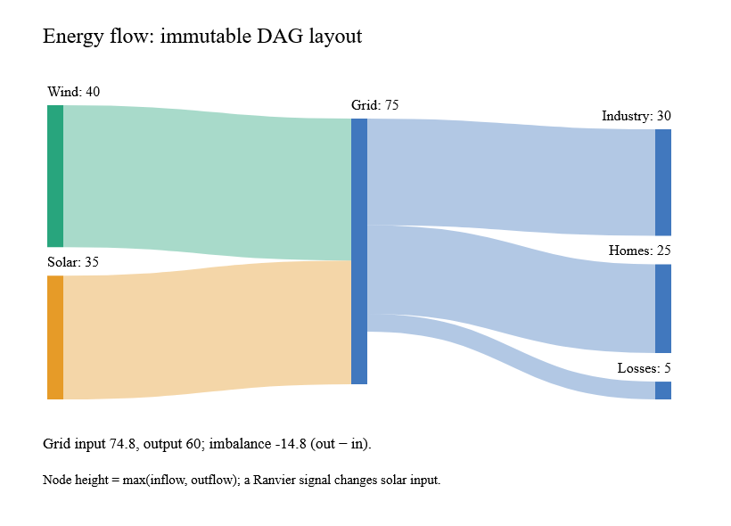

# DAG Sankey layouts

`FlowGraph.create nodeIds links` validates stable string identities, endpoints and
finite nonnegative values. Node and edge identity spaces are separate; parallel
links retain separate IDs. Nodes and links are stored in ordinal ID order, making
layout independent of input enumeration order. Zero-valued links remain part of
the topology. `Sankey.layout config graph` returns immutable nodes and links and
never reads a signal or mutates the input graph.

Node output includes `Inflow`, `Outflow`, `Value=max(inflow,outflow)`, and
`Imbalance=outflow-inflow`. A sink therefore has negative imbalance, a source
positive imbalance. The layout does not invent missing flows or shrink an
unbalanced node to imply conservation. Link widths use one shared scale across all
columns; incoming and outgoing attachment stacks begin at their node's top.

`SankeyAlignment.Left` uses longest source distance, `Right` uses longest sink
distance, `Justify` pushes sinks to the last column, and `Center` moves source-only
nodes immediately before their earliest target while retaining other depths.
Cycles, including self-links and zero-valued cycles, return `InvalidTopology`.
Circular Sankey is not supported.

`NodeWidth` and `NodePadding` are requested sizes in the supplied `Bounds` coordinate
space. Layout rejects widths that cannot fit all columns and padding that cannot
fit a column; it does not silently reduce them. Positive flows require remaining
vertical space. Zero-valued nodes have zero height and retain spaced positions.
Empty graphs return empty lists. Subnormal and very large inputs are normalized
before scaling; unrepresentable per-node totals return `InvalidObservation`.

The initial placement distributes spare column space evenly. Iterative weighted
barycentric relaxation alternates right-to-left and left-to-right; collision
resolution preserves column spacing and viewport bounds. Link attachments sort by
the opposite node's center, with edge ID breaking ties. This is a deterministic
heuristic, not a globally minimal crossing solution or a promise of D3's exact
iterative trajectory. Twelve pinned `d3-sankey` 0.12.3 cases verify initial positions,
values, widths and all four alignments; independent tests cover relaxed invariants.
The reference's BSD-3-Clause license is included in the core package.

Defaults allow 100,000 nodes, 1,000,000 links and six relaxation iterations; valid
iteration counts are 0–256. Storage is O(nodes + links). Each iteration traverses
the links and sorts nodes within columns; final stacking sorts incident links.
`layoutWithCancellation` checks cancellation during indexing, topology traversal,
relaxation and output construction. For expensive graphs, use the existing
`ReactiveLayout` owned worker with immutable inputs and latest-result publication.

The [native example](../examples/Ranvier.D5.Gallery/SankeyGallery.fs) uses a Ranvier
signal to vary solar input and displays the grid's resulting imbalance. Run
`dotnet run --project examples/Ranvier.D5.Gallery -c Release -- --sankey`.
Capture with `--capture-sankey artifacts/sankey.bmp`; the image above is converted
from a working WebCore view. CI captures normal/Traced builds on all three platforms.

A local Windows Traced Release layout of 1,000 nodes and 2,000 links measured
2.26 ms median, 3.11 ms p95 and 1.98 MB allocated. The normal build measured
2.41 ms median and 3.33 ms p95 with the same allocation. CI gates p95 at 25 ms and
allocation at 8 MB, separately from these local measurements. Chart recipes and node dragging
follow in task 8's composition batch.
