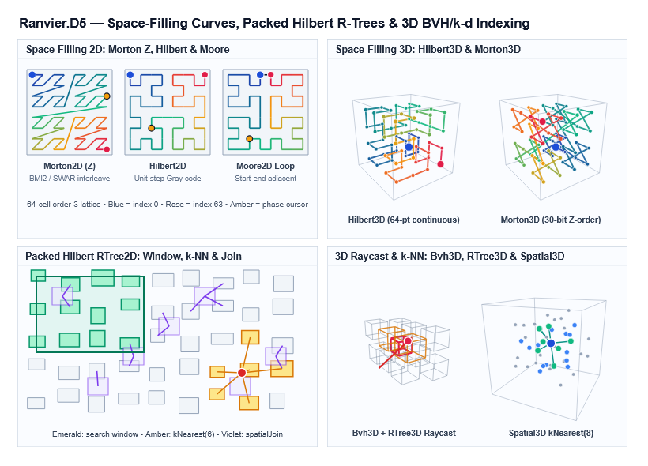
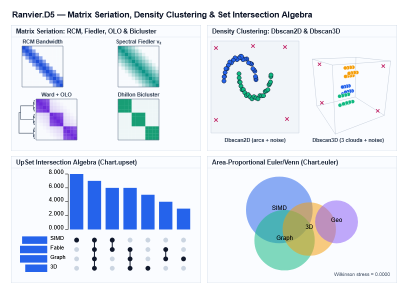
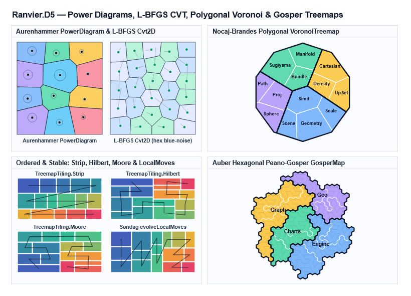
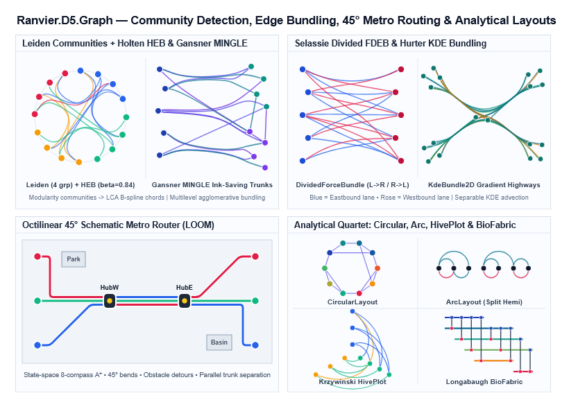
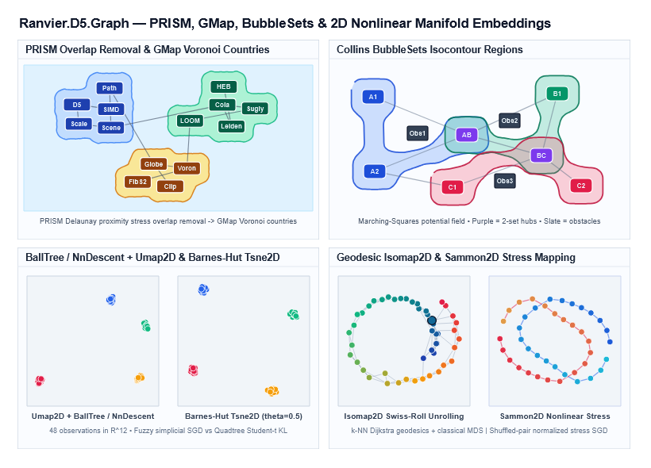
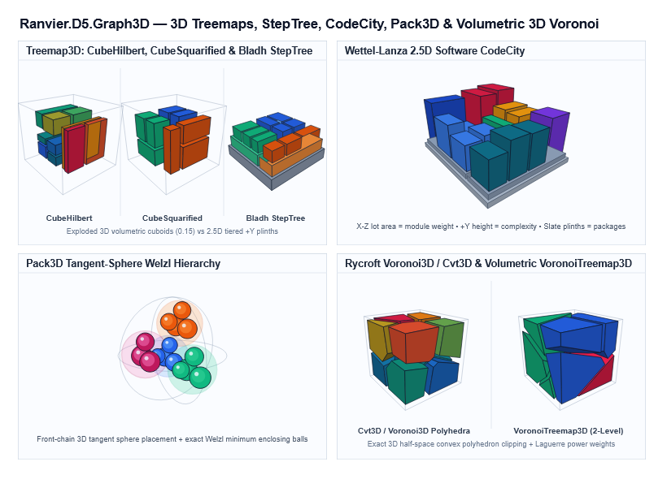
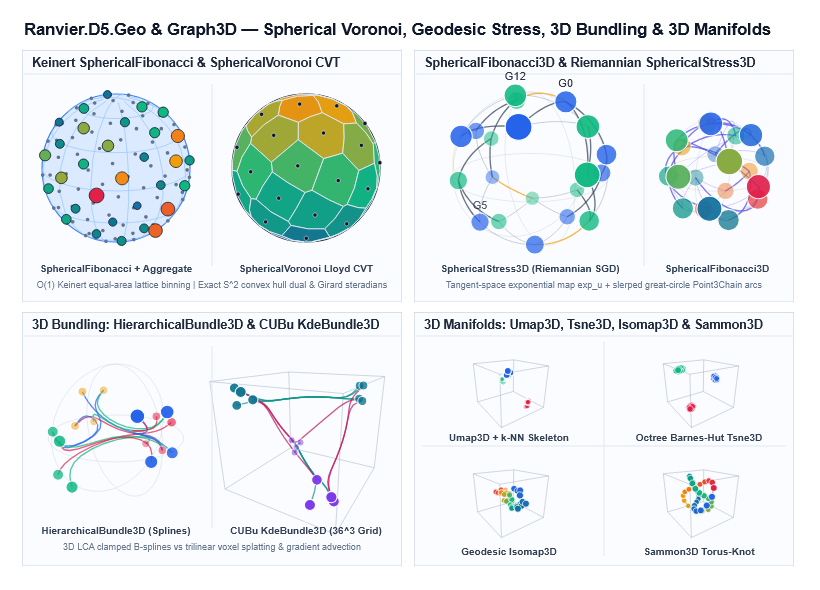
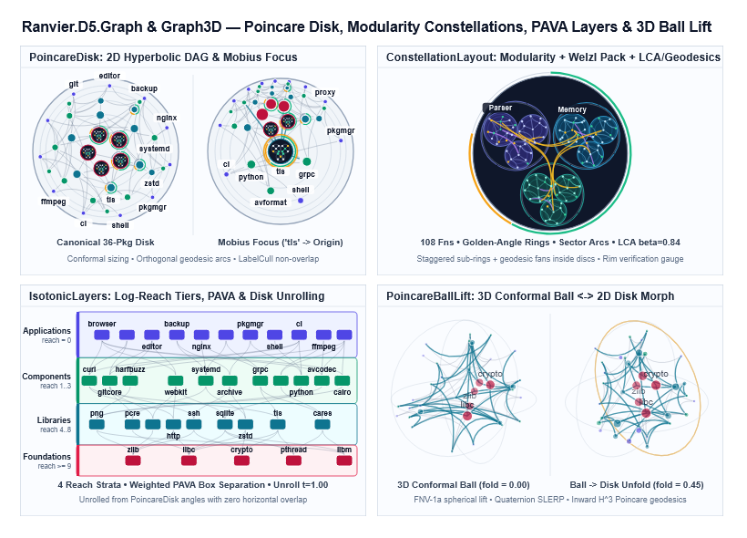

# 2D & 3D Spatial Indexes, Data Organisation, Hierarchy, Bundling & Manifold Engines

Building on the foundational 2D/3D diagram engines in [graph-layouts.md](graph-layouts.md) and the primary-source literature survey in [spatial-and-organisation-research.md](spatial-and-organisation-research.md), `Ranvier.D5` `v0.3.0` provides ten additional families of deterministic, AOT-compatible (`.NET 10` SIMD + `Fickl`/Fable JavaScript) spatial indexing, combinatorial seriation, tessellation, space-filling hierarchy, edge bundling, schematic routing, cluster hull, and high-dimensional manifold engines across 2D and 3D space.

---

## 1. Space-Filling Curves & Static Packed Spatial Indexes (`Ranvier.D5`)

Placed in core `Ranvier.D5` so `Ranvier.D5.Charts`, `Ranvier.D5.Geo`, `Ranvier.D5.Graph`, `Ranvier.D5.Graph3D`, and `Ranvier.D5.Wgpu` share 2D/3D locality ordering and volumetric/box acceleration without cross-package coupling:

| Module | Space | Algorithms & Capabilities |
|---|---|---|
| `Morton2D` & `Morton3D` | 2D & 3D | 16-bit/axis (`uint32`) 2D Z-order and 10-bit/axis (`uint32`) 3D Z-order bijections (`Bmi2` hardware `PDEP`/`PEXT` on x86-64 `.NET 10`, native 32-bit SWAR in Fable JS) + deterministic `orderBy` |
| `Hilbert2D`, `Moore2D` & `Hilbert3D` | 2D & 3D | Skilling (2004) Gray-code bit-transpose continuous space-filling curves (including closed-loop `Moore2D`), `orderBy` spatial sorting, and fractal `curve` polyline generators |
| `RTree2D<'T>` & `RTree3D<'T>` | 2D & 3D | Kamel & Faloutsos (1994) / `Flatbush` static Hilbert-packed AABB trees ($M = 16$, SIMD multi-child pruning): `search`, `within`, `nearest`, `kNearest`, `spatialJoin`, and 3D branchless slab `raycast` |
| `Bvh3D<'T>` | 3D | Karras (2012) $O(N)$ 30-bit Morton binary-radix Bounding Volume Hierarchy (`search`, `raycast`, `raycastClosest`) |
| `Spatial3D` (`SpatialIndex3D<'T>`) | 3D | Exact balanced 3D point k-d tree (`within`, `withinRadius`, `nearest`, `kNearest`) with input-order tie-breaking |



---

## 2. Matrix Seriation, Optimal Leaf Ordering, Density Clustering & Set Algebra (`Ranvier.D5` & `Ranvier.D5.Charts`)

| Module | Domain | Algorithms & Capabilities |
|---|---|---|
| `Seriation` | Graphs & Matrices | Gibbs–Poole–Stockmeyer `reverseCuthillMcKee` bandwidth reduction, Atkins–Boman–Hendrickson `spectralFiedler` Laplacian sequencing, Lance–Williams `hierarchicalCluster` + Bar-Joseph `optimalLeafOrder` ($O(n^3)$ flat-arena DP), and Dhillon/Barycentric `bicluster` |
| `MatrixOrder` (`Chart.adjacencyMatrix`) | 2D Charts | Upgraded with `ReverseCuthillMcKee`, `SpectralFiedler`, `OptimalLeafOrder`, and `Barycenter` |
| `Dbscan2D` & `Dbscan3D` | 2D & 3D | Ester et al. (1996) spatial density clustering (`Core`, border, and explicit `None` noise outliers) accelerated by `Spatial` and `Spatial3D` |
| `UpSet` & `Chart.upset` | Set Algebra / 2D | Lex et al. (2014) multi-word 32-bit bitvector exclusive/inclusive intersection cardinalities, degrees, independence deviation $\Delta(I)$, and combination-matrix chart recipe |
| `EulerVenn` & `Chart.euler` | Set Algebra / 2D | Wilkinson (2012) exact circle-lens inversion + MDS + stress minimization for area-proportional Venn/Euler diagrams |



---

## 3. Power Diagrams, Voronoi Treemaps, Spatially Stable Treemaps & GosperMaps (`Ranvier.D5`)

| Module | Space | Algorithms & Capabilities |
|---|---|---|
| `PowerDiagram` | 2D | Aurenhammer (1987) additively-weighted Laguerre Voronoi tessellation clipped to arbitrary convex polygons or `Bounds` |
| `VoronoiTreemap` | 2D | Nocaj & Brandes (2012) resolution-independent hierarchical polygonal treemap (centroidal position + inscribed-bounded power weight adaptation in rectangles or regular $k$-gons) |
| `Cvt2D` | 2D | Du–Faber–Gunzburger Lloyd and Liu et al. (2009) quasi-Newton L-BFGS Centroidal Voronoi Tessellation |
| `Voronoi3D` & `Cvt3D` | 3D | Rycroft (2009) `Voro++` zero-allocation arena 3D convex polyhedron radical/power clipper (`PolyhedronCell3D` vertices, faces, volume, centroid) and 3D CVT |
| `Treemap` (`Strip`, `Hilbert`, `Moore`, `evolveLocalMoves`) | 2D | Bederson (2002) ordered strip tiling, Tak & Cockburn (2013) Hilbert/Moore space-filling tilings, and Sondag et al. (2018) aspect-improving local-move dynamic treemap updates |
| `GosperMap` | 2D | Auber et al. (2013) order-$k$ Peano–Gosper hexagonal curve treemap with nested territory contours and border-locked Chaikin smoothing |



---

## 4. Community Hierarchy, Edge Bundling, $45^\circ$ Metro Routing & Analytical Views (`Ranvier.D5.Graph`)

| Module | Space | Algorithms & Capabilities |
|---|---|---|
| `Leiden` | Graph Org | Traag, Waltman & van Eck (2019) Modularity & Constant Potts Model community detection with guaranteed connected refinement, multilevel CSR aggregation, `toHierarchy`, and `applyGroups` |
| `HierarchicalBundle`, `DividedForceBundle`, `MingleBundle` & `KdeBundle2D` | 2D | Holten (2006) LCA B-spline bundling, Selassie et al. (2011) directional lane-separated FDEB, Gansner et al. (2011) $O(E \log E)$ agglomerative ink-saving MINGLE, and Hurter et al. (2012) linear-time $O(I(ES + G^2))$ kernel density advection |
| `OctilinearRouter` | 2D | Nöllenburg & Wolff (2011) / Bast, Brosi & Storandt `LOOM` (2020) $45^\circ$ compass-octant schematic metro-map A* router with obtuse $135^\circ$ bend preference and parallel trunk track ordering |
| `CircularLayout`, `ArcLayout`, `HivePlot` & `BioFabric` | 2D | Baur & Brandes (2005) greedy + $O(VE)$ sifting crossing-minimized circular/arc layouts, Krzywinski (2012) rational multi/split-axis Hive Plots, and Longabaugh (2012) shadow-sorted BioFabric strands |



---

## 5. Cluster Regions & 2D Nonlinear Manifold Embeddings (`Ranvier.D5.Graph`)

| Module | Space | Algorithms & Capabilities |
|---|---|---|
| `PrismOverlap`, `GMap` & `BubbleSets` | 2D | Gansner & Hu (2010) isotropic Delaunay proximity-stress box overlap removal, Gansner–Hu–Kobourov (2010) Voronoi country polygons, and Collins et al. (2009) Marching-Squares concave set contours |
| `BallTree`, `NnDescent`, `Umap2D`, `Tsne2D`, `Isomap2D` & `Sammon2D` | High-$D \to$ 2D | SIMD row-matrix distance kernels (`Euclidean`, `Cosine`, `Manhattan`, `Correlation`), metric `BallTree` (chordal sphere lifting for cosine/correlation), Dong `NN-Descent`, McInnes UMAP, van der Maaten $O(N \log N)$ Barnes–Hut t-SNE (`BhQuadtree2D`), Landmark Nyström Isomap, and Sammon mapping |



---

## 6. 3D Space-Filling Hierarchies, CodeCity, Pack3D & Volumetric 3D Voronoi (`Ranvier.D5.Graph3D`)

| Module | Space | Algorithms & Capabilities |
|---|---|---|
| `Treemap3D` & `CodeCity` | 2.5D & 3D | `CubeSquarified`, `CubeHilbert`, `CubeSliceDice`, Bladh et al. (2004) tiered `StepTree`, exploded Information Cubes, and Wettel & Lanza (2007) bivariate `CodeCity` districts & buildings |
| `Pack3D` & `VoronoiTreemap3D` | 3D | Hierarchical 3D advancing-front tangent sphere packing with Welzl (1991) miniball, plus recursive 3D volumetric Laguerre `VoronoiTreemap3D` |



---

## 7. Spherical Tessellations, $\mathbb{S}^2$ Geodesic Stress, 3D Bundling & 3D Manifolds (`Ranvier.D5.Geo` & `Ranvier.D5.Graph3D`)

| Module | Space | Algorithms & Capabilities |
|---|---|---|
| `SphericalFibonacci` & `SphericalVoronoi` (`Ranvier.D5.Geo`) | 3D / $\mathbb{S}^2$ | Keinert et al. (2015) $O(1)$ forward lattice + closed-form $O(1)$ `nearestCell` (`inverseSF`) pole-free equal-area globe binning, plus 3D convex-hull `SphericalVoronoi` & `relaxCvt` |
| `SphericalStress3D` & `SphericalFibonacci3D` (`Ranvier.D5.Graph3D`) | 3D / $\mathbb{S}^2$ | Positive-curvature Riemannian SGD geodesic stress layout on $\mathbb{S}^2$ with great-circle arc routing (`Point3Chain`), completing $\mathbb{R}^3$, $\mathbb{H}^3$, and $\mathbb{S}^2$ in `Ranvier.D5.Graph3D` |
| `HierarchicalBundle3D` & `KdeBundle3D` (`Ranvier.D5.Graph3D`) | 3D | 3D LCA cubic B-spline bundling and $O(I(ES + G^3))$ volumetric separable kernel-density advection (`CUBu`) |
| `Umap3D`, `Tsne3D`, `Isomap3D` & `Sammon3D` (`Ranvier.D5.Graph3D`) | High-$D \to$ 3D | 3D fuzzy-simplicial UMAP, 3D Octree Barnes–Hut Student-$t$ t-SNE (`BhOctreeWorkspace`), 3D geodesic Isomap, and 3D Sammon mapping |



---

## 8. 2D Poincaré Disk DAGs, Multi-Scale Constellations, PAVA Isotonic Unrolling & 3D Conformal Ball Lift (`Ranvier.D5.Graph` & `Ranvier.D5.Graph3D`)

| Module | Space | Algorithms & Capabilities |
|---|---|---|
| `Hyperbolic2D` & `PoincareDisk` (`Ranvier.D5.Graph`) | 2D / $\mathbb{D}^2$ | Open unit Poincaré disk, Lamping–Rao–Pirolli (1995) conformal Möbius focus automorphism $T_a(z) = \frac{z - a}{1 - \bar{a} z}$ (`focusNode`, `focusPoint`), orthogonal Poincaré geodesic circular arcs (`ArcTo`), segmented outer progress/category rim gauges (`rimGaugeArcs`), perimeter group `sectorArcs`, dominant-parent spanning-forest bouquet wedges (`PoincareRingOrder`), hub-vs-stardust topological sizing (`PoincareSizeBy`), `HubCount` promotion, and $\sinh(d)$-weighted golden-angle ($\pi(3 - \sqrt{5})$) multi-row `SplitDenseRings` |
| `ConstellationLayout` (`Ranvier.D5.Graph`) | 2D | Multi-scale compound module/call-graph constellations: `ExplicitGroups`, `LeidenAuto`, `HybridGroupsAndLeiden`, or `DirectoryModularity` (slash-path tree + greedy Newman–Girvan modularity agglomeration + bottom-up tree DP + sparse satellite coalescing), recursive front-chain circle packing + exact Apollonius/Welzl minimum enclosing discs (`encloseDiscs`), tight `InnerRadius` dashed directory rims + annular tangent `SectorArcs`, leaf `InnerRingRadii` + orthogonal Poincaré geodesics, ancestor-only midpoint `QuadraticTo` spline curtains, and recursive "graph-in-disc" LOD miniatures (`DiscInlay`, `inlaySubgraphs`) |
| `Pava`, `IsotonicLayers` & `LabelCull` (`Ranvier.D5.Graph`) | 2D | Exact $O(n)$ weighted Pool Adjacent Violators (`Pava.solveWeighted`) box separation, bitset transitive reach (`computeReach`), water-filling stratified bands (`IsotonicLayers`) with `PoincareDisk` angular unrolling and continuous `interpolate` morphing, plus uniform spatial-grid `LabelCull.select` |
| `PoincareBallLift` (`Ranvier.D5.Graph3D`) | 2D $\leftrightarrow$ 3D | Conformal 2D Poincaré disk $\to$ 3D Poincaré ball lifting (FNV-1a deterministic spherical elevation, $\tanh(\operatorname{atanh}(\rho)\cdot\text{boost})$ radial boost, quaternion SLERP rotation, conformal ball scaling, inward $\mathbb{H}^3$ geodesic chains, and continuous `morph` `fold: 0 -> 1`) |



---

## Reproducing Interactive Native Views & Lossless Captures

```sh
# Interactive SDL + WebCore showcase windows
dotnet run --project examples/Ranvier.D5.Gallery -c Release -- --spatial-indexing
dotnet run --project examples/Ranvier.D5.Gallery -c Release -- --seriation-sets
dotnet run --project examples/Ranvier.D5.Gallery -c Release -- --voronoi-treemaps
dotnet run --project examples/Ranvier.D5.Gallery -c Release -- --bundling-routing
dotnet run --project examples/Ranvier.D5.Gallery -c Release -- --cluster-manifolds-2d
dotnet run --project examples/Ranvier.D5.Gallery -c Release -- --hierarchies-3d
dotnet run --project examples/Ranvier.D5.Gallery -c Release -- --spherical-manifolds-3d
dotnet run --project examples/Ranvier.D5.Gallery -c Release -- --atlas-recipes

# Headless native BMP captures + lossless PNG conversion
dotnet run --project examples/Ranvier.D5.Gallery -c Release -- --capture-spatial-indexing artifacts/spatial-indexing.bmp
dotnet run --project examples/Ranvier.D5.Gallery -c Release -- --capture-seriation-sets artifacts/seriation-sets.bmp
dotnet run --project examples/Ranvier.D5.Gallery -c Release -- --capture-voronoi-treemaps artifacts/voronoi-treemaps.bmp
dotnet run --project examples/Ranvier.D5.Gallery -c Release -- --capture-bundling-routing artifacts/bundling-routing.bmp
dotnet run --project examples/Ranvier.D5.Gallery -c Release -- --capture-cluster-manifolds-2d artifacts/cluster-manifolds-2d.bmp
dotnet run --project examples/Ranvier.D5.Gallery -c Release -- --capture-hierarchies-3d artifacts/hierarchies-3d.bmp
dotnet run --project examples/Ranvier.D5.Gallery -c Release -- --capture-spherical-manifolds-3d artifacts/spherical-manifolds-3d.bmp
dotnet run --project examples/Ranvier.D5.Gallery -c Release -- --capture-atlas-recipes artifacts/atlas-recipes.bmp
python tools/document-snapshots.py
```

---

## Measured Release Performance (`Ranvier.D5.Graph.Benchmarks`)

All figures below are **measured here** via `dotnet run --project benchmarks/Ranvier.D5.Graph.Benchmarks -c Release -- artifacts/graph-benchmarks.json` on `.NET 10.0` (Windows x64 Release):

| Benchmark Contract | Median (`ms`) | p95 (`ms`) | Allocated (`bytes`) |
|---|---:|---:|---:|
| `rtree2d-hilbert-build-and-200-queries-10000` | `3.438` | `4.758` | `1,612,176` |
| `bvh3d-morton-build-and-500-raycasts-5000` | `1.454` | `1.768` | `1,590,152` |
| `seriation-olo-ward-120-items` | `1.432` | `2.039` | `662,736` |
| `leiden-modularity-1000-nodes` | `2.108` | `10.855` | `4,387,992` |
| `voronoi-treemap-2d-80-leaves` | `3.749` | `17.186` | `2,690,392` |
| `voronoi3d-polyhedral-clip-250-sites` | `9.192` | `20.265` | `15,436,800` |
| `gospermap-hex-hierarchy-120-leaves` | `0.478` | `0.792` | `902,168` |
| `spherical-fibonacci-voronoi-300-sites` | `14.609` | `16.998` | `666,768` |
| `kde-bundle-2d-400-edges` | `4.411` | `9.403` | `4,893,736` |
| `mingle-bundle-2d-400-edges` | `17.020` | `29.485` | `1,213,032` |
| `octilinear-metro-router-40-edges` | `0.228` | `0.288` | `322,656` |
| `bubblesets-contours-120-nodes` | `5.803` | `19.272` | `5,825,856` |
| `umap2d-250-points-16d` | `33.287` | `40.110` | `327,272` |
| `tsne2d-barnes-hut-250-points-16d` | `21.508` | `23.259` | `1,366,008` |
| `codecity-treemap3d-300-nodes` | `0.188` | `0.329` | `329,520` |
| `pack3d-spheres-300-nodes` | `3.550` | `6.053` | `490,640` |
| `spherical-stress-3d-250-nodes` | `27.896` | `30.807` | `1,954,208` |
| `kde-bundle-3d-300-edges` | `4.423` | `5.821` | `1,278,192` |
| `umap3d-250-points-16d` | `33.413` | `35.348` | `331,608` |
| `tsne3d-barnes-hut-250-points-16d` | `26.728` | `29.352` | `1,595,752` |
| `poincare-disk-2d-500-nodes-1000-edges` | `1.608` | `7.008` | `1,837,032` |
| `constellation-hybrid-300-nodes-600-edges` | `1.100` | `2.791` | `2,722,672` |
| `isotonic-layers-pava-500-nodes` | `1.402` | `3.307` | `2,592,688` |
| `poincare-ball-lift-3d-500-nodes` | `0.758` | `1.698` | `1,526,168` |
