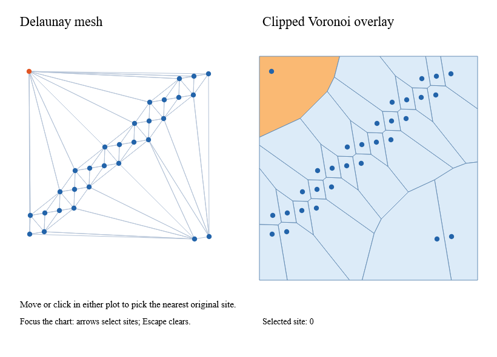

# Triangulation, Voronoi and native picking



`Delaunay.build points` constructs an immutable mesh. Unique sites retain their
first-occurrence order. `sites`, `triangles`, `halfedges`, `hull`, `neighbors` and
`inputIndices` return copies. Triangle triples are strictly counterclockwise in
Cartesian coordinates (visually clockwise in SVG). Each halfedge starts at its
triangle's corresponding vertex; its opposite is -1 at the hull boundary.

Exact duplicate coordinates share one site; `inputIndices` maps it back to all
original input identities. Nearly coincident sites are never silently merged.
`nearest query mesh` returns the nearest **original input index**, with exact
distance ties resolved by input order. This distinction matters when a chart
joins values by semantic ID: retain the original data array and use that index.

Empty inputs produce empty arrays and no nearest site. A singleton has one hull
site and no triangles. Collinear sites form a lexicographically ordered chain
with adjacent-site neighbors; no jitter or invented area is added. Cocircular
diagonals are deterministic for the same input order, but are not a promise of
the same diagonal as D3 or under input permutation.

The fast kernel adapts Delaunator 5.1.0 under its included ISC license. Search
heuristics use power-of-two normalized coordinates; topology tests always use
the original coordinates and exact-sign predicates. The legalization stack is
owned by each build and has no fixed-cap truncation. If normalization collapses
distinct sites, a seed is not representable, or radial insertion cannot locate a
visible edge, construction falls back to hull triangulation, exact point
insertion and Lawson edge flips. This fallback preserves extreme finite inputs
but can be substantially slower: insertion is quadratic and each legalization
pass scans the mesh. Large pathological datasets should run in a worker.
These pure kernels currently have no internal cancellation checkpoints.

`Voronoi.clip bounds mesh` returns one cell per unique site, with all original
input indices. It clips the finite viewport against neighboring-site bisectors;
sites outside the viewport can have empty cells. Vertices do not repeat the
closing point. Bisector classification uses exact fallback arithmetic;
intersection coordinates round to doubles and are clamped to segment bounds.
Zero-width/height viewports can produce point or line cells. This is a planar
pipeline, not geographic projection or spherical geometry.

Validation includes pinned d3-delaunay 6.0.4 adjacency and cell-area fixtures,
empty-circumcircle checks, halfedge/adjacency symmetry, duplicate identity,
extreme/subnormal coordinates, viewport area conservation and a 100,000-site
grid. Integer predicate fast paths use explicit representability bounds; they
do not replace near-zero values with an epsilon-based topology decision.

Performance gates cover 100,000-site construction (p95 1,000 ms / 300 MB managed
allocation) and 10,000 clipped cells (500 ms / 150 MB). These are batch workload
budgets, not frame-rate claims. Reuse the immutable mesh and cell geometry while
updating query/selection signals. Rendering 100,000 SVG cells is not the intended
interactive path; clip, aggregate or reduce visible output first.

The native example uses the existing screen-to-SVG input adapter. Pointer moves
and clicks query the retained mesh, and Ranvier signals update the highlight.
Arrow keys select sites; Escape clears. CI captures the view after a real native
click and checks the selected original index.

```sh
dotnet run --project examples/Ranvier.D5.Gallery -c Release -- --spatial
dotnet run --project examples/Ranvier.D5.Gallery -c Release -- --capture-spatial artifacts/spatial.bmp
python tools/document-snapshots.py
```
