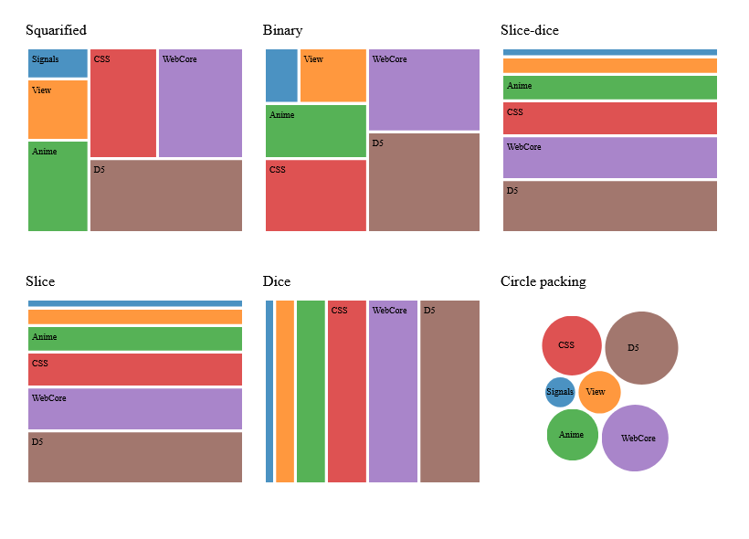

# Treemaps and circle packing



Captured from the working [native tiling example](../examples/Ranvier.D5.Gallery/TilingGallery.fs).

```fsharp
let config = TreemapConfig.create (Bounds.create 0. 0. 800. 600.)
let cells = Treemap.layout config hierarchy
let updated = Treemap.resquarify config hierarchy previousState
let circles = Pack.layout (PackConfig.create config.Bounds) hierarchy
```

Treemap supports Slice, Dice, SliceDice, Binary and Squarified modes. Input sibling
order is stable. IncludeOwnWeight reserves blank area for a branch's own weight;
LeavesOnly ignores branch weights. All-zero siblings share space equally.
Padding is an inset at each depth and clamps small cells to zero area.

Resquarify returns both the boxes and an opaque immutable state. Keep that state
in the caller, including a Ranvier signal if needed. Matching topology and
configuration reuse row membership and orientation when weights change. Bounds,
padding, ratio, sum policy, or topology changes reset the rows. There is no global
cache or mutation of the supplied hierarchy.

Pack uses deterministic front-chain sibling placement adapted from d3-hierarchy
3.1.2 (ISC), followed by a conservative linear enclosure. It does **not** promise
D3's minimum enclosing circle or identical coordinates. Leaf areas preserve
weight ratios; internal circles enclose their children. Default weights are
LeavesOnly; IncludeOwnWeight reserves a packed circle for a branch's own weight.
All-zero trees give leaves equal radii. Padding is approximate after fitting the
whole hierarchy to the bounds; large padding and deep nesting reduce the final
gap. Zero-sized bounds produce zero radii.

The implementation uses private buffers and iterative traversals. Tests cover
50,000-node chains, 10,000-child packing, containment, sibling nonoverlap, weight
ratios and retained-state invalidation. Development-machine medians for 10,000
siblings were 7.50 ms for squarified treemap and 35.81 ms for packing. Use the owned
ReactiveLayout worker for expensive layouts; a large pack should not run on the
input or paint thread. CI gates time and allocation and retains native captures
on Windows, Linux and macOS, normal and Traced.

```sh
dotnet run --project examples/Ranvier.D5.Gallery -c Release -- --tiling
dotnet run --project examples/Ranvier.D5.Gallery -c Release -- --capture-tiling artifacts/tiling.bmp
python tools/document-snapshots.py
```
