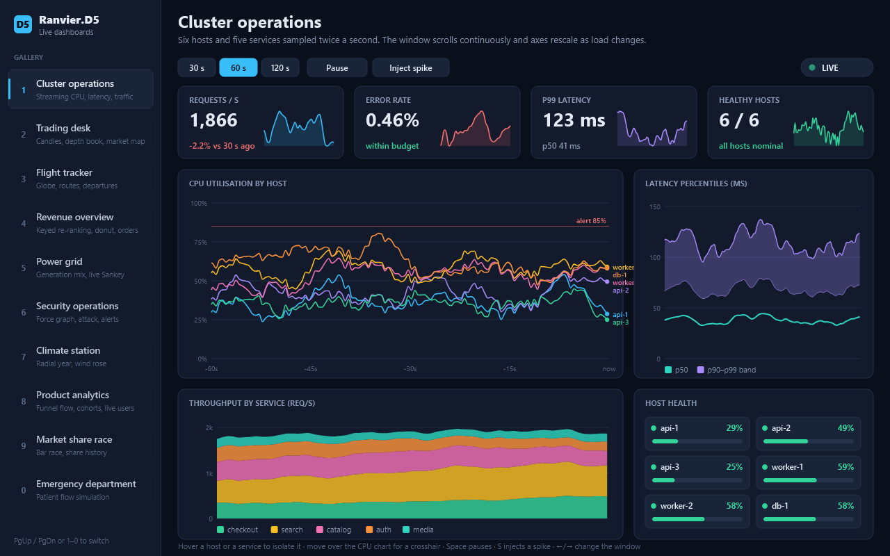
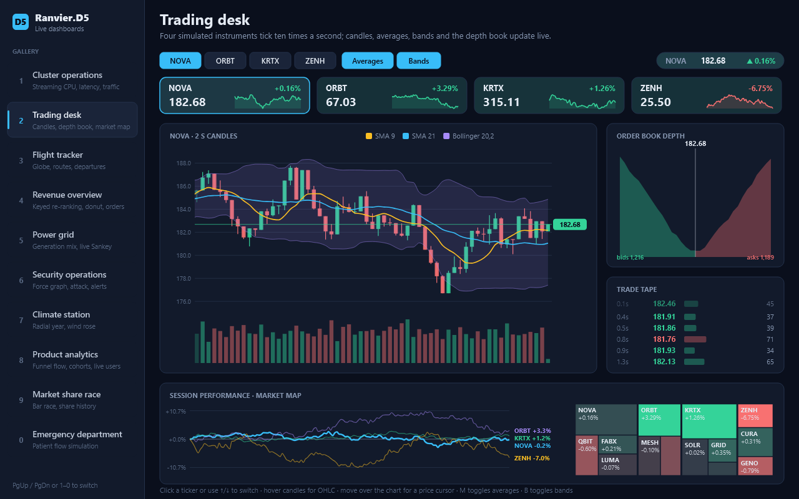
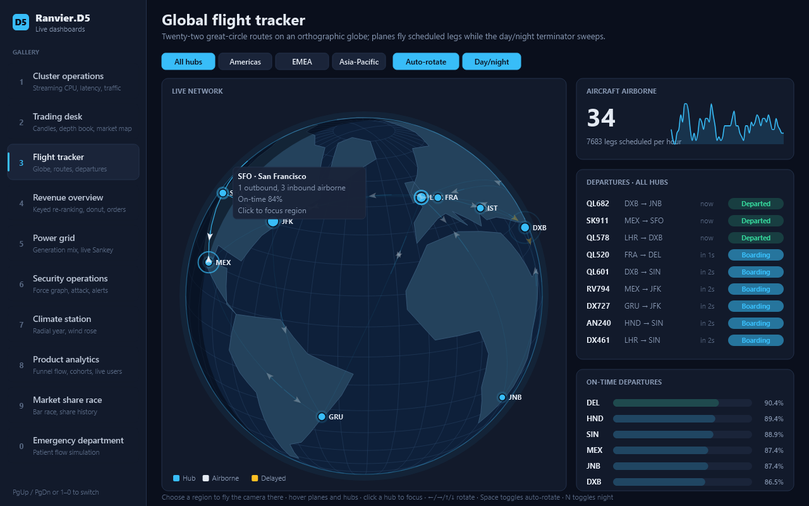
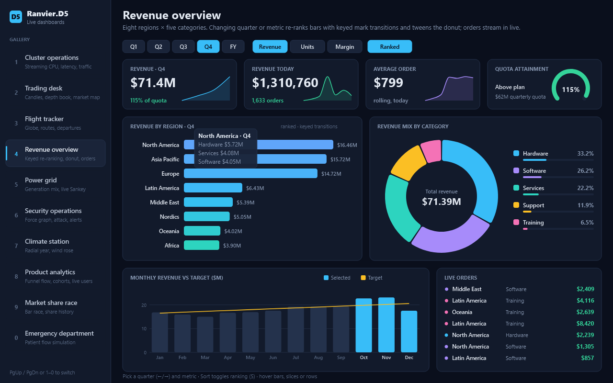
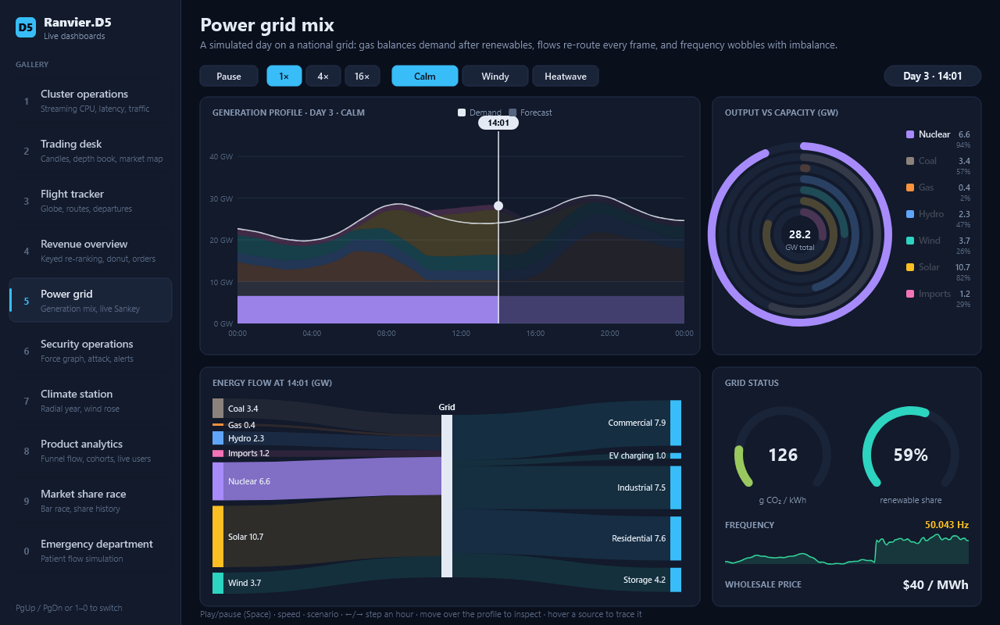
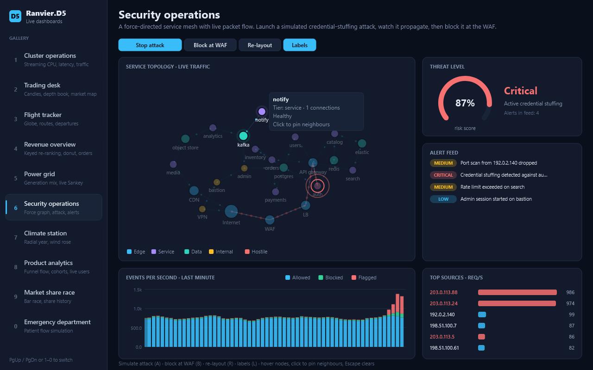
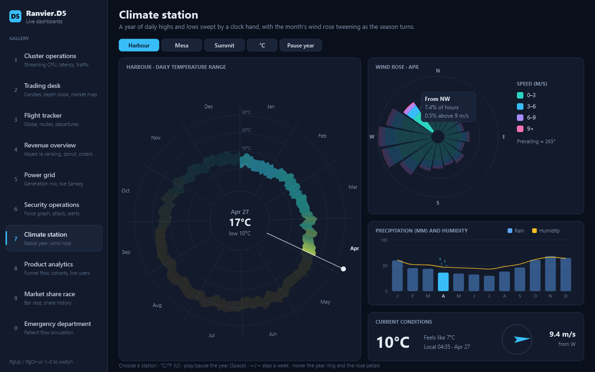
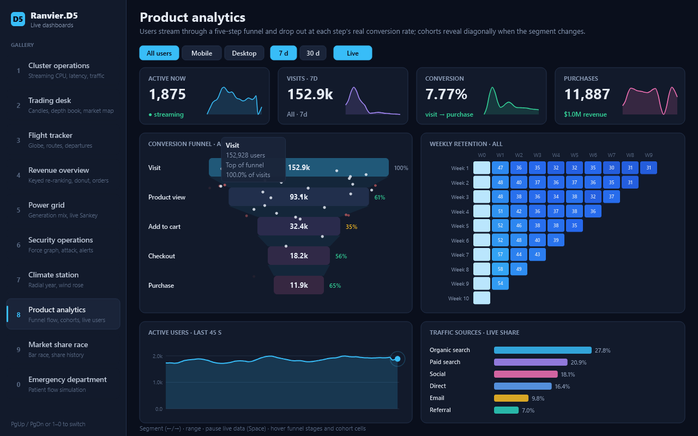
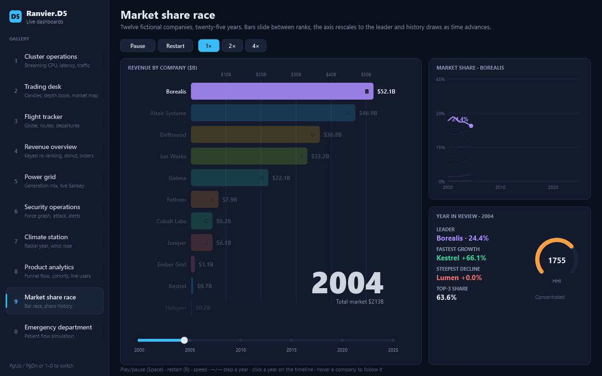
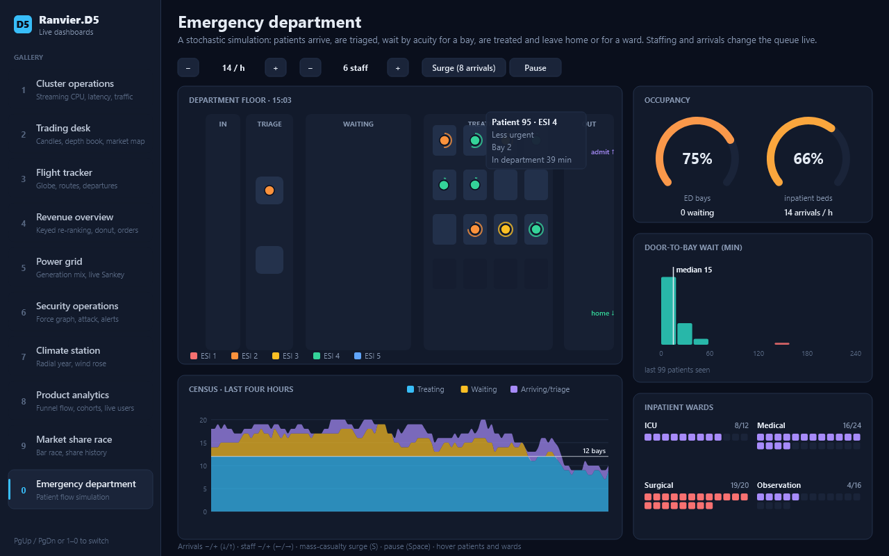

# Live dashboards

This is a native Ranvier app: a gallery of ten animated dashboards modelled on real-world tools. Everything is
drawn with Ranvier.D5 marks and layouts, kept reactive by Ranvier signals and rendered by Ranvier View on WebCore.
It uses no other charting, UI or animation library.

```bash
dotnet run --project examples/Ranvier.D5.Dashboards -c Release
```

Pick a dashboard from the sidebar. You can also switch with `PgUp`/`PgDn` or the keys `1`–`0`. To open one directly,
pass `-- --dashboard <id>`, for example `-- --dashboard flights`.

## How it is built

Each dashboard is a pure model: `Init`, `Tick dt`, `Input` and `View`, in [Kit.fs](Kit.fs). Its state is immutable
and its randomness uses an explicit `RandomState`, so the same inputs always produce the same frames.

The shell in [Shell.fs](Shell.fs) holds one immutable `Live` value per dashboard in a Ranvier signal, and advances
only the active one on each window frame. A single retained scene contains the sidebar and the active dashboard.

Native events reach the model like this:

- **Clicks on controls:** marks grouped as `b:<id>` arrive as `Input.Click`.
- **Clicks on data items:** marks grouped as `h:<id>` arrive as `Input.Pick`.
- **Hover:** pointer moves over `h:<id>` groups arrive as `Input.Hover`.
- **Pointer position:** every move also sends the position in content coordinates, for crosshairs and scrubbing.
- **Keys:** keyboard input arrives as `Input.Key`.

Motion comes from four mechanisms:

- **Smoothing:** displayed values approach their targets with a frame-rate-independent exponential (`Kit.approach`).
- **Keyed transitions:** D5 `KeyedTransition` re-ranks the sales bars.
- **Anime easings:** easing functions from Ranvier.Anime shape transitions.
- **Simulation:** some dashboards simply advance their own simulated clock.

## The dashboards

| | Dashboard | What moves | Inputs | Ranvier.D5 features used |
|---|---|---|---|---|
|  | **Cluster operations** | CPU, latency and traffic stream twice a second while the window scrolls continuously. Axes rescale, KPIs count to new values, and hot hosts pulse. | Window size, pause, spike injection; host and service hover; CPU crosshair | `Scale`, `Curves` monotone lines and areas, `Stack`, `Format` |
|  | **Trading desk** | Four instruments tick ten times a second. Candles form live, averages and Bollinger bands follow, and the depth book jitters. A trade tape slides in, and a treemap market map re-tiles as caps drift. | Symbol, averages, bands; candle hover (OHLC); price cursor; market-map hover | `Random` (normal and log-normal draws), `Treemap` (binary tiling), `Hierarchy` |
|  | **Flight tracker** | An orthographic globe rotates while a day/night terminator sweeps. Planes fly great-circle legs with trails, and hubs pulse on departures. | Region (the camera flies there), auto-rotate, night shading, arrow keys; plane and hub hover; hub click | `Ranvier.D5.Geo`: `Projection`, `GeoPath`, `Graticule`, `Geodesic.interpolate`, `GeoMeasure.area` |
|  | **Revenue overview** | Regional bars slide to new ranks with keyed mark transitions, and the category donut tweens. KPIs count, the current month's bar pulses and orders stream in. | Quarter, metric, ranking; bar, slice and row hover | `KeyedTransition`, `Shapes.arc` (padding and corner radius), `Scale.band` |
|  | **Power grid** | A simulated day plays out. The generation stack sweeps under a clock, and a live Sankey re-routes sources to sectors every frame. Capacity rings fill and empty, and grid frequency wobbles with imbalance. | Play/pause, speed, scenario (calm, windy, heatwave), hour stepping; profile scrubbing; source hover | `Stack`, `Sankey` + `FlowGraph`, `Shape.linkHorizontal` |
|  | **Security operations** | A force-directed service mesh carries packets along every edge. A credential-stuffing drill turns the edge path red until the attack is blocked at the WAF. The threat gauge, event bars, top sources and alert feed all react. | Start/stop attack, block, re-layout, labels; node hover and pinning | `Force` (many-body, collision, x/y), `GraphData` |
|  | **Climate station** | A clock hand sweeps a radial year of daily highs and lows. The wind rose tweens between months, rain falls on the current month and the compass gusts. | Station, °C/°F, play/pause, week stepping; year-ring and petal hover | `Shape.arc` radial bars, `Shapes.arc`, `Scale.sqrt` |
|  | **Product analytics** | Users flow down a funnel and drop out at each step's conversion rate. Cohort cells reveal diagonally, active users stream, and traffic sources re-sort. | Segment, range, live toggle; stage and cohort-cell hover | `Scale`, `Curves`, Anime easing |
|  | **Market share race** | Twelve fictional companies race across 25 years. Bars slide between ranks while the axis rescales to the leader. A share history draws progressively, and the year in review includes an HHI gauge. | Play/pause, restart, speed, year stepping, timeline clicks; company hover | `Scale.ticks`, `Curves` |
|  | **Emergency department** | In a stochastic simulation, each patient is a token. It moves through triage and acuity-ordered waiting into treatment bays, then home or to a ward. A census stack, wait histogram, occupancy gauges and ward bed grids follow the simulation. | Arrival rate, staffing, mass-casualty surge, pause; patient and ward hover | `Random` (exponential, uniform, log-normal), `Data.bin`, `Stack` |

## Verification

```bash
dotnet run --project examples/Ranvier.D5.Dashboards -c Release -- --capture artifacts/dashboards
```

The capture runs in two stages.

1. **Pure soak.** Each model runs for 20 simulated seconds. The soak clicks every control and hovers every item it
   exposes, and composes a scene every fifth frame. It serialises every path, so duplicate keys and non-finite or
   extreme coordinates fail with the offending mark's path.
2. **Native checks.** For every dashboard, the run checks five things:
   - a real sidebar click opens it;
   - painted pixels keep changing, which shows it animates;
   - it paints enough of the content area, in enough colours;
   - a native pointer sweep reaches a hoverable data item;
   - native clicks on its toolbar controls change the view.

   Keyboard navigation is checked once, after the last dashboard.

Each dashboard is written to `artifacts/dashboards/<id>.bmp`. Convert the captures with `python tools/document-snapshots.py`.
