# Native examples

Every image below comes from a working native WebCore view.

## Bounded geographic projections

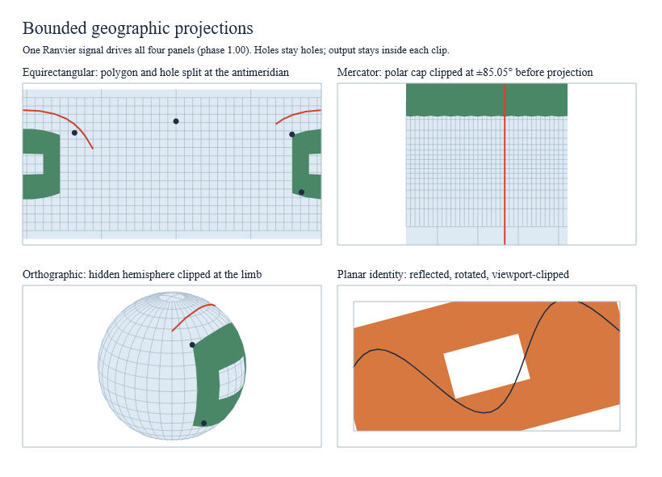

Run `--projections`; capture with `--capture-projections artifacts/projections.bmp`.
One signal rotates all four panels. The capture paints two phases and fails unless
native pixels show filled polygons, open holes and the clipped Mercator polar cap.
[Source](ProjectionGallery.fs) · [Pipeline contracts](../../docs/geographic-projections.md).

## Planar geometry

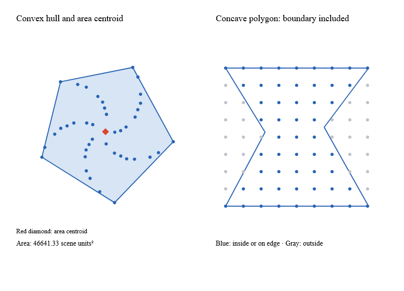

Run `--planar`; capture with `--capture-planar artifacts/planar.bmp`.
[Source](PlanarGallery.fs) · [Numeric and boundary contracts](../../docs/planar.md).

## Hierarchy chart family and explorer

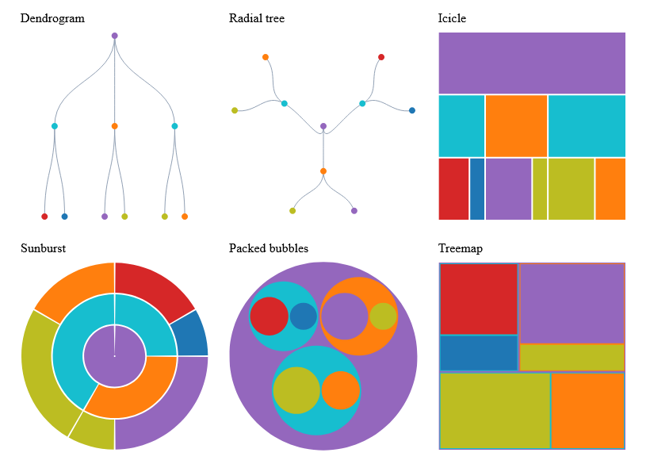

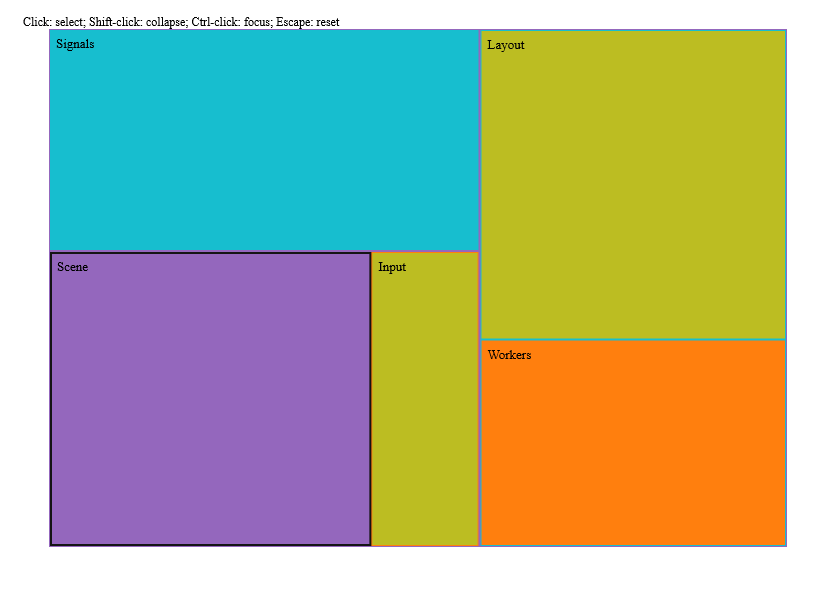

Run `--hierarchy-charts` or `--hierarchy-explorer`. The explorer supports selection,
collapse, drill-down and transitions using Ranvier signals and the owned worker.
[Source](HierarchyExplorer.fs) · [Interaction and capture instructions](../../docs/hierarchy-charts.md).

## Hierarchy layouts

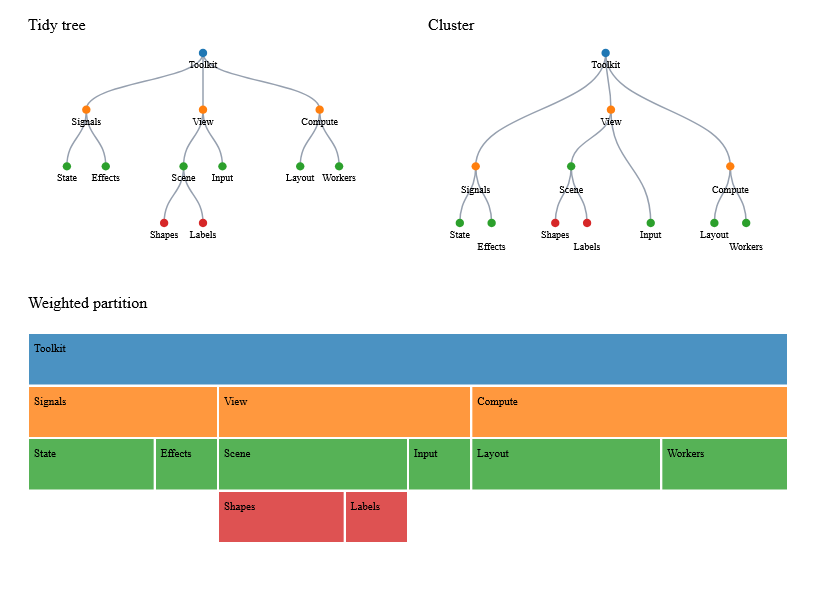

Run with `--hierarchy`; capture with `--capture-hierarchy artifacts/hierarchy.bmp`.
The example composes pure tidy-tree, cluster and partition outputs into retained
SVG marks. [Source](HierarchyGallery.fs) · [Contracts](../../docs/hierarchy.md).

## Treemaps and packing

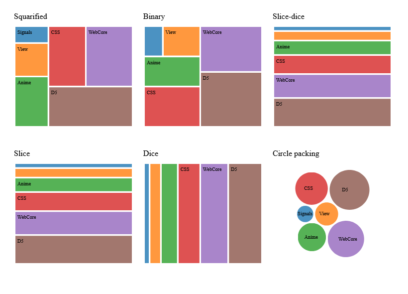

Run with `--tiling`; capture with `--capture-tiling artifacts/tiling.bmp`.
[Source](TilingGallery.fs) · [Contracts and limitations](../../docs/tiling.md).

## Linked selection

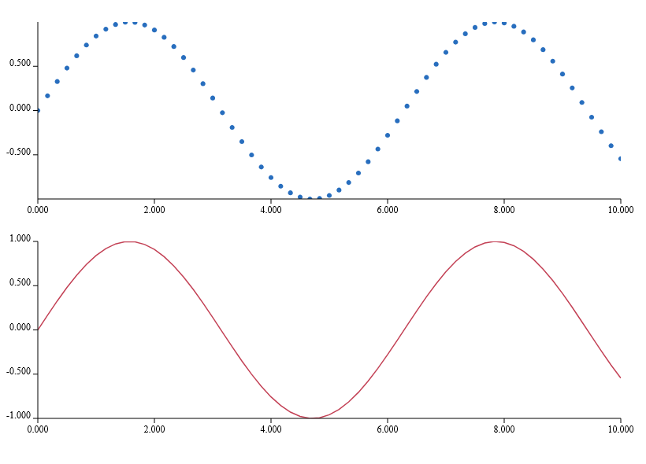

Run with `--linked`; capture with `--capture-linked artifacts/linked.bmp`.
Brush the upper scatter plot and the lower line updates through a shared Ranvier
signal. Arrow keys and Enter select, Escape clears.
[Source](../Shared/LinkedCharts.fs).

## Immutable force state

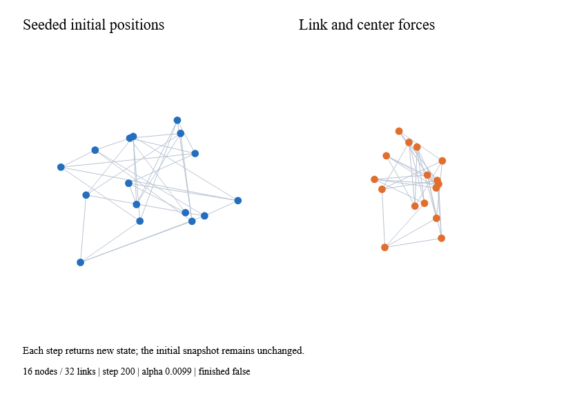

Run `--force` to advance immutable solver state through a Ranvier signal.
Capture with `--capture-force artifacts/force.bmp`.
[Source](ForceGallery.fs) and [solver contracts](../../docs/force.md).

## Delaunay and Voronoi picking

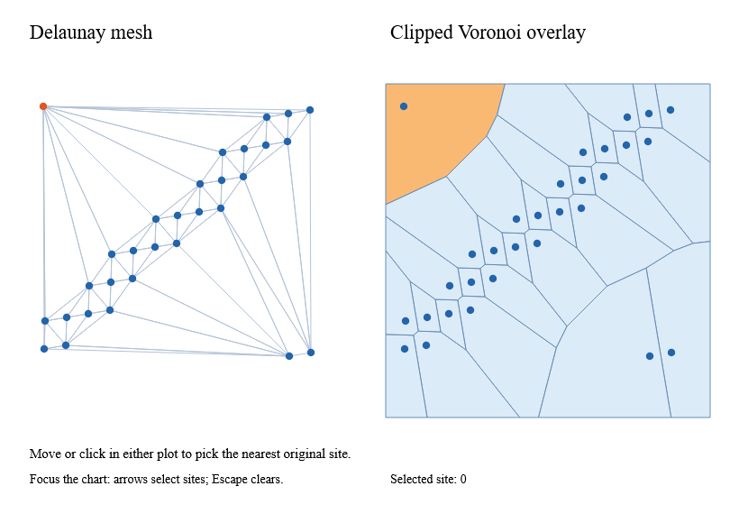

Run `--spatial`; move or click in either plot to select the nearest original site.
Focus the chart for arrow-key selection and Escape to clear.
Capture with `--capture-spatial artifacts/spatial.bmp`; capture checks a real native click.
[Source](SpatialGallery.fs) and [contracts](../../docs/spatial.md).

## Quadtree search

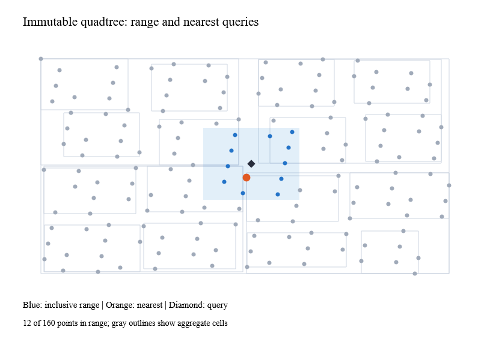

Run `--quadtree` for a signal-driven moving query over a retained immutable index.
Capture with `--capture-quadtree artifacts/quadtree.bmp`.
[Source](QuadtreeGallery.fs) and [contracts](../../docs/quadtree.md).

## Networks and bubble clusters

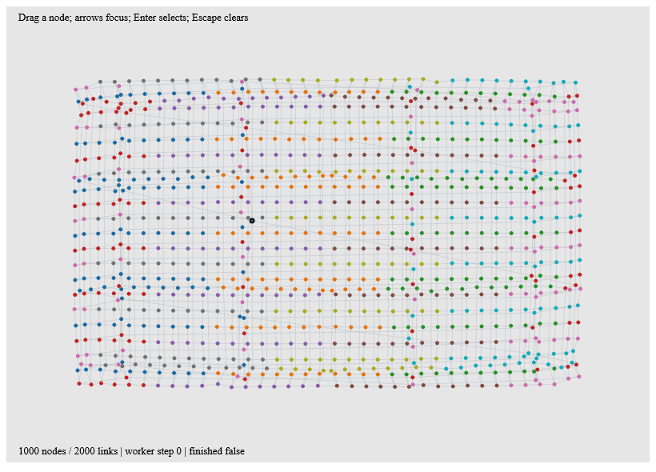
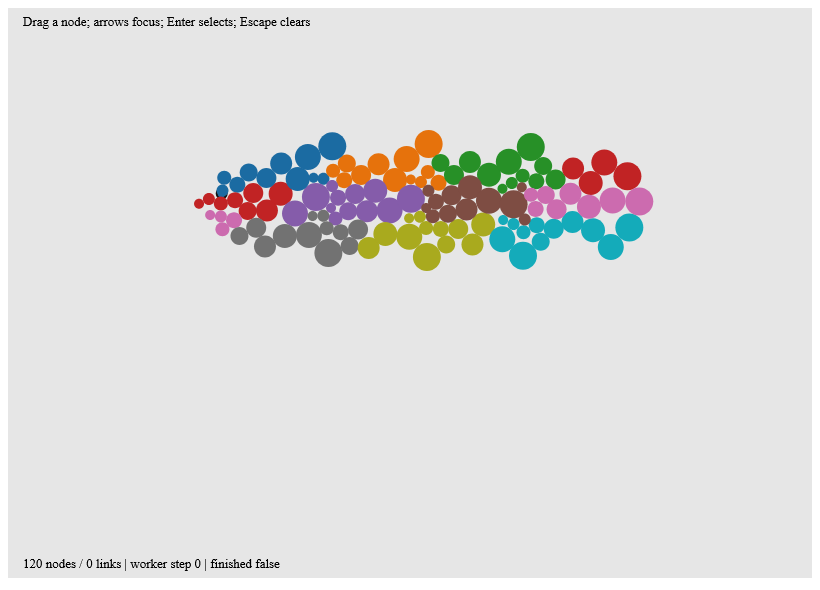

Run `--network` for 1,000 nodes and 2,000 edges, or `--bubbles` for variable-radius
collision layout. Drag pins/unpins a node; arrows focus and Enter selects.
Capture with `--capture-network artifacts/network.bmp` or
`--capture-bubbles artifacts/bubbles.bmp`.
[Source](NetworkGallery.fs) and [contracts and measured limits](../../docs/network.md).

## Chords and directed ribbons

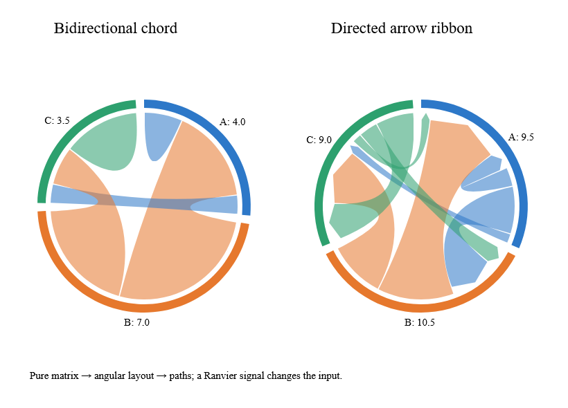

Run `--chord` for a signal-driven matrix; capture with
`--capture-chord artifacts/chord.bmp`.
[Source](ChordGallery.fs) and [layout contracts](../../docs/chord.md).

## Sankey flows

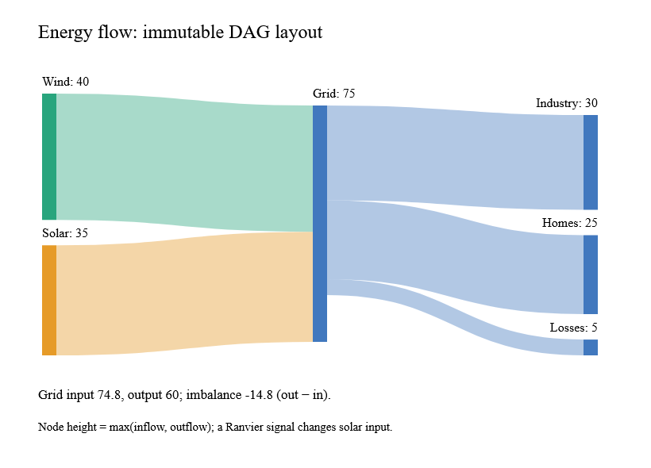

Run `--sankey` for a signal-driven DAG layout; capture with
`--capture-sankey artifacts/sankey.bmp`.
[Source](SankeyGallery.fs) and [flow contracts](../../docs/sankey.md).

## Interactive flow recipes

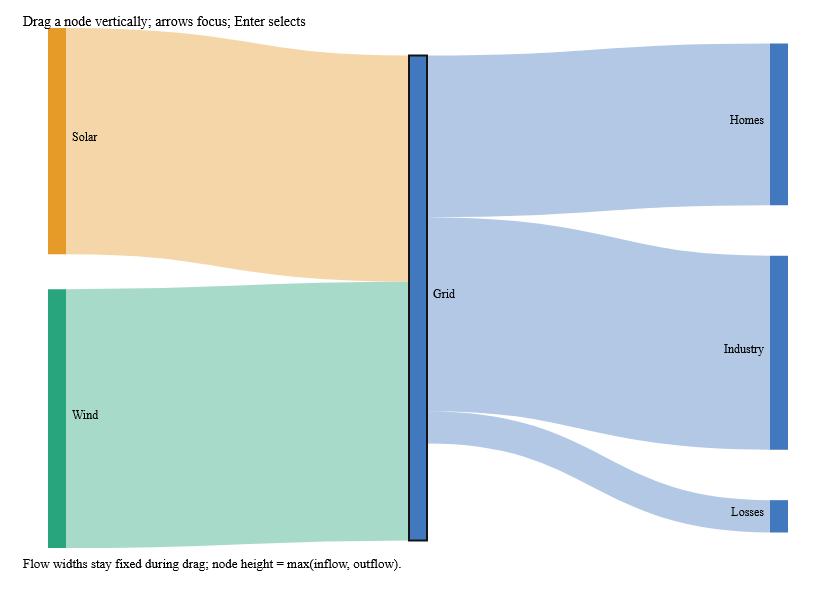
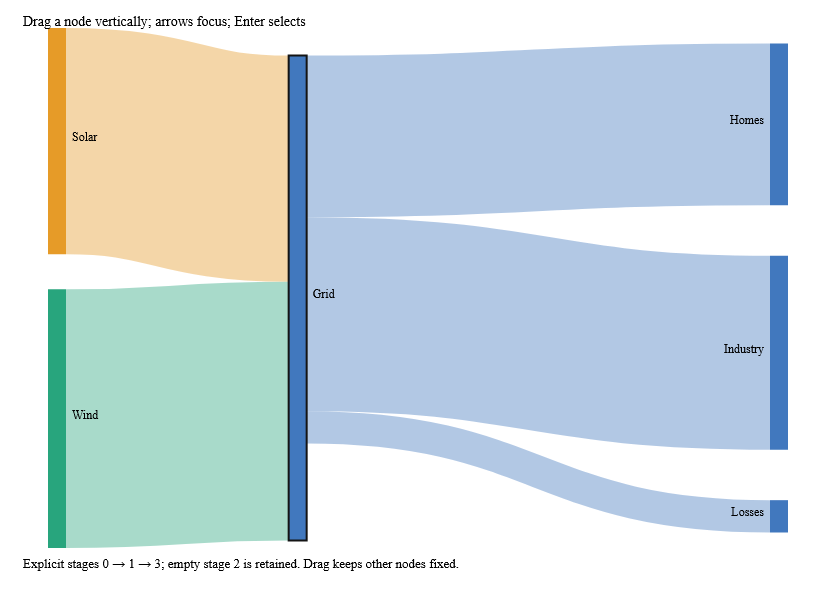
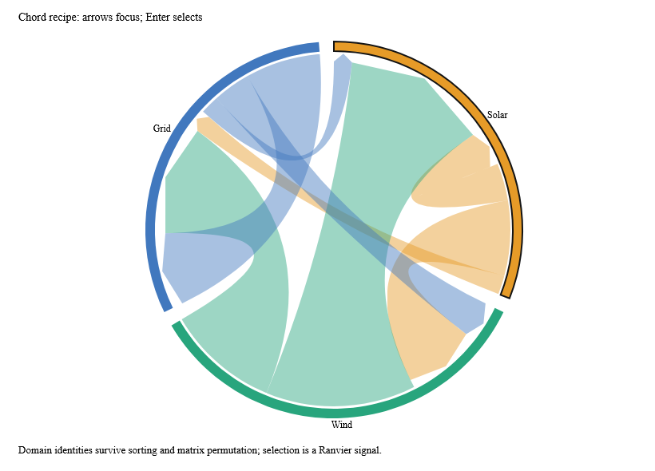

Run `--flow-sankey`, `--flow-alluvial`, or `--flow-chord`. Capture with the matching
`--capture-flow-* artifacts/flow-*.bmp` option. Flow nodes drag within their column
slots; arrows focus and Enter selects. Capture checks native drag and keyboard input.
[Source](FlowGallery.fs) and [recipe and interaction contracts](../../docs/flow-charts.md).

## Foundation scene

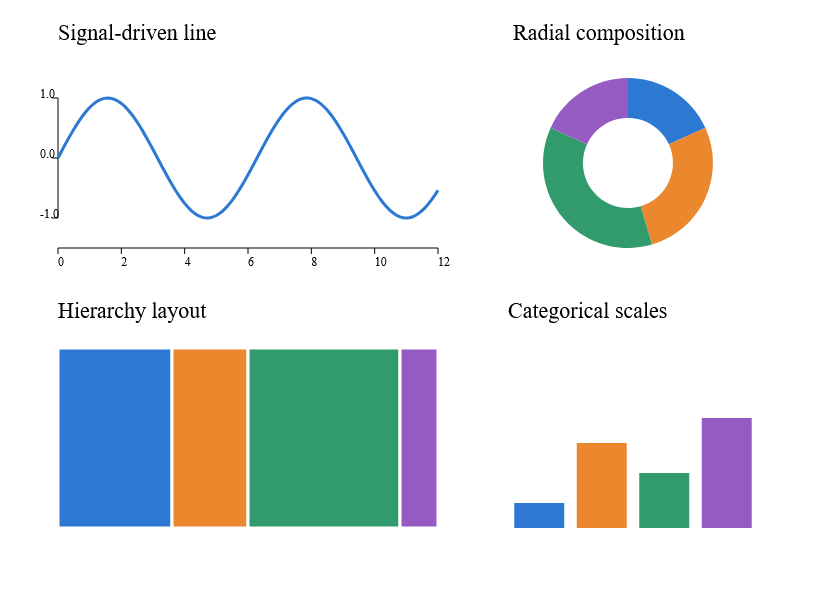

Run without arguments; capture with `--capture artifacts/gallery.bmp`.
The scene combines line, bars, donut and treemap primitives.
[Source](Scenes.fs).

Prefix each invocation with
`dotnet run --project examples/Ranvier.D5.Gallery -c Release --`.
Convert captures to checked-in lossless PNGs with
`python tools/document-snapshots.py` (Pillow required).

## Reactive density

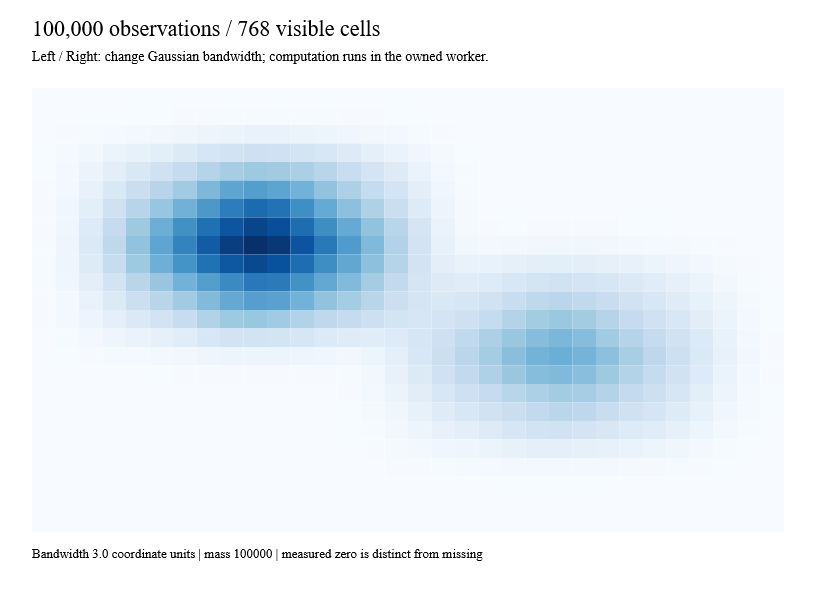

Run --density; Left/Right adjusts bandwidth. Capture with --capture-density artifacts/density.bmp. The example aggregates 100,000 observations in the owned worker and paints 768 cells. [Source](DensityGallery.fs) and [density contracts](../../docs/density.md).

## Density contours

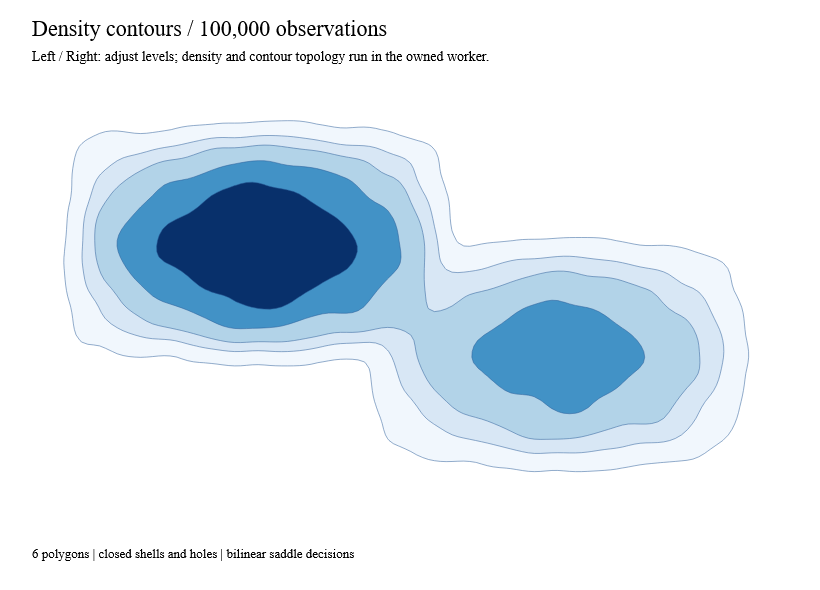

Run --contour; Left/Right adjusts levels. Capture with --capture-contour artifacts/contour.bmp. Density and topology run through the owned worker. [Source](ContourGallery.fs) and [topology contracts](../../docs/contours.md).

## Hexbin and line reduction

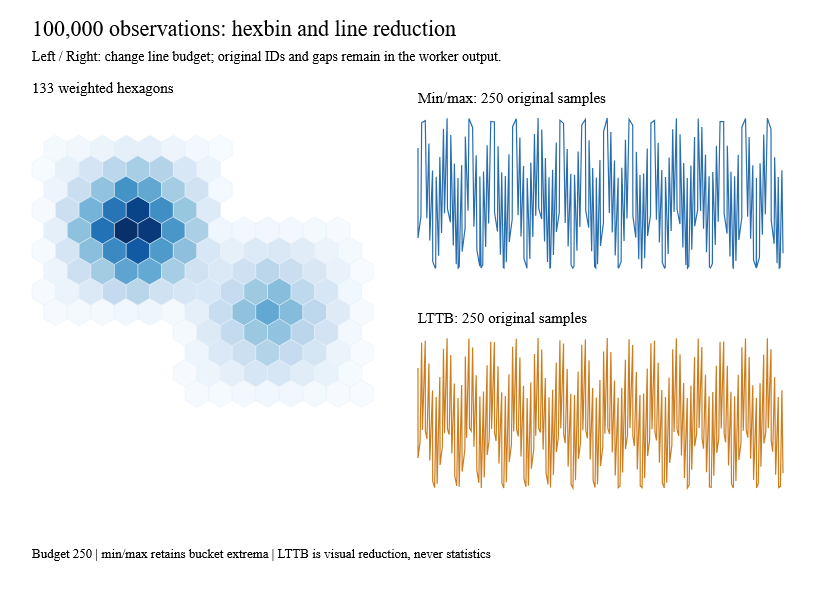

Run --reduction; Left/Right adjusts the visible sample budget. Capture with --capture-reduction artifacts/reduction.bmp. [Source](ReductionGallery.fs) and [membership, gap and sampling contracts](../../docs/reduction.md).

## Density chart recipes

Run `--density-recipe heatmap`, `hexbin`, `contours` or `isobands`. Hover shows original membership; arrows and Enter select; `+` / `-` changes bandwidth or radius through the owned worker. Capture with `--capture-density-recipe isobands artifacts/isobands.bmp`.

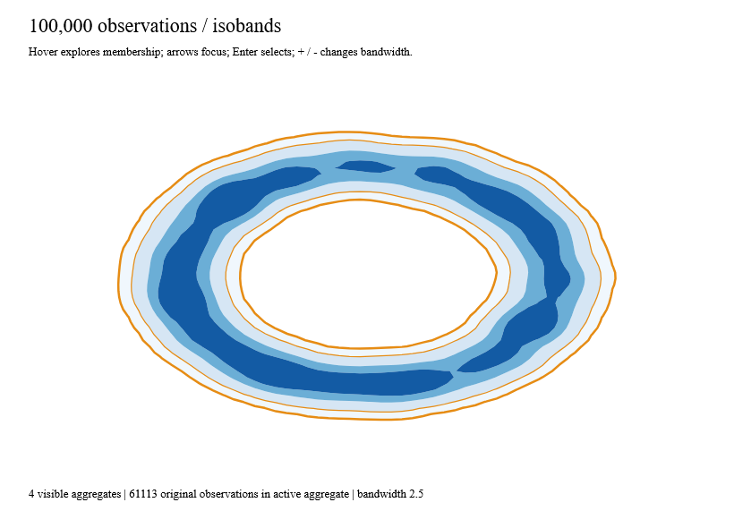

[All four native snapshots and contracts](../../docs/density-charts.md) · [source](DensityRecipesGallery.fs)

## Violin and reduced-series recipes

Run `--distribution violin`, `minmax` or `lttb`. Arrows and Enter select; `+` / `-` changes bandwidth or visible budget through the owned worker. Capture with `--capture-distribution violin artifacts/violin.bmp`.

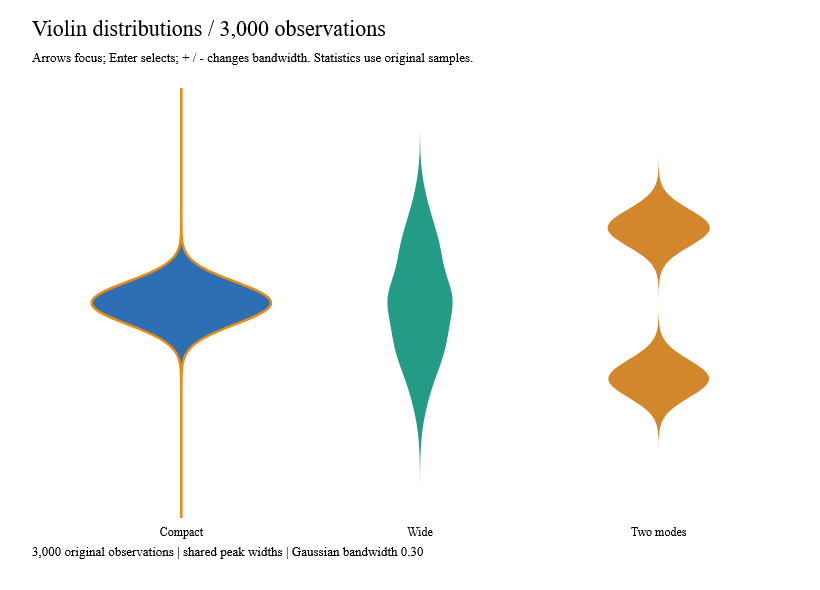

[All three native snapshots and contracts](../../docs/distribution-series.md) · [source](DistributionRecipesGallery.fs)

## Spherical geometry foundations

Run `--geographic-kernels` for a signal-driven great-circle arc and analytical latitude bound. Capture with `--capture-geographic-kernels artifacts/geographic-kernels.bmp`.

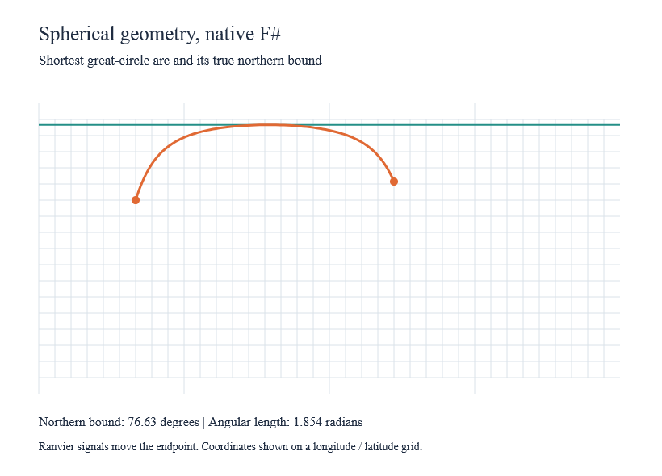

[Coordinate, winding and budget contracts](../../docs/geographic-kernels.md) · [source](GeoKernelsGallery.fs)
